# ELMP 需求树 / 依赖图（v2 定稿）

> 本文件是 `D:\CodeT\ELMP\docs\REQUIREMENTS.md`（v1，按模块平铺的 FR-* 清单）的**自顶向下重排与全面定案**。
> 阅读顺序：L0 玩家目标 → L1 玩家可感知功能 → L2 系统能力 → L3 机制 → L4 原版入口 / 事实。每个节点有稳定编号（`G/F/C/M/E-xx`），依赖关系见 §6；旧编号 FR-* 在节点末尾以 `← FR-…` 标注，便于对照。
> **状态**：本版所有节点均为 **[定]**。原 v1 中的 [待定] / [调研] 项在 §7 逐条给出定案与证据。证据标签：`[E-IDA]` 静态分析、`[E-CUE]` CUE4Parse 包取证、`[E-实测]` ELMP 隔离实例实测、`[E-源码]` UE4SS / 引擎源码。日期一律指 ELMP 工程（科研版已删除，不再引用）。
> 架构侧见同目录 `ARCHITECTURE-V2.md`（Shipping 纯 C++）。

---

## 0. 方法论与硬约束（所有节点的前提）

| 编号 | 约束 | 出处 |
|---|---|---|
| **X-1 原版管线优先** | 补齐原版需要的上下文、不模拟行为；原版有硬约束时才偏离并写明约束 | ADR 0002 |
| **X-2 Host 权威铁律** | 客人进程永不自行结算；Host 做不到的场景 fail closed（拒绝 + 说明原因） | FR-NET-1/2/10 |
| **X-3 fail closed** | 未知转换 / 身份冲突 / 未就绪地图 / 版本不符一律拒绝，不静默降级 | NFR-2, FR-PLT-4, FR-NET-8 |
| **X-4 P1 只读** | 内核不写 P1；只有共享进度模块经原版入口写 P1 共享池，会话层在入档完成后经原版恢复入口回满 | FR-CORE-7 |
| **X-5 Hook 纪律** | PolyHook2；EXE SHA-256 + 函数前缀校验；能反射取地址不写 RVA；不 Hook `IsPlayer` 本体 `0xD150F0` | FR-PLT-2/3/4a |
| **X-6 证据标准** | “没被调用”必须有原生 detour 计数或 IDA xref；UE4SS UFunction 钩子看不到原生直接 / 虚表调用 | ADR 0002 |
| **X-7 Shipping 零 Lua** | 发布包不含任何 `.lua`，不依赖 UE4SS LuaMod 加载器；Dev 构建可带 Lua 辅助（义肢 / UEBridge） | 本版新增（用户决定 2026-10-25） |
| **X-8 存档安全** | 不碰正式存档；Client 原版档永不写；Host 存档只经原版入口 | NFR-6, FR-NET-2c |

2026-11-09按[ADR0021](adr/0021-null-and-terminal-context.md)补充X-1的验收解释：原版查询/零delta求值不自动等于只读；必须核实是否同步派发通知或重入。能力生命周期允许在一次原生调用内开始、命中并结束，不能要求一定存在持续Tick。明确无目标属于有效权威事实，必须与未知/未收到区分；目标和结束所有权按具体子实例核对，不能用整棵Root上的标志代替。

同日按[ADR0022](adr/0022-buffered-command-source.md)补充：原版命令入队、接受与实际Start是三个不同事件；缓冲/派生动作以真实命令身份保留入队或父来源，不用Start发生时最新输入代替。原版有接受窗口与TTL顺序时，等量delta分段不代表离散行为等价；Host源帧的原版执行次数/顺序也属于必须保留的上下文。不同Client帧率下同时验证正常启动、缓冲后启动和过期不启动，身份匹配不使用输入编号容差或技能特判。

---

## 1. L0 玩家目标

| 编号 | 目标 | 一句话 |
|---|---|---|
| **G0 单人零干扰** | 装了 ELMP、不加座位时，游戏与原版在行为与帧时间上不可区分 | 所有玩法的底线 |
| **G1 本地同屏多人** | 同一台电脑、同一个窗口，P1 + P2…PN 各自一只完整的莉莉，共享进度、各自装备；可设友方 / 敌方互殴 | 已发布 v0.1.x |
| **G2 远程联机合作** | 朋友通过配对码加入 Host 的世界；Host 唯一结算；客人像本地 P2 一样完整参与 | 同图已实现，验收待补 |
| **G3 猎人模式** | 1 名速通选手（Host P1）对抗最多 4 名猎人（本地或远程），可分处不同地图 | 依赖多地图 |
| **G4 二次开发** | 其他 Mod 用 ELMP 内核生成跟随者 / 自定义 Boss，不自己装 Hook | SDK |
| **G5 AI 义肢（开发）** | AI 能操控任意 P、读结构化状态、截图、复现场景；不进发布包 | Dev 专属 |

---

## 2. L1 玩家可感知功能（按目标分组）

格式：`编号 功能名 —— 玩家叙述（谁 / 想要什么 / 为什么）`。每条的实现依赖写在 §6 邻接表。

### 2.1 G0 单人零干扰
- **F0.1 零座位零开销** —— 作为单人玩家，我不加座位时不应多出任何每帧工作；ELMP 只在有座位 / 会话时才运行巡检与覆盖层逻辑。
- **F0.2 版本不符即停用** —— 游戏或 UE4SS 版本不匹配时整体停用并在日志里说明原因，不带病运行。← FR-PLT-3/4
- **F0.3 一键安装** —— 一个 `Mods/ELMP/` 文件夹（`dlls/main.dll` + `data/` + `elmp.json`），`mods.txt` 一行。← FR-PLT-5/9（本版：无 `Scripts/`）

### 2.2 G1 本地同屏多人
- **F1.1 添加 / 移除玩家** —— 读档后右下角 ELMP 按钮 → 管理器 → `Add player`，P2 出生在 P1 身边；`Remove` 后保存其装备。← FR-UI-2a, FR-LOC-9
- **F1.2 自由分配设备** —— 任意键盘 / 手柄 → 任意玩家，一个玩家可绑多个设备；未分配设备归 P1；分配给 PX 的设备对原版不可见。← FR-LOC-3
- **F1.3 PX 可改按键** —— 每座位各一套键盘 / 手柄绑定，默认与原版一致；GUI 内按键录入；无全局快捷键。← FR-LOC-3a/3b
- **F1.4 一键静默本机输入** —— 开发 / 后台模式：所有物理输入对所有玩家静默，不改分配表。← FR-LOC-3
- **F1.5 共享进度** —— 任何人捡到的经验 / 货币 / 遗物 / 强化 / 精灵升级进 P1 存档并同步给所有人；装备各自独立。← FR-PRG-1..6
- **F1.6 共享镜头** —— 镜头框住所有本地玩家；有 PX 时放宽取景（留白、最远距离可调）。← FR-LOC-4
- **F1.7 切图规则** —— 默认只有 P1 能切图；P1 过图 / 死亡重生时其他人黑屏内一起被带走；可配置“任何人进门全员走”“全员到门口才走”。← FR-LOC-2/2a
- **F1.8 死亡 / 复活 / 召回** —— PX 死亡后在 P1 身边复活（装备原样）；掉出地图或离太远自动回到 P1 身边。← FR-LOC-6
- **F1.9 椅子** —— P1 坐椅子与原版一致；PX 在椅子旁按交互只回满自己（HP / 祈祷 / 技能次数）并保存装备，不存原版档、不刷新敌人。← FR-BENCH-1..4

2026-11-08业务方向（用户提出，规划中，尚未实现）：限制的是越权结算，不是坐姿本身。可支持Host授权的客人坐姿与受限休息菜单，前提是Client不自行刷新地图/敌人、不写原版存档、不执行未经授权的菜单业务。参考`D:\CodeT\LilyInEM\native\guest\g_body.cpp`：菜单呈现独立于原版坐椅事件，隐藏不适用按钮、同时拦截处理函数并修正导航；只隐藏按钮不算权限边界。ELMP具体菜单功能逐项授权：装备沿既有Host请求链；强化、消耗资源、快速移动、保存、回想/挑战等不能因复用菜单而默认放行。当前Client意外进入完整EVT_Rest仍是缺陷，不作为此方向已完成的证据。

多人坐姿规划：Host居中；Host按同一休息点当前座位占用、角色宽度/间距与可坐区域，给客人选择距离中心最近的左/右空位，避免与其他莉莉重叠。客人先坐时保留Host中心位；座位申请/释放及Pawn更换/离图/断线由Host统一维护，尽量保持已坐角色稳定。同步座位位置与原版坐姿/起身表现，不为摆位调用带保存、刷新或世界切换的原版休息业务；无合法空位时明确拒绝。该方向与本轮权限漏口修复分别验收。
- **F1.10 PX 装备菜单** —— 座位自己的键打开，暂停全世界，只响应该座位；精灵 2×3、遗物槽位；默认只能椅子旁更换（`equipAnywhere` 放开）；固定菜单操作键。← FR-UI-5
- **F1.11 PX HUD** —— 头顶小血条 / 祈祷 / 座位号；右侧每座位一块技能面板（图标、次数、冷却、奥义槽），可折叠；原版菜单打开时隐藏。← FR-UI-4/4a/4b
- **F1.12 PX 皮肤** —— 原版 6 种外观选择并记住。← FR-UI-2b, FR-CORE-12
- **F1.13 友方 / 敌方 与 PvP** —— PX 可设友方 / 敌方（P1 固定友方）；异队互伤、同队互不伤；怪物对所有人一视同仁；PvP 伤害倍率、击退档位可调。← FR-ID-1..4
- **F1.14 存档隔离与自动重入** —— 队伍 / 装备 / 皮肤属于当前原版存档；回标题 / 读档 / 重启后同一存档的队伍自动回来；A 档不带入 B 档。← FR-LOC-9/11
- **F1.15 入档满状态** —— 每次重新进入存档，所有 P 的 HP / MP / 祈祷 / 技能次数在能力约束下回满（未解锁奥义 MP=0）；普通切图不回满。← FR-LOC-11, FR-CORE-4a
- **F1.16 剧情 / 教程 / 对话归属** —— PX 碰到教程 / 对话 / 剧情触发器不弹窗、不暂停 P1 的游戏；PX 交互拿到的物品与击败 Boss 的奖励进共享池（P1 背包）。**本版定案，见 §7.1**。← FR-ID-6
- **F1.17 设置持久化与规则页** —— PvP / 召回 / 镜头 / 切图规则等 `elmp set` 设置持久化到 `Saved/ELMP/`，管理器有“规则”页。← README 后续目标（本版定）

### 2.3 G2 远程联机合作

2026-11-04 回归：F2.4/F2.5 未通过用户验收（Client本机击退不自然、伊莱恩及远程技能特效缺失）；按 [ADR 0009](adr/0009-restore-native-lily-pipelines.md) 恢复原版因果链后重新验收，既有局部快照验证不覆盖这两项。

2026-11-05：用户要求快速重写并部署双实例；远端 Host Lily 按 ADR0010 改为原版执行，移除对应旧表现复制，验收以 Client 所见与 Host 实际动作/音光/召唤连续对齐为准；编译、连接与计数不代替用户游玩结论。
- **F2.1 主持 / 加入** —— 管理器“联机”页：主持（端口、配对码）、加入（地址、配对码）、玩家列表、连接状态与拒绝原因、离开。← FR-NET-15
- **F2.2 版本一致才能连** —— EXE / `main.dll` / `data` 内容哈希 / 协议版本任一不同即拒绝并告知发起方。← FR-NET-8
- **F2.3 客人 = Host 上的 P2** —— 客人的输入经网络进 Host 原版管线；伤害 / 死亡 / 机关 / 奖励 / 进度只在 Host 结算。← FR-NET-2
- **F2.4 客人画面与 Host 一致** —— 敌人数量 / 位置 / HP / 动作特效 / 弹体 / 变身 / 门 / 机关 / 宝箱 / 可破坏物 / 剧情旗标按 Host 呈现；Spine 丝滑。← FR-NET-3/3a/3b, G1–G4 验收
- **F2.5 客人手感** —— 客人本机角色即时响应（本地预测），位置由 Host 纠正；敌人无决策、无结算。← ADR 0003 决定四例外

2026-11-08：按 [ADR0014](adr/0014-native-presentation-handoff.md)，Client 本机与远端莉莉及所属角色采用同一呈现完整性契约。输入响应时机可以因预测不同，材质/特效/生命周期不能因 own-seat 降级；自主 Spirit 的生命周期与 AI 决定由 Host 统一接管，验收同时覆盖 own/remote、首次/反复召唤/软退场/换图/重绑定。
- **F2.6 客人 HUD** —— 客人看到的是 Host 权威数值（HP / MP / 祈祷），用原版 HUD 显示。← FR-NET-14a
- **F2.7 独立镜头** —— 联机双方各自屏幕，Client 纯原版单人镜头；Host 上的远程座位不进共享镜头、不触发“太远召回”。← FR-NET-2b/3c
- **F2.8 晚加入 / 断线重连** —— 随时加入对齐 Host 当前状态；断线期间 Host 保留座位；客人 Pawn 死亡由 Host 巡检复活。← FR-NET-9
- **F2.9 客人进度与构筑归属** —— 世界进度归 Host 存档；客人构筑（遗物佩戴 / 精灵装配 / 皮肤）按 `guestKey` 存在 Host 的该存档作用域；Client 本地原版档全程只读。← FR-NET-2c
- **F2.10 客人装备菜单** —— 客人在自己进程打开同一 ImGui 装备界面，操作经可靠通道由 Host 执行并回传结果。Client 菜单占用自己的游戏输入，持续消费 Host 回放，不暂停世界；单机/Host 菜单保持原暂停语义。2026-11-08 接管决定见 [ADR0016](adr/0016-client-menu-clock.md)。← FR-NET-13
- **F2.11 多客人** —— 一个 Host 同时接待 ≥4 名客人；满员明确回 `Full`。← FR-NET-12
- **F2.12 多地图** —— 玩家可分处不同地图：Host 后台加载有玩家的图并结算，只把该图数据递给该图客人；后台做不到的场景拒绝切图。← FR-NET-10
- **F2.13 配对安全** —— 配对码派生密钥（ECDH + HKDF + AES-GCM），不提供远程执行，不用 PEM。← FR-NET-7/11

### 2.4 G3 猎人模式
- **F3.1 开局** —— 速通选手 = Host P1（友方）；猎人 = 其他座位（敌方，≤4）；先发宽限 15 s 内猎人冻结。← FR-HUNT-7.1/7.3
- **F3.2 胜负** —— 速通：限时内击败目标 Boss 或抵达目标地图；猎人：击杀速通选手达 N 次（默认 1）或超时。← FR-HUNT-7.2
- **F3.3 猎人进度** —— 默认实时镜像速通选手的能力 / 等级 / 拥有池（打怪收益不写回速通池），各自独立配装；可切预设。← FR-HUNT-7.4, FR-CORE-9
- **F3.4 猎人复活与切图** —— 死亡 8 s 后在自己所在图的入口满状态复活；猎人有独立切图权限，只切自己的后台图实例；坐椅子只回满自己。← FR-HUNT-7.5
- **F3.5 指南针** —— 同图显示速通选手相对方向，异图显示其所在地图。← FR-HUNT-7.5
- **F3.6 速通选手零额外延迟** —— 由“速通选手 = Host P1”保证。← FR-HUNT-5

### 2.5 G4 二次开发
- **F4.1 声明式接入** —— 第三方 Mod 在自己文件夹放 `elmp.json`（依赖版本、slot 范围）；版本不满足明确报错；范围重叠后加载者拒绝。← FR-SDK-1, FR-SLOT-1
- **F4.2 唯一公开 API** —— `elmp.core` 语义化版本：`apiVersion` / `onReady` / 事件订阅 / `acquire` / 生成 / 档案 / 输入 / 状态 / 设置 / 权限 / 命中规则；第三方不装 Hook。← FR-SDK-2, FR-CORE-10/13
- **F4.3 C ABI 优先 + Lua 绑定注入** —— **本版定案**：SDK 主形态为 C ABI 头文件（C++ Mod 直接链接 / 取函数表）；Lua Mod 由 `main.dll` 在 `on_lua_start` 向其状态注入 C 函数（ELMP 包内不含任何 `.lua`），Lua 语法糖包装随 SDK 示例仓库分发。← X-7
- **F4.4 第三方对象联机不同步** —— 状态里明确报“未支持”；以后开放适配器注册。← FR-SDK-3
- **F4.5 示例** —— LilyFollower（1001–1999）、LilyEnemy（2001–2999），附类型注解 / 头文件。← FR-SDK-5

### 2.6 G5 AI 义肢（Dev）
- **F5.1 实例管理** —— 启动 / 重启 / 读档 / 等待就绪，只操作 `devconfig.json` 内的实例。← FR-PIL-2
- **F5.2 观测** —— 任意 slot 的位置 / HP / MP / 动画 / 出招 / 附近敌人 / 地图 / 可交互物；事件流游标；无焦点截图；按条件等待；帧时间统计。← FR-PIL-3/5
- **F5.3 操控** —— 虚拟手柄驱动任意 slot（含显式允许后的 P1）；输入脚本；写世界的辅助必须登记并在报告列出。← FR-PIL-4/6
- **F5.4 可复现场景** —— 读档 + 地图 + 位置 + 档案。← FR-PIL-7
- **F5.5 形态** —— UEBridge MCP + Lua 库（Dev 构建注入）+ PowerShell 脚本；不做独立 MCP 服务。← FR-PIL-1
- **F5.6 工具链可用性（2026-11-04）** —— 复用已有 CUE4Parse / IDA Pro MCP，提供本仓库命令行客户端与只读冒烟入口，使当前 Agent 即使未加载原生 MCP 工具也能查询资产、蓝图和原生函数；路径由 `devconfig.json` / 本机覆盖配置管理。检查构建依赖、预检、运行实例的 UEBridge 与联机状态；不为检查启动/停止游戏、发送输入或恢复窗口。资产脚本 `--help` / 非法参数不得生成发布数据，最小化截图须明确跳过；CTest 使用构建目录内的临时目录。

---

## 3. L2 系统能力

每项列：职责 / 关键规则 / 依赖的机制（§4）。

### C1 平台与发布
- **C1.1 预检**：EXE SHA-256（`elmp.json` 单一来源）+ 每个 RVA Hook 的函数前缀；失败整体停用。`data/binary/EL.json` 的无反射原始偏移在世界就位后按反射邻接校验，单项失败只让依赖它的能力 fail closed（v2 2026-10-25 实施细化）。依赖 M1。
- **C1.2 构建形态**：Dev（含义肢 API、UEBridge 注入、pdb）与 Shipping（无）；两者都输出 `dlls/main.dll`。
- **C1.3 发布包**：`ELMP-<ver>-shipping.zip`（`ELMP/dlls/main.dll` + `data/` + `elmp.json` + INSTALL）与 `-dev.zip`（另含 pdb、义肢脚本、Dev Lua）。**无 `Scripts/`**。
- **C1.4 用户数据**：`Saved/ELMP/`（配合 `-UserDir` 隔离）；Mod 目录只读。
- **C1.5 版本单源**：版本 / API 版本 / 协议版本 / EXE 哈希只在 `elmp.json`。

### C2 座位系统（Seat）
- 座位 = 角色 + 输入来源（本地设备 / 脚本 / 网络）+ 身份（友方 / 敌方）+ 权限集 + 装备状态 + 所在图。
- 本地座位 slot 2..100（内部），远程座位同区间按对端分配；测试 101–1000（Dev）；第三方 >1000。
- 座位生命周期：加入（基线 → 对齐进度 → 恢复 → 公开输入路由）/ 离开（保存装备 → 释放租约 → 丢 UObject）/ 世界卸载（保存到旧存档上下文）/ 新世界就位（按存档恢复名单）。
- 依赖 M2 槽位租约、M3 生成管线、M4 档案、M5 虚拟手柄、M12 弱引用身份、M13 世界生命周期。

### C3 输入系统
- 设备枚举（Raw Input 键盘按设备、XInput 0–3）、分配表持久化、每座位绑定表、静默开关、虚拟手柄写入；P1 的手柄由 ELMP 合并后交给原版；网络座位不进物理路由。
- 依赖 M5 虚拟手柄、M6 XInput 导入表改写、M7 Raw Input 拦截。

### C4 身份 / 队伍 / 命中规则
- 阵营（与世界的关系，原版 `Faction`，所有 PX 恒为 1）与队伍（玩家之间的关系，ELMP 数据）分离；命中窗口内按配对翻转目标阵营；伤害倍率改攻击者 `DamagePercentBonus`；击退档位改原版 `AE_Knockback`。对 SDK 开放为“只能绑定自己租用的 slot”。
- 依赖 M8 命中窗口。

### C5 权限闸门（按座位、按类）
- 开关：`travel`（切图）、`rest`（原版椅子）、`trigger.*`（剧情 / 教程 / 对话 / 事件触发器，按触发器类白名单）、`pickup`（自动拾取）、`interact`（可交互物）、`save`（存档）。
- 默认：非 P1 一律 `travel=false`、`rest=false`、`trigger.story=false`（对话 / 教程 / 事件 / 影片触发器）、`trigger.world=true`（假墙等纯表现触发器）、`pickup=true`、`interact=true`、`save=false`；租约持有者可放开自己的 slot；1P 不受管理。远程座位在 Host 上同规则；Client 侧全部 ELMP 对象 `IsPlayer` 返回 false。
- 依赖 M9 重叠忽略闸门、M10 IsPlayer 跳板闸门、M11 结算拦截 / 存档保护。

### C6 共享进度与进度来源
- 进度来源可替换：`shared`（P1 池，默认）/ `mirror`（只读镜像 P1，猎人默认）/ `preset`（固定档案）/ `independent`（第三方）。
- `shared`：每秒按座位汇总合法增量（经验 / 货币 / 四个背包行计数 / 精灵等级）→ 经原版入口记到 P1 → 镜像回座位（只增不减；能力集合 / 精灵等级 / 玩家等级 / 祈祷等级 / 遗物槽数对齐）；读回确认签名才算成功；失败按座位记原因并重试。
- 不把 HP / MP / 剩余祈祷 / 技能次数计入签名。
- 依赖 M4 档案入口、E4 拾取归属事实。

### C7 状态恢复
- 统一入口：本角色控制器 `FullyRestore(Pawn)` + MP 组件 `Add`/`Reset`（未解锁奥义 MP=0）。加入 / 重生 / 椅子 / 入档复用；对账巡检不回血。
- 依赖 M4。

### C8 切图与过图跟随
- 规则 1 / 2 / 3（默认 3）；凡走 `SwitchGameMap` 的流程：P1 `OnSwitchGameMapStart` → 冻结本地 PX → P1 落位后黑屏内摆到 P1 身后 → `LaunchFadeIn` 放开下落 → `OnGameMapReadyPostFade` 结束；超时强制落位。远程座位只带“无切图权限且与 P1 同图”的。
- 规则 1：任一有 `travel` 权限的座位进门即触发原版切图，其余按跟随走。规则 2：对每个出口统计“在出口盒内的本地存活座位数 == 本地座位数”才放开并由 P1 触发。
- 依赖 M9、M14 UFunction 钩子（BP 事件）、E1 切图门事实。

### C9 复活 / 召回 / 摆位
- 死亡延时后只换 Pawn（原版 `RespawnPlayerPawn` 语义）+ `ReequipSpirits`；复活前对齐进度；丢 Pawn 兜底；召回 `fell`（低于 P1 2000）立即、`far`（>2500 持续 2 s）；统一“P1 身后按序排开”摆位；联机远程座位只保留 `fell`。
- 多地图后改“以该座位所在图为准”（本地座位仍以 P1 为准）。

### C10 镜头
- 本地 PX 注册为 `AllyAIControllerTargets`；≥2 目标时放宽取景（side/top/bottom 留白、MaxDistance 倍数）。远程座位不注册。Client 每帧清洗目标表只保留真实 P1。
- 依赖 M15 镜头原生 Hook。

### C11 椅子（PX 分支）
- PX 碰撞忽略椅子（原版交互不开始）；靠近 + 交互键（累计按下边沿）→ `FullyRestore` + 保存冷档案；冷却绑定 Pawn 生命周期（单调时钟）；拒绝原因细分。

### C12 存档作用域 / PX 冷存储
- `saveId` 世代身份 + 指纹（最近 64 个快照）关联；同步 / 异步保存都登记；外部替换 / 回档时显式 New / Reuse；原子写 + `.bak`；schema 校验；不自动删除旧世代。
- 内容：schema、saveId、各座位装备 / 精灵组 / 遗物佩戴 / 皮肤 / 身份 / 加入名单；客人构筑按 `guestKey`。

### C13 UI（ImGui 覆盖层）
- HUD（头顶 + 右侧面板）、管理器（本地玩家 / 联机 / 规则 / 存储确认）、PX 装备菜单、提示 / Toast；原版全屏菜单打开或 HUD 关闭时隐藏；单机/Host 菜单暂停世界，Client 菜单仅占用自己的游戏输入并继续权威回放（F2.10）；手柄导航直接读 XInput；字体 / 图标来自游戏包提取的 `data/`。
- 依赖 M16 Present/WndProc 覆盖层。

### C14 联机传输
- 自研 UDP + CNG（ECDH P-256 / HKDF / AES-256-GCM）；不可靠最新通道（快照 / 输入）+ 可靠有序通道（握手 / 跟图 / 档案 / 装备请求 / 断线原因 / 动作重放）；MTU 1200 分片；增量快照（按对端基线）；所有队列有界；ACK 规则；`F_CLOSE`；多对端表；接口可替换（`IEncryptedTransport` 语义）。

### C15 Host 权威世界同步
- 实体注册表（上网清单唯一事实）+ 每类适配器（静态敌人 / 动态敌人 / 莉莉行 / 世界对象 / 剧情旗标 / 掉落物）；快照节按实体 id 键控、按图分区、按对端兴趣过滤；敌人动作通道（`LaunchAbilityFromDescription` 原生捕获 → 可靠下发）；跟图闸门（`map` / `mapReady` 回执前不投入客人 Pawn）；卸载 ≠ 死亡。
- 依赖 M12、M17 实体注册与生命周期监听、E5 敌人激活 / 清除事实。

### C16 Client 呈现
- 呈现化接管：敌人逐组件关 tick（白名单保留渲染 / 动画 / 技能 / FX）、`CanBePaused=false`、原生三闸（激活本体 / 碰撞原语 / tick 原语）+ 1 Hz 直写复检；激活体积源头冻结；输入锚点（本机 P1 隐藏、保留碰撞与输入组件与 Spine 跟随 tick）；幂等 Set 清单；行驻留语义（缺席 ≠ 消失）；注册式 teardown 按原值逐项还原。
- 依赖 M11、M18 激活闸门、M14。

### C17 多客人
- 每对端独立会话 / 密钥 / 可靠层 / 基线 / epoch；座位按对端分配；快照公共部分 + 每对端 `me`；其他客人在 Client 上是 `l<seat>` 副本。

### C18 多地图（Host 后台加载）
- 前台图（P1）原版管理；后台图以 `ELMP_BG_<Map>__<Part>` 实例名、大 Y 偏移（槽位 × 300000）加载 GEO / DESIGN / GAMEPLAY 子关卡；生命周期（首个座位进入加载、最后座位离开宽限后卸载、P1 进入先卸载再原版切图）；地图上下文窗口（`0xCAAFF0` 单汇点 + `ClearableComponent::BeginPlay`）；坐标按“图 id + 局部坐标”传输；切图权限按座位只切自己的实例。
- **单值假设清单与处理**（本版定案，见 §7.3）。
- 依赖 M19 关卡实例加载、M20 地图上下文窗口、E6 单值假设事实。

### C19 猎人模式规则引擎
- 对局状态机（宽限 → 进行 → 结束）、计时（单调时钟）、胜负判定、猎人座位规则（敌方 / travel / 进度源 / 复活点 = 所在图 PlayerStart）、指南针数据。依赖 C4、C6、C9、C17、C18。

### C20 SDK
- 槽位范围声明、身份绑定的 API、事件订阅、`acquire/release`、生成 / 档案 / 输入 / 状态 / 设置 / 权限 / 命中规则；C ABI + Lua 注入。

### C21 义肢（Dev）
- 实例脚本、UEBridge 注入的 `ELMP_*` 观测 / 操控 API、事件游标、帧时间、截图（`PrintWindow`）、测试辅助登记。

### C22 可观测性
- 状态命令（`elmp seats/progress/pvp/lan/storage/maps/hunter`）、计数器（对账修正、拦截、重建原因、丢包）、日志打包；帧时间采样接口。

---

## 4. L3 机制（“第 N 个莉莉”内核与特权机制）

| 编号 | 机制 | 要点 | 证据 |
|---|---|---|---|
| **M1 预检与符号** | SHA-256 + RVA 前缀逐字节比对；二进制清单 `data/binary/EL.json` 运行时加载（v2，取代 v1 构建期 `symbols.h`）；反射能取的函数指针优先 | `[E-实测]` |
| **M2 槽位租约** | 原生租约表按调用方身份校验范围；越界拒绝；状态重建时释放；重叠声明后加载者拒绝 | `[E-实测]` |
| **M3 生成 / 找回 / 移除 / 复活** | 生成 PC 时临时替换 `PlayerCameraManagerClass`；Pawn `BP_p0000_Lily_C`、Yaw ±90；补 Spine 数据；Possess；PC 按 slot 池化并精确重置；移除 `UnequipAllSpirits → UnPossess → Destroy`；复活只换 Pawn + `ReequipSpirits` | core-facts `[E-实测]` |
| **M4 档案（全部原版入口）** | `InventoryComponent:AddItem/RemoveItem`、子背包行遍历、`SpiritEquipComponent:Equip/Unequip/SwitchSummonSet`、`ItemSpiritInventory:SetSpiritLevel`、`PassiveEquipComponent:Equip/Unequip/SetSlotCount`、`SetLevel/AddExperiencePoints`、`SetHealCountLevel/SetHealPowerLevel`、`AddMaxHPBonusPercentage(0)` 重算；增量 / 精确 / 重置三种应用 | core-facts `[E-实测]` |
| **M5 虚拟手柄** | detour `0xCEF310`（输入快照消费）；消费后写 Current 快照（+224）；按住 / 点按 / 方向；mirror 采样；按组件指针索引、组件失效自删 | `[E-实测]` `[E-IDA]` |
| **M6 XInput 改写** | 改 EXE 导入表 `XInputGetState`（校验仍指向系统 DLL）；分配给座位的手柄对游戏报告“已连接、无输入” | `[E-实测]` |
| **M7 Raw Input** | 按设备区分键盘；分配给 PX 的键盘消息不再送给游戏 | `[E-实测]` |
| **M8 命中窗口** | UFunction pre/post：`AbilityHitbox:OnActorOverlapBegin`/`ProcessActorEnter`/`Ability:ExecuteAbilityEffectsOnTarget` + 原生 detour `AbilityEffectQueue 0xCBB110`；配对异队 → 目标 `Faction=2` 临时直写 → 还原；伤害倍率改 `DamagePercentBonus`；击退档位改 `AE_Knockback.bBypassStaminaCheck`+数据 | party-facts `[E-IDA]` `[E-实测]` |
| **M9 重叠忽略闸门** | 对座位全部碰撞组件 `IgnoreActorWhenMoving(目标, true)`；新流入的目标由对象创建监听补设；适用：`BP_WorldTravelVolume_C`、`BP_Interactable_RestingPoint_C`、`ATrigger` 子类（按类策略）；pickup=false 改为关闭座位 `UAutoCollectComponent` 球体的重叠事件（2026-10-26，§7.16.4 更正） | `[E-源码]` 引擎 `UpdateOverlapsImpl`；`[E-实测]` |
| **M10 IsPlayer 跳板闸门** | detour `0xCE3C90`（蓝图侧 5 字节跳板），对登记对象返回 false；本体不 Hook | `[E-IDA]` |
| **M11 结算拦截 / 存档保护** | detour `DoDamage 0xCA0380`、技能伤害 `0xCB07E0`、`SaveGame 0xD25410`、`SaveGameAsync 0xD25550`；回放窗口按目标放行 | `[E-IDA]` |
| **M12 弱引用身份** | `FWeakObjectPtr`（index + serial）；身份键 = 地址 + 对象名；热路径不缓存裸地址 | `[E-源码]` |
| **M13 世界生命周期** | `LoadMap` pre 回调 = teardown（旧世界完好时存数据）；新世界就位判定 = 存档身份明确 + P1 就位 + `IsGameMapReady`；`SwitchGameMap` 不经 LoadMap | `[E-实测]` |
| **M14 UFunction / 引擎回调钩子** | UE4SS C++ `UFunction::RegisterPreHook/PostHook`（BP 事件：`OnSwitchGameMapStart`、`LaunchFadeIn`、`OnGameMapReadyPostFade`、`SaveGameAsync` 回调等）；引擎回调 `EngineTick`、`LoadMap`、`BeginPlay/EndPlay`、`ProcessConsoleExec`、`StaticConstructObject` | `[E-源码]` UE4SS `Hooks.hpp` |
| **M15 镜头原生 Hook** | detour `GameplayCameraUpdate 0xCF7B60` + `TargetBounds 0xCD63D0`；字段偏移经反射校验 | `[E-IDA]` |
| **M16 覆盖层** | 临时交换链取 vtable `Present=8 / ResizeBuffers=13` detour；只画 `UnrealWindow`；自带 ImGui 静态副本（与 UE4SS 调试窗口上下文无关）；WIC 解码图标 → SRV | `[E-实测]` |
| **M17 实体注册与生命周期监听** | `FUObjectCreateListener/DeleteListener` + `BeginPlay/EndPlay` 回调维护按类分桶的注册表；世界就位时一次全扫建基线；运行期不做 `FindAllOf` | `[E-源码]` `UObjectArray.hpp` |
| **M18 激活闸门** | detour `SetActorEnableCollision 0x22C78D0`、`SetActorTickEnabled 0x22C8540`：登记对象开启方向跳过；`CanBePaused=false`；1 Hz 两标志复检。**v2 2026-10-25 更正**：`0xCEFAE0` 是 `AZenithSpirit::SetActive`（精灵出现 / 消失），不是敌人激活单汇点（`docs/kb/engine-facts.md`）；敌人激活入口 P2 前用 IDA 重新定位。**2026-10-26 已定位**：AI 激活单汇点 `AZenithAIController::Activate 0xCCD8F0`（体积 / SetPawn 自激活 / UFunction 全经此处）+ Pawn 侧 `AZenithCharacter::Activate 0xCCDAA0`，登记对象两处跳过（EL.json `GuardEnemyAIActivate` / `GuardEnemyCharacterActivate`） | `[E-IDA]` `[E-实测]` |
| **M19 关卡实例加载** | 原生按反射参数名 / 尺寸校验后 `ProcessEvent` `LoadLevelInstance`；卸载 `SetIsRequestingUnloadAndRemoval` | `[E-实测]` |
| **M20 地图上下文窗口** | detour `0xCAAFF0`（清除管理按图查询 / 记账单汇点）与 `ClearableComponent::BeginPlay 0xC997B0`；按 Outer 链命中 `ELMP_BG_<map>__` 返回后台图 FName | `[E-IDA]` `[E-实测]` |
| **M21 事件总线** | 原生有界环（1024）、单调 seq、游标读、丢失计数；来源：M8/M11 detour、死亡广播、切图钩子；消费者：party / coop / SDK / 义肢 | `[E-实测]` CTest |
| **M22 帧泵** | 游戏线程每帧一次（`EngineTick` pre 回调），分阶段调度；所有巡检按节拍（500 ms / 1 s）从帧泵派生，不再各自起循环 | `[E-源码]` |
| **M23 敌人动作捕获** | detour `LaunchAbilityFromDescription 0xCAD0C0`（`FAbilityTimeline::Tick` 直调，不经 ProcessEvent）；pre 取参 | `[E-IDA]` `[E-实测]` |
| **M24 Spine 姿态读写** | 读：`SpineSkeletonAnimationEx:GetCurrent(i)` → 动画名 / 轨道时间 / 循环 / 时长；写：`SetAnimation` + `SetTrackTime`；接管敌人必须显式打开 `SpineSkeletonAnimationEx` 与 `SpineSkeletonRenderer` tick | net-facts `[E-实测]` `[E-IDA]` |

---

## 5. L4 原版入口与事实（节选，完整表见 `D:\CodeT\ELMP\docs\kb\*.md` 与 `data/RVA.json`）

| 编号 | 事实 | 证据 |
|---|---|---|
| **E1 切图门** | `BP_WorldTravelVolume_C.ReceiveActorBeginOverlap → IsPlayer → OnPlayerEnter → WorldLoaderSubsystem:SwitchGameMap(map, fader, fader, tag)`；原版只移动 P1；`OnSwitchGameMapStart/OnGameMapSwitch/OnGameMapReadyPostFade` 对每个 PC 都调用 | `[E-CUE]` `[E-实测]` |
| **E2 椅子** | `BP_Interactable_RestingPoint_C.OnInteract(Controller) → SetRespawnPointData → EVT_Rest`；`EVT_ACT_FullyRestorePlayer` 写死 `GetZenithPlayerController(0)`；事件会存档并重生敌人 | `[E-CUE]` |
| **E3 奥义 / MP** | `SpecialAttack=120` 未解锁时 `MPComponent:Add` 不加 MP；`FullyRestore` 含技能次数 | `[E-实测]` |
| **E4 拾取归属** | 掉落物 `ACollectable` → 拾取者 PC 背包（`GetCollectingPlayerController`）；货币 `AddCurrency` 负数也是增加 | `[E-CUE]` `[E-实测]` |
| **E4a 交互物品归属（2026-10-25 新证）** | `BP_Interactable_Item_C`：`OnInteract(Controller)` 播 `EVT_GetItem` 后 `OnEventFinished` **一律** `GameplayStatics::GetPlayerController(this,0)->InventoryComponent->AddItem(Item)`；`EnsureItemObtained` 同样写 Controller0。即无论谁交互，物品都进 P1 背包 | `[E-CUE]` |
| **E4b Boss 奖励归属（2026-10-25 新证）** | `BP_Character_Boss_Base_C`：死亡 → `PostDeathEvent`（`EVT_GetSpirit_Boss`）以 `GetPlayerController(this,0)` 及其 Pawn 为主体播放 → `OnDeathEventFinished` → `GetZenithPlayerController(this,0)->InventoryComponent->AddItem(Item)`；死亡慢动作也绑 Controller0 | `[E-CUE]` |
| **E4c 触发器判定（2026-10-25 新证）** | `BP_Trigger_C.ReceiveActorBeginOverlap`：`Cast<APawn>` → `IsPlayerControlled()` → 控制器 `Cast<APlayerController>` → `Trigger(PC)`（条件按该 PC 检查、事件以该 PC 播放）。**不走 `IsPlayer` 跳板**；PX 的 Pawn 被 PlayerController 附身，天然满足判定 → 必须用 M9 重叠忽略而非 M10 拦截 | `[E-CUE]` |
| **E4d 教程 / 取得物品弹窗** | `EVT_ACT_OpenWBP_Get_Item` / `_TutorialDialog`：`WidgetBlueprintLibrary::Create → AddToViewport` + `WaitGameUnpaused`（屏幕级控件，暂停游戏） | `[E-CUE]` |
| **E5 敌人激活与清除** | 敌人 AI 激活单汇点 `AZenithAIController::Activate 0xCCD8F0`、Pawn 侧 `AZenithCharacter::Activate 0xCCDAA0`（v2 2026-10-26；v1 的 `0xCEFAE0` 属于 `AZenithSpirit`，见 `docs/kb/engine-facts.md`）；清除管理按 `CurrentGameMapID` 记账（`0xCAAFF0` 单汇点）；`UClearableComponent.IsCleared` 为门 / 机关 / 宝箱 / 可破坏物共同语义；clear 单向 | `[E-IDA]` `[E-源码]` |
| **E6 `CurrentGameMapID` 位置与原生读者（2026-10-25 新证）** | 字段在 `UWorldLoaderSubsystem + 472 (0x1D8)`，取址 helper `0x140CE1550`；`+480`（helper `0x140CE1540`）推断为当前入口标签——与 `SetRespawnPointData` 写入 PC+1624 的第二字段同型、同在重生点查找中成对使用，字段名待 Dev2 反射核对。子系统获取 helper：`0x140CC6FF0(GameInstance)`、`0x140D0A850(WorldContextObject)`。**原生读者全集**（xref）：`0xCAAFF0`（清除管理，已 Hook）、`0xCF1A20`（`SetRespawnPointData`：PC+1616/1624 写入当前图 / 标签；字符串 “Trying to set an invalid respawn point.”）、`0xCE61E0`（死亡重生：按当前图 + 标签找出生点 → `0xCE4F10`）、`0xCDC1C0`（挂起的重生点应用）、`0xD0B8A0`（按当前区域 `+560` 查表）、`0xC997B0`（`ClearableComponent::BeginPlay`，已 Hook）、以及经 `0xD0A850` 的 12 个调用方：`0xC98210 0xC98D80 0xC99770 0xC9A9F0 0xCA2820 0xCB6240 0xCCDD10 0xCCE900 0xCD5060 0xCD52D0 0xCDC950 0xCDD110`（待逐个分类，见 §7.3） | `[E-IDA]` |
| **E7 原版 UI 数据** | 技能次数 / 冷却经 `CommandQueueComponent:GetOrCreateCommandAction(CommandActionType)` 精确取动作；`HPComponent/MPComponent` 无 `SetCurrHP/SetCurrMP` UFunction（写反射属性）；祈祷只有 `UseHeal/RestoreHeal` 计数入口 | `[E-CUE]` `[E-IDA]` `[E-实测]` |
| **E8 关卡构成** | 游戏图 = 多个子关卡以 `LoadLevelInstance` 零偏移挂进 `PersistentGameMap`；`SwitchGameMap` 只卸载 `CurrentGameLevels` 清单 | `[E-实测]` |
| **E9 UE4SS 能力** | C++ 侧：`RegisterEngineTickPre/PostCallback`、`RegisterLoadMapPreCallback`、`RegisterBeginPlay/EndPlay*`、`RegisterProcessConsoleExecCallback`、`RegisterStaticConstructObject*`、`UFunction::RegisterPreHook/PostHook`、`FUObjectCreate/DeleteListener`、`UObjectGlobals::FindAllOf/StaticFindObject`、`GetValuePtrByPropertyNameInChain`、`ProcessEvent`。`on_update` 跑在 UE4SS 事件循环线程（~5 ms），**不是游戏线程**；游戏线程每帧入口用 `EngineTick` 回调 | `[E-源码]` `UE4SSProgram.cpp` / `Hooks.hpp` |

---

## 6. 依赖图

### 6.1 总览（Mermaid）

```mermaid
graph TD
  G0[G0 单人零干扰] --> F0_1["F0.1"] & F0_2["F0.2"] & F0_3["F0.3"]
  G1[G1 本地同屏多人] --> F1_1["F1.1"] & F1_2["F1.2"] & F1_5["F1.5"] & F1_7["F1.7"] & F1_8["F1.8"] & F1_9["F1.9"] & F1_10["F1.10"] & F1_11["F1.11"] & F1_13["F1.13"] & F1_14["F1.14"] & F1_16["F1.16"]
  G2[G2 远程联机] --> F2_1["F2.1"] & F2_3["F2.3"] & F2_4["F2.4"] & F2_5["F2.5"] & F2_8["F2.8"] & F2_9["F2.9"] & F2_11["F2.11"] & F2_12["F2.12"]
  G3[G3 猎人模式] --> F3_1["F3.1"] & F3_2["F3.2"] & F3_3["F3.3"] & F3_4["F3.4"]
  G4[G4 二次开发] --> F4_1["F4.1"] & F4_2["F4.2"] & F4_3["F4.3"]
  G5[G5 义肢] --> F5_2["F5.2"] & F5_3["F5.3"]

  F1_1 --> C2 & C13
  F1_2 --> C3
  F1_5 --> C6
  F1_7 --> C8 & C5
  F1_8 --> C9
  F1_9 --> C11 & C7 & C12
  F1_10 --> C13 & C6
  F1_11 --> C13
  F1_13 --> C4
  F1_14 --> C12 & C2
  F1_16 --> C5
  F2_3 --> C14 & C15 & C2
  F2_4 --> C15 & C16
  F2_5 --> C16 & M5
  F2_9 --> C12 & C6
  F2_11 --> C17
  F2_12 --> C18
  F3_1 --> C19
  F3_3 --> C6
  F3_4 --> C18 & C9
  F4_2 --> C20
  F5_2 --> C21 & M21

  C2 --> M2 & M3 & M4 & M5 & M12 & M13
  C3 --> M5 & M6 & M7
  C4 --> M8
  C5 --> M9 & M10 & M11
  C6 --> M4
  C7 --> M4
  C8 --> M9 & M14
  C9 --> M3 & M4
  C10 --> M15
  C11 --> M9 & M4
  C13 --> M16
  C15 --> M12 & M17 & M23 & M24
  C16 --> M11 & M18 & M14 & M24
  C18 --> M19 & M20
  C19 --> C4 & C6 & C9 & C17 & C18
  C20 --> M2 & M21
  C21 --> M5 & M21
  M22 --> C2 & C6 & C8 & C9 & C10 & C13 & C15 & C16
  M1 --> M5 & M8 & M10 & M11 & M15 & M18 & M20 & M23
```

### 6.2 邻接表（实现顺序意义上的硬依赖）

| 节点 | 直接依赖 | 说明 |
|---|---|---|
| C2 座位 | M2, M3, M4, M5, M12, M13, M22 | 没有租约 / 生成 / 档案 / 手柄就没有座位 |
| C3 输入 | M5, M6, M7, C2 | 设备 → 座位映射需要座位名单 |
| C4 身份 / PvP | M8, C2 | 配对判定要能从对象解析到座位 |
| C5 权限闸门 | M9, M10, M11, M17 | 新流入对象的补设依赖对象创建监听 |
| C6 共享进度 | M4, C2, E4/E4a/E4b | 归属事实决定“谁的增量” |
| C7 恢复 | M4, E3 | |
| C8 切图 | C5(travel), M9, M14, E1, C9（摆位） | |
| C9 复活 / 召回 | M3, M4, C6（复活前对齐） | |
| C10 镜头 | M15, C2 | |
| C11 椅子 | C5(rest), M9, C7, C12, E2 | |
| C12 存档作用域 | M13, M14(SaveGame/Async 钩), 文件原子写 | |
| C13 UI | M16, C2, C3, E7 | |
| C14 传输 | 无游戏依赖（纯逻辑，CTest） | |
| C15 Host 同步 | C14, M12, M17, M23, M24, C2 | |
| C16 Client 呈现 | C14, M11, M18, M14, M24, M5(mirror) | |
| C17 多客人 | C14, C15, C2 | |
| C18 多地图 | M19, M20, C15, C17, E6/E8 | 地图上下文窗口必须先于“允许客人进后台图” |
| C19 猎人 | C4, C6(mirror), C9, C17, C18, C13 | |
| C20 SDK | M2, M21, C2, C4(命中规则开放) | |
| C21 义肢 | M5, M21, M22, Dev Lua 注入 | |
| M22 帧泵 | E9 | 所有周期逻辑的唯一时钟源 |

### 6.3 关键路径（到 G3 猎人模式）

M1 → M22/M17 → C2 → C14 → C15/C16（同图验收 FR-NET-14 余项）→ C17 → M19/M20 → C18（单值假设逐项隔离，§7.3）→ C19。

---

## 7. 本版定案（原 [待定] / [调研] → [定]）

### 7.1 FR-ID-6 非 P1 触发的结果去向 → **[定]**
依据 E4 / E4a / E4b / E4c / E4d：
1. **掉落物**（经验 / 货币 / 物品 `ACollectable`）→ 进拾取者 PC → 共享进度模块合并到 P1（已实现）。
2. **可交互物品**（遗物 / 强化 / 精灵碎片等 `BP_Interactable_Item*`）→ 原版即写 P1 背包（Controller0），**天然进共享池**，ELMP 不介入；`EVT_GetItem` 的取得弹窗是屏幕级控件且暂停游戏——本地多人可接受；**Host 上的远程座位默认 `interact.item=true`**（物品进 Host 存档符合 FR-NET-2c），弹窗对 Host 可见，属已知体验取舍，不做抑制（抑制需改原版事件，违反 X-1）。
3. **Boss 奖励** → 原版写 P1 背包，演出以 P1 的 PC / Pawn 为主体。同图：无论谁打死都正确进共享池。**后台图（P1 不在场）里的 Boss：fail closed** —— 远程 / 猎人座位进入后台图 Boss 房的切图被权限闸门拒绝并提示“Boss 战只能在 P1 所在图发起”（Boss 房出口通过 `DT_GameMapData` 行 + Boss 出生点所在图标记识别）。猎人模式的“击败目标 Boss”本来只属于速通选手（P1），不受影响。
4. **剧情 / 教程 / 对话 / 事件 / 影片触发器**（`ATrigger` 子类，按 `IsPlayerControlled` 判定）→ 非 P1 默认 `trigger.story=false`：座位碰撞忽略这些触发器（M9），不弹窗、不暂停、不推进 P1 剧情；`BP_Trigger_HideFakeWall*` 等纯表现触发器归 `trigger.world=true`。类策略表放 `data/gates.json`，可配置。
5. **死亡慢动作 / 镜头锁定**（绑定 Controller0）→ 原版行为，不改。

### 7.2 FR-ID-5 权限闸门按座位开关的验收 → **[定]**
闸门统一为 C5 的 6 项开关 + 触发器类策略；实现统一走 M9（重叠忽略）/ M10（Client `IsPlayer`）/ M11（存档）。验收矩阵：每项开关 × {本地 PX, 远程座位(Host), Client 副本} × {开 / 关}，用义肢驱动并以原版副作用（切图发生 / 弹窗出现 / 背包行数 / 存档哈希）为判据。

### 7.3 FR-NET-10 多地图单值假设 → **[定：清单 + 处理策略]**
依据 E6（IDA 读者全集）与 kb 实验：

| 单值假设 | 原生入口 | 处理 |
|---|---|---|
| 清除清单 / 完成度 / 通用变换按图记账 | `0xCAAFF0`（+ `0xC997B0`） | **已隔离**：地图上下文窗口（M20） |
| 重生点数据 `SetRespawnPointData` | `0xCF1A20` 读当前图 | PX 不走原版椅子（C11），不触发；P1 只在前台图 → 无需处理 |
| 死亡重生出生点查找 | `0xCE61E0 → 0xCE4F10`、`0xCDC1C0` | 只服务 P1（`RespawnPlayerPawn` 单弱指针）；座位复活由 ELMP 按“所在图的 PlayerStart（含偏移）”摆位（C9） |
| 区域表查询（BGM / 环境 / 区域参数） | `0xD0B8A0`（`+552/+560`） | 只影响 Host 的前台表现，后台图不需要声音 / 后处理；**不处理**（后台只加载 GEO/DESIGN/GAMEPLAY，不加载 AUDIO/LIGHT） |
| 镜头房间边界、`MPC_Main.PlayerLocation`、区域标题 `OnOpenNewArea`、KillZ | 前台表现 / 每 PC 蓝图 | 远程座位不注册镜头、PX 的 PC 不是 Controller0；KillZ 用 Y 偏移避开；区域标题由 PX 的 PC 触发的 `WBP_EnterArea` **抑制**（UFunction pre 钩 + 对 PX 的 PC 不创建，属 UI 层可控） |
| 椅子 `EVT_Rest` 敌人重生范围 | 只有 P1 走原版椅子 | 前台图语义，不处理 |
| Boss 奖励 / 演出 | E4b | **fail closed**（§7.1.3） |
| `0xD0A850` 的 12 个未分类调用方 | 见 E6 | 实施 C18 前逐个分类进本表（任务列表见 ARCHITECTURE-V2 §9）；分类前后台图对该入口 fail closed |

### 7.4 FR-LOC-2 切图规则 1 / 2 → **[定]**
见 C8：规则 1 = 给有 `travel` 权限的座位放行并统一跟随；规则 2 = 对每个 `BP_WorldTravelVolume_C` 盒子做本地存活座位计数，全员在内才由 P1 触发（P1 不在内时提示）。两条规则只对本地座位；远程座位按 C18。

### 7.5 FR-NAT-8 ImGui 上下文冲突 → **[定：无冲突]**
`main.dll` 自带 ImGui 静态副本并自建上下文，与 UE4SS 调试窗口（GLFW/OpenGL）互不相干；已连续多版本实测（M16）。

### 7.6 FR-PIL-8 无焦点截图 / 单步 → **[定]**
截图 `PrintWindow(PW_CLIENTONLY|PW_RENDERFULLCONTENT)` + 采用窗口 DPI 上下文（已用）。**帧单步不做**：用 `t.MaxFPS` 锁帧 + `SetGamePaused` + 义肢按游戏时间采样覆盖需求；保持 FR-PIL-5 语义。

### 7.7 NFR-3 锁帧 → **[定]**
`t.MaxFPS` 生效，需同时显式设 `GameUserSettings.FrameRateLimit` 与关闭 VSync；验收档位 60 / 144 / 每 2 s 切换。

### 7.8 FR-NET-6 传输可替换 → **[定：接口保留，首实现不变]**
`IEncryptedTransport` 语义（可靠 / 有序 / 最大包长）；Steam / GNS 以后接。

### 7.9 FR-SDK-2 Lua 公开面 → **[定：见 F4.3]**
ELMP 包零 Lua；对 Lua Mod 注入 C 函数；语法糖随 SDK 仓库。`elmp.core` API 名称不变，语义化版本从 1.0.0 起（因 FR-CORE-13 收束改语义）。

### 7.10 FR-CORE-13 命中规则收束 → **[定：实施]**
删除 `settings.faction/damageScale/hitReaction` 三项，统一为 C4：`team`、配对规则（倍率 / 击退档 / 跳过韧性）、受击配置；SDK 只能绑定自己租用的 slot。

### 7.11 设置持久化 → **[定]**
`Saved/ELMP/ELMP/settings.json`（schema 版本），`elmp set` 即写；管理器“规则”页；`muteInput` 等显式标注不持久化的项除外。

### 7.12 剧情旗标载体 → **[定]**
本作剧情旗标 = 当前图内的 `BP_Condition_*` actor（`ConditionResult`）；Client 落地 `SetConditionResult` 并摘掉本地求值源；条件 actor 之外的剧情状态报“未支持”。

### 7.13 P1 开工产品决定（用户 2026-10-25）→ **[定]**
1. **管理器“规则”页**（F1.17）只放玩法规则：切图规则 1/2/3、PvP 伤害倍率与击退档位、`equipAnywhere`、召回开关与阈值（`recallDistance / recallDelayMs / recallFallDepth`）、镜头放宽开关 `cameraFraming`。镜头留白 / 倍数（`cameraSideMargin / cameraTopMargin / cameraBottomMargin / cameraMaxDistanceScale`）只经 `elmp set`；所有项都持久化。
2. **未登记的 `ATrigger` 子类**（F1.16 / §7.1.4）：对非 P1 座位按 `story` 处理（碰撞忽略，fail closed），并且每个未知类只记一次：UE4SS.log 一行 + `elmp gates` 列出，便于把纯表现触发器补进 `data/gates.json`。
3. **旧 `party_<saveId>.profile.lua` 解析失败**（C12 迁移）：旧文件永不修改 / 删除；不导入任何内容、不写该档 JSON；原因记一次 UE4SS.log 并在 `elmp storage` 与管理器存储页显示（英文）“Old ELMP profile for this save could not be read (<reason>). Nothing was imported; the file was kept.”；存储页提供显式 “New PX data” 按钮（需确认）让玩家主动以空队伍开始该档。**永不自动以空队伍开始。**
4. **规则 1 授予切图权限**：规则 1 生效期间所有本地座位（slot 2..100 的本地输入座位）的有效 `travel` = 开；切回规则 2/3 恢复逐座位值。测试 / 第三方 slot（101+）与远程座位不受规则 1 影响（远程切图归 C18 多地图逻辑）。

### 7.14 P1d 实施决定（2026-10-26）→ **[定，可复议]**
1. **管理器按钮可见性与 G0**：按钮每帧只用直读判定（世界就位、P1 有 Pawn、世界未暂停〔`PersistentLevel.WorldSettings.PauserPlayerState`〕、无过图、无 PX 菜单、管理器未开）。原版可导航菜单检测要 `IsInViewport`（ProcessEvent），只在有座位时做；**无座位时不暂停的原版菜单（椅子休息菜单）期间按钮仍显示**，以保持“无座位无会话 0 次反射调用”。v1 在此情况下隐藏按钮，这是有意的偏离。
2. **打开的 ELMP 窗口算活动**：管理器 / PX 菜单打开期间（会暂停世界并轮询设备）不计入 G0 空闲帧。
3. 界面语言仍为英文（v1 决定 2026-10-07），`data/catalog/items.json` 已带 5 种语言。

### 7.15 P1e 实施决定（2026-10-26）→ **[定，可复议]**
1. **触发器初始分类**（`data/gates.json`，全部 15 个 `ATrigger` 蓝图类由 `tools/catalog --triggers` 列出）：`HideFakeWall` 两类 = world；对话 / 会话 / 事件 / 教程 / 基类 = story；**`BP_Trigger_Ability(_Stalactite)` 暂按 story**（会改动世界并带 ClearableComponent，未实测前按 fail closed），PX 不触发钟乳石等机关，P1 照常。
2. **保存登记方式**：不读原版保存函数的参数 / 返回值；绑定后读 `.sav` 修改时间（原版保存调用后 32 s 内 1 Hz，其余 0.1 Hz，P1f 调整），变化稳定后计算 SHA-256；只有“30 s 内有原版 `SaveGame` / `SaveGameAsync` 调用”的变化才登记（覆盖同步、异步与椅子异步保存），否则记为外部变化不登记（下次读档询问 New / Reuse）。新游戏判定直读 `GameInstanceZenithBase.LaunchGameIntent == NewGame`。
3. **`save` 闸门**：PX 能接触到的唯一原版保存入口是椅子（`EVT_Rest`，已由 `rest` 闸门关闭），`save` 作为记录项，不对应碰撞目标。
4. **存储未就绪时拒绝加入**：存档未识别或等待 New / Reuse 时 `join` 被拒（队伍必须有归属）。

### 7.16 P1f 验收决定（2026-10-26）→ **[定，可复议]**
1. **PX 原版交互**（F1.16 / §7.1.2）：P1 设备绑了专用交互键时，原版交互物只听 P1 本地玩家的 UE 动作 `"Interact"`，PX 无从触发。ELMP 把 PX 的 INTERACT 按下沿交给交互物自己的原版 Pressed 处理函数（manifest `InteractablePressInteract`，只对“当前交互者 = 该座位 PC”的那一个），判定 / 结果 / 弹窗全是原版；方向型（UP / DOWN）交互物不介入，座位按上 / 下即可。属“补齐上下文”。
2. **`rest` 闸门打开的含义**：PX 走原版 `EVT_Rest` = P1 被摆去休息、P1 的休息菜单打开、原版保存与敌人重生（事件以 Controller0 为主体）。默认关闭不变。
3. **复制存档**：复制件按槽名是新槽 → 新世代、空队伍；源槽的 PX 不跟随（PX 数据只属于一个槽；要带过去需在新槽重新加入）。
4. **pickup 闸门**：测试图中经验光球在生成时已发放（`IsDropGranted`），闸门只影响光球表现；物品类掉落未找到，保持“未验证”，P2 远程列一并复核。**更正（2026-10-26 P1 遗留）**：白花掉落实测证明“碰撞忽略 Collectable”泄漏（掉落物在座位身上生成即重叠，掉落物自身的重叠更新不看座位的 MoveIgnoreActors）；改为关闭座位自己的 `UAutoCollectComponent.SphereComponent` 重叠事件（`SetGenerateOverlapEvents(false)`），未被捡的掉落物由原版兜底飞向 P1 并归 P1。实测见 party-facts「P1 遗留」。
5. **§7.2 远程座位 / Client 副本两列**随 P2 联机实现后补做；P1 签收只含本地 PX 列。（P2 已补，见 net-facts「§7.2 …」各节。）

### 7.17 P2 实施决定（2026-10-27）→ **[定，可复议]**
1. **Client 本地 P1 = 预测体 + 回拉**：本地 P1 跑原版移动（手感零延迟），入座（Welcome）后与每次跟图就绪后的首个快照无条件传到 Host 座位一次（初始摆位，不受阈值限制），此后与 Host 座位偏差 > 150 UU 时传回 Host 位置；HP / MP / 治疗次数取 Host 值（属性直写，原版 HUD 显示）。
2. **客人进程 P1 呈现模式**：P1 忽略全部闸门目标（门 / 椅子 / 交互物 / 触发器）并关拾取球；世界变化只来自 Host（worldobj / story / pickup / enemy_dyn 适配器）。
3. **Client 离开会话回标题**（fail closed：本地世界是呈现态，不在其上继续单机）；从未落座的被拒绝 join 不回标题。
4. **可破坏物 Client 只隐藏**，不回放原版破坏（会本地生成掉落）。
5. **重放技能 Actor 寿命上限 2 s**（Client 无原版结束路径；Host 发结束事件可更精确，留待需要时）。
6. **敌人呈现**：按 Host 时间 100 ms 缓冲插值、>500 ms 直跳、不外推；离本地 Lily > 3000 UU 的敌人位置写入降为 ~10 Hz；换动画时 `SetTrackTime` 对齐。
7. **切图规则 1 / 2 只对本地座位**；网络座位保留自己的 travel 闸门（C18）。交互按下时复查闸门（激活残留不能绕过后来关闭的闸门）。
8. **客人构筑**：新座位按客人自带装备字段（spirits / summonSet / passives.equipped）apply；解锁 / 等级 / 持有用 Host 共享进度；重连收回座位不覆盖。装备变更 1 Hz 比对上行（EquipRequest / EquipResult）。
9. **G3 门 / 宝箱 / Boss 窗口**：Host2 存档无可用对象，门 / 宝箱以同一 `AInteractable` 通路 + Tip 实测代证；Boss 战按 §7.1.3 fail closed。

### 7.18 P3 实施决定（2026-10-27）→ **[定，可复议]**
1. **后台图槽位**：前台 = 槽 0；后台槽 1–3 = Y +300000·k，Y 带 ±150000 判定归属；槽满 fail closed。
2. **网络座位从不触发原版门**（会切整个 Host 世界）；maps 按门盒轮询有 travel 权限的网络座位，目标是前台图则摆到前台 PlayerStart，否则后台加载并摆到实例的 PlayerStart。
3. **P1 进入后台图**：后台实例就绪即清空其 PlayerStart 原版标签（防原版落点选中后台副本）；原版切图完成后座位按局部坐标移交到前台副本，再卸载后台。
4. **快照按对端座位所在图过滤并平移**；不同图的 Host P1 / 其他座位不出现在该 Client。
5. 后台图只加载 GEO / DESIGN / GAMEPLAY（不加载 AUDIO / EVENT / Map / Common_LIGHT：剧情事件 fail closed）。
6. **Boss 房识别**：后台实例内未清除的 `BP_EnemySpawnPoint_Boss_C` 或 Boss id 类活敌人 → 拒绝到达；`DT_RecollectionBossData` 列的重温竞技场整图拒绝；表不可读 → 一律拒绝后台移动。
7. **已知限制（接受）**：后台图对象收到的切图 / 就绪 / 加载中事件是前台语义（AbilityComponent 在前台切图时清理生成物）；OnOpenNewArea 原版不对 PX 的 PC 发出，不另加抑制。

### 7.19 P4 实施决定（2026-10-27）→ **[定，可复议]**
1. **猎人选项**：`elmp hunter start [kills N] [time S] [grace S] [respawn S] [target boss|<mapId>] [progress mirror|preset]`，默认 kills 1 / time 0 / grace 15 / respawn 8 / target boss / mirror；猎人 = 开局时的全部座位（≤4），rest 闸门关、travel 开。
2. **Boss 目标**：开局（及每次前台换图）记下前台图未清除的 Boss 出生点，任一变为已清除 → 速通胜。
3. **指南针**：同图 
unner <方向> <距离>，异图 
unner in <mapId>；客人经 Control code 10 横幅显示。
4. **SDK 身份**：调用方 = Mod 目录名，须带 elmp.json（elmpApi 1 + slots）；最多 16 个 SDK Mod；Lua 事件用 `ELMP_PollEvents` 轮询（JSON），C++ 用 `subscribe` 回调（帧泵末尾派发）。

### 7.20 P6 远程表现补全决定（2026-10-27，用户追加）→ **[定，可复议]**
1. **事件归属 Ref**：动作 / 特效 / 音效 / 技能结束一律带所属对象 `{kind: enemy(出生点名) / dyn(动态 id) / lily(座位) / spirit(座位<<8|序号) / companion(稳定实体id), id}`；只发给座位与所属对象同图的对端，不回发给产生它的座位（该客人本机的莉莉与精灵自己跑）。P6当时协议为3；当前版本以`elmp.json`为准，不兼容字段变更须拒绝旧端。
2. **精灵呈现**：快照新段 `sp`（只含已召唤 = 未隐藏、Owner 为座位 PC 的精灵）；Client 按行的类生成呈现用精灵（白名单冻结、无碰撞、guard 标记），行消失则隐藏复用；位置每快照直放（同莉莉副本）。
3. **特效**：Host按已核入口捕获所属网络对象的特效，包括`UBaseFXComponent::SpawnFX`和独立的`SpawnEmitterAttached`；不把它们视作全粒子系统的穷尽汇点。`DeactivateSystem`同步为FxStop，持续效果具有稳定ID和基线恢复。Client对guard标记的呈现对象抑制非重放的本地产生（保留原版返回对象，避免调用方解引用空值）；确切`Companion.FX`由独立状态写者负责，不重复走事件。
4. **音效**：Host 钩 FMOD `PlayEventAtLocation`（`PlayEvent2D` 转发到它；音效时间线、技能、动画通知、蓝图都经此），上下文为 Actor 或其组件、且不是技能的才发；Client 在呈现对象处以同一入口播放（单位变换 = 2D），距本地莉莉 > 4000 UU 不播；呈现对象的本地音效抑制。`PlayEventAttached` 只计数。
5. **技能结束**：Host 钩 `AAbility::Stop`，已下发的发射按 (Ref, seq) 发 ActStop；Client 对仍在运行的重放体调同一 `Stop`；重放寿命上限从 2 s 放宽为 10 s 兜底。
6. **受击表现**：按ADR0008采集Host真实动画轨道和视觉输出；删除HP下降时合成蓝图`OnReceiveDamage`的旧决定。该事件带有未闭合的状态/Notify上下文，不能仅凭名称认定为纯表现；客户端不得自行结算。
7. **乱序**：所属对象尚未呈现的事件（如精灵首个技能先于召唤它的快照到达）按序重试 ≤ 300 ms。

---

### 7.21 远端同步证据修正（2026-11-04）→ **[定，可复议]**

按 [ADR 0008](adr/0008-authoritative-presentation.md) 修正 §7.20 的覆盖推断：SpawnFX 并非全部粒子的汇点；HP 差值合成受击和直接 OnChangeTarget 不作为独立动画/声音写者。远程对象共用 Host 呈现基线，包含可核实的播放实例/相位与组件坐标；运行中换皮肤和同名动作重启必须恢复。取消未封闭的全局模拟开关；完整状态、装备、召唤、交互、死亡链路仍以图谱逐项证明，不能仅复制输入/命令后声称完整同步。双人会话在没有本地额外座位时，双方各有本人和一个远端；本地座位与网络座位必须分别可审计。

## 8. 验收口径（继承并细化）

- **G1 敌人归权威方**：Client 没有 AI 决策（三闸计数 + 1 Hz 复检计数可观测）。
- **G2 所有玩家都能打**：输入经权威方原版管线（动画序列 `run → jump_up …` 取证）。
- **G3 各窗口一致**：敌人数量 / 位置（≤5 UU）/ HP / 门 / 机关 / 宝箱 / 可破坏物（Client ⊆ Host）/ 剧情旗标 / Boss 窗口（敌人行覆盖）。
- **G4 Spine 丝滑**：60 / 144 / 波动三档录像 + 帧时间 P50/P95/P99（`ops.frameTimes`）。
- **G0 零干扰**：无座位时 ELMP 帧内工作 = 0 次反射调用（计数器），帧时间与裸 UE4SS 基线 P99 差 < 0.2 ms。
- **性能门槛（NFR-3a 细化，进入 ARCHITECTURE-V2 §16）**：Host 2 名客人 + 128 敌人时，ELMP 每帧游戏线程占用 P99 < 1.0 ms（60 fps）；Client 呈现每帧 P99 < 1.0 ms；本地 P1+P3 HUD + 巡检每帧 P99 < 0.3 ms。
- 报告区分：同机双窗口 / 真实两台电脑；原版路径 / 调试干预 / 测试辅助（`ops.summary().aids`）。
- PX 冷存储验收口径沿用 v1 §17。

---

## 9. 节点索引（状态 = 实现状态，需求均已定）

| 节点 | 名称 | v1 实现状态（2026-10-25） | v2 目标 |
|---|---|---|---|
| F0.1 | 零座位零开销 | 部分（Lua 常驻循环仍在） | C++ 帧泵按需启用 |
| F0.2/0.3 | 预检 / 安装 | 已实现 | 保持（去掉 Scripts） |
| F1.1–F1.15 | 本地多人全部 | 已实现（F1.7 规则 1/2 空壳；F1.17 未做） | 全部 C++ 化；补规则 1/2、设置持久化 —— **v2 P1 已签收（2026-10-26，kb party-facts「P1f」）**；精灵升级收益 2026-10-26 补测（party-facts「P1 遗留」） |
| F1.16 | 触发器 / 归属 | 未实现 | 实现 C5 类策略 —— **v2 已实现**（story / world / interact / pickup 实测，§7.16.4） |
| F2.1 | 联机 UI | 未实现 | 实现 |
| F2.2–F2.9 | 同图联机 | 已实现，FR-NET-14 余项待验收 | C++ 化后重验 G1–G4 |
| F2.10 | 客人装备通路 | 未实现 | 实现 |
| F2.11 | 多客人 | 传输 + Host 已实现，双真实客人未测 | 三实例联调 |
| F2.12 | 多地图 | 原生窗口 + Lua 生命周期已实现，异图未实测 | §7.3 清单分类 → 实测 |
| F3.* | 猎人模式 | Lua 实现，未验收 | C++ 化 + 验收 |
| F4.* | SDK | 骨架 | C ABI + 注入 + 示例 |
| F5.* | 义肢 | 已实现（Lua） | 保留 Lua（Dev） |

---

## 10. 与 v1 文档的关系

- v1 `REQUIREMENTS.md` 保留为历史与细则出处；本文件为导航与定案层。两者冲突时以本文件为准，并把差异回写 v1 对应条目（标 “v2 定案”）。
- kb（`core-facts` / `party-facts` / `net-facts`）继续作为事实库；本文件 §5 的 E4a / E4b / E4c / E6 为 2026-10-25 新证，应同步追加进 `net-facts.md`（多地图单值假设）与 `party-facts.md`（归属与触发器）。
