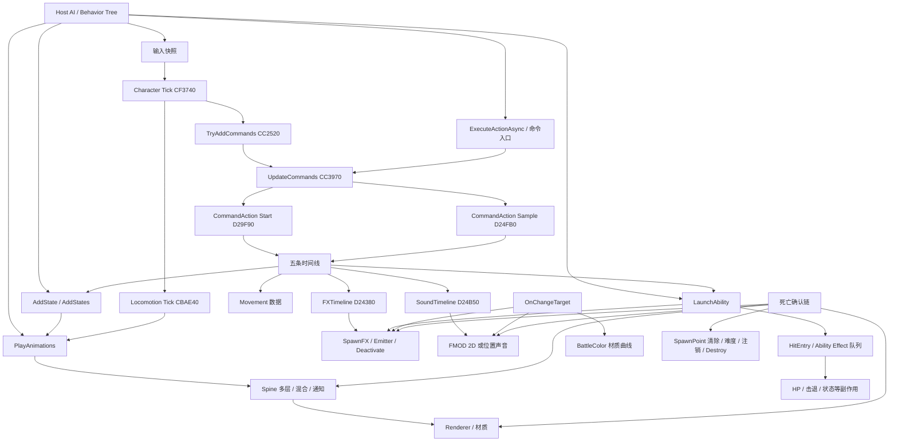

# 远程敌人、精灵与 FX / 声音执行链核验（ELMP v2，2026-11-04）

本次为静态核验：重新读取 Shipping IDB、CUE4Parse 包与当前 v2 源码，没有向游戏发输入，没有重启实例，没有进行新的画面对比。下文“当前缺口”指代码结构已证实的缺口；不能把它写成新的游戏实测结果。

2026-11-05续证：Ability私有FX与子生命周期已按[技能图谱](lily-skill-pipeline-2026-11-04.md)恢复原版执行；敌人候选碰撞、Invoker阵营和目标速度对追踪弹的影响见[Homing图谱](lily-homing-context-2026-11-04.md)。敌人全部决策/命中反馈仍未完成验收，本文不作为全面冻结或全面开放的授权结论。

证据目录：`build/toolchain-smoke/research-enemy/`。IDA 使用已有 headless HTTP 服务的 `database=elmp` 工作副本，未改原数据库。基址 `0x140000000`，下文地址均为 RVA。原始 MCP 返回保存为 JSON，反编译另存同名 `.c`。包路径均来自当前 devconfig 的 paks/usmap。

证据等级沿用 AGENTS：`[E-IDA]`、`[E-CUE]`、`[E-SDK]`、`[E-源码]`。本文的 `[E-源码]` 特指**当前 v2 实现的行为**时会明确写“v2 源码”；它不能证明原版逻辑。SDK 头在 `D:/CodeT/EnderLilies/Source/Zenith/Public/`，只证明声明。旧 kb 为研究线索，不因已有结论而自动升级证据。

## 1. 本轮确认的边界

1. `AZenithCharacter` 的帧推进有一条原生命令链，但**敌人决策不是只有输入，也不是全部经过命令**。CUE 已找到 AI Task 直接启动 Ability、动画与状态的入口。
2. 命令含五条时间线；只有启动沿，没有持续的 Actor Tick、状态、停止/中断及相同上下文，不能等价复制完整命令执行。
3. 当前 `guard` 没有 `OnApplyEffect`、`OnFinalizeEffect`、`StartDeathProcess` detour。旧 `pipeline-facts.md` §5 与 `commands.h` 关于“已经拦住”的表述不符合当前源码。
4. 死亡原生链同时驱动动画/溶解/粒子/声音，以及出生点清除、难度变化、注销和销毁。**DeathStart 不是纯表现入口**，不能整体放行后声称 Host 仍掌握所有结算。
5. 当前三个全局实验开关存在不闭合组合：`simLocal` 没有补齐权威闸与 AI 非命令入口，`animLocal` 并非按对象域限制，`fxLocal` 的 Fx/FxStop/Snd 策略不对称。现有证据不足以支持全面打开原版模拟。
6. 按对象固定为 Host 结果驱动的 presentation，可在保留权威边界的前提下继续改善多层动画、相位与渲染。但这属于**更完整的表现快照**，尚不是恢复完整的命令、召唤、受击和死亡执行链。

## 2. 原版多入口图谱

图中命令、Ability、状态、动画并非互斥来源。CUE 调用边证明某入口存在，不证明所有敌人都会执行它，也不证明完整的运行时顺序。

### 2.1 AI 不止“输入 → 命令” `[E-CUE]`

共同路径前缀：`/Game/_Zenith/Core/AI/Tasks/`。

| 蓝图类 | 已解析的原版调用 | 原始证据 |
|---|---|---|
| `BTTask_ExecuteActionBase.BTTask_ExecuteActionBase_C` | `ExecuteActionAsync`；退出/后续分支还有 `ClearCommandBuffer` | `cue-graph-ai_execute.json` |
| `BTTask_LaunchAbility.BTTask_LaunchAbility_C` | `AbilityComponent:LaunchAbility`；结束分支 `Stop` | `cue-graph-ai_ability.json` |
| `BTTask_PlaySpineAnim.BTTask_PlaySpineAnim_C` | `SpineAnimationComponent:PlayAnimations`、`StopActionAnimation` | `cue-graph-ai_anim.json` |
| `BTTask_StatesAdd.BTTask_StatesAdd_C` | `StateComponent:AddState`、`AddStates` | `cue-graph-ai_state.json` |

这些 call graph 返回无 diagnostics。尚未遍历全部 BT/任务/服务/装饰器、全部 Boss 和事件脚本，因此这里只能否定“输入/命令是唯一入口”，不能给出全覆盖入口清单。

### 2.2 角色帧顺序 `[E-IDA]`

`CF3740`：先调用 Actor Tick，然后查询两个虚函数门控（vtable `+1728`、`+1720`）。输入组件位于角色 `+1344`，消费入口 `CEF310`，当前快照在输入组件 `+224`、长度 40 B。命令队列在角色 `+1320`：先 `CBCA20` 写快照，满足门控时 `CC2520` 从角色 `+1552` 的 CommandSet 生成命令，再 `CC3970` 推进队列。最后通过角色 `+1392` 的 Locomotion 调 `CBAE40`。

这证明**该帧函数内部**的顺序；不证明此前没有 AI Task/蓝图直接调用，亦不证明复制输入就能复现所有状态。`CBAE40` 还读取环境/移动状态，当前 Client 永久禁用 CharacterMovement 后，不应假定它与 Host 输入一致就会得出相同结果。

证据：`char_tick.c`、`cq_update.c`、`cq_process.c`、`loco_tick.c`、`xref_cq_tryadd.json`。

`CEF190` 也是一个消费输入/生成命令的函数，且被 exec `D9BAC0` 调用；本轮**没有证实它是 ZenithSpirit::Tick**。IDB 中的显示函数名不可靠，不应把候选文件名 `spirit_tick_candidate.c` 当语义证据。

### 2.3 命令的五条时间线与时序 `[E-IDA][E-SDK]`

| 原生入口 | 已见行为 |
|---|---|
| `D29F90` Start | 先虚调用 `+648`（SDK 对应 OnStartCommandAction），处理资源消耗，设置 started `+498` 与时间；初始化/采样五条时间线 |
| `D24FB0` Sample | 检查 `+498`；累计执行时间 `+500`，受 HitStop 条件影响；结果字节 `+496==0` 时依次采样 State、Ability、Move、FX、Sound |
| `D24CA0` | 状态时间线（本轮从调用点及 SDK 交叉确认名称，未重新展开全部状态实现） |
| `CBABE0` | Ability 时间线：到点 `CAD0C0` 启动，结束时 `CBDC90` 停止；另有预告 FX 分支 |
| `D24590` | Move 时间线入口（本轮未逐分支核验） |
| `D24380` | FX 时间线按开始/结束时间创建并保存粒子实例，结束时对该实例 `DeactivateSystem` |
| `D24B50` | Sound 时间线按条目 `+8` 在 **PlayEvent2D** 与 `78D570` PlayEventAtLocation 之间选择；`78D520` PlayEvent2D 本身使用 identity transform 转调 `78D570` |

命令对象内五条时间线偏移分别为 `+88 / +128 / +224 / +288 / +328`。本轮反编译证据：`command_start.c`、`command_sample.c`、`ability_timeline.c`、`fx_timeline.c`、`sound_timeline.c`、`sound_2d.c`。`CommandAction.h` 证明字段命名，不代替行为证据。当前 AtLocation detour 能看见上述 2D 转发路径；不能因没有单独 hook PlayEvent2D 就断言漏掉它。

当前 Cmd 协议记录启动时的类、输入枚举和方向，通过 `AddNewImmediateCommand` 注入；没有同一命令执行实例的权威时间、排队进度、退出/中断或完整输入快照。因此“Cmd 到达”只证明启动请求到达，不能证明五条时间线同相、同寿命。

## 3. 动画、受击、目标与激活

### 3.1 动画的输入比轨道 0 多 `[E-SDK][E-CUE]`

`SpineAnimationComponent.h` 声明它持有 State、Locomotion、Movement、Input 与底层 AnimComponent；存在 LOCOMOTION、ACTION、REACTION、DEATH、EVENT 等层，包含转向/混合/受击/死亡定义。CUE 的 AI Task 可以直接 `PlayAnimations`，也可以先修改状态再让动画组件处理。

因此“直接写 track-0 名字”必然不能表达其余层、mixingFrom、转场或动作事件来源。至于当前 Spine 实现能安全复制哪些层/phase/renderer、哪些动画通知带副作用，应由 Spine 专项证据与实机验证补齐；本文件不把 SDK 声明冒充完整动画状态机反编译。

### 3.2 HP 的蓝图受击事件不是完整受击链 `[E-CUE]`

资产：`/Game/_Zenith/Core/Pawns/BP_Character_SpineBase.BP_Character_SpineBase_C`。

`BndEvt__HPComponent_K2Node_ComponentBoundEvent_0_HPDamageEvent__DelegateSignature` 将 From/Damage 写入事件参数并进入 ubergraph `274`。后续读取 HP、Stamina 是否 broken、Knockback 是否进行中及其类型，满足条件时在 `689` 调 `SpineAnimation:PlayAdditiveDamage`，否则直接结束。

这条 handler **没有启动死亡**，也不能创建缺失的 Knockback、Stamina、HitStop 或其他 HP delegate 状态。当前 Client HP 下降后手调该 handler、From=null，最多重放这条分支；前置组件状态若不一致，连分支结果也可能不同。

证据：`cue-spinebase-get_kismet_disassembly.json`、`cue-spinebase-BndEvt__HPComponent_K2Node_ComponentBoundEvent_0_HPDamageEvent__DelegateSignature.json`。本轮未重新还原 HP DoDamage 到所有 delegate 的完整顺序。

### 3.3 Enemy_Base 的目标与暂停 `[E-CUE]`

资产：`/Game/_Zenith/Core/Pawns/BP_Character_Enemy_Base.BP_Character_Enemy_Base_C`。

`OnChangeTarget` 进入 ubergraph `1888`，写 CurrentTarget 后跳 `57` 检查有效性。有效分支启用 BattleColor、调用 TriggerFindEnemyFX、TriggerSoundEvent；无效分支关闭 BattleColor，转至 ClearColor。它含材质参数路径，不能靠捕获粒子覆盖。

该**基类**只在这里检查目标有效性；不能据此断言所有派生敌人只需要一个 engaged bool。当前 Client 用本地 P1 代替 Host 的实际 target，只是基类路径的近似。

同一资产 ComponentDelegateBinding 明确把 TickTrigger 的 Begin/EndOverlap 绑定到 SetPaused 路径；ReceiveBeginPlay 也按当前 overlapping components 决定暂停。激活/暂停会改变 Tick 与状态，不能只靠“组件显式开启过一次”假定其后稳定。

证据：`cue-enemy-get_kismet_disassembly.json`、`cue-enemy-OnChangeTarget.json`、`cue-enemy-bindings.json`。既有 `enemy-fx-graph.md` 的红光结论本轮在该基类得到复核；其中历史实测只适用于其当时版本。

## 4. 技能效果：可证汇点，不等于已封闭的权威边界

### 4.1 标准 Ability 效果队列 `[E-IDA]`

`AAbility` Tick 候选入口 `CBEE00` 遍历其 `+696` 数组，条目长 336 B，调用 `CBB110` 推进。条目 `+304` 为队列索引，`+312/+316` 为时间/开始状态。`CBB110` 验证目标弱引用与过滤条件后，调用 `D3BCB0(effect, ability+640 的 From, target, entry+16 的 HitInfos)`；再查询效果的完成状态并推进。首次命中入口 `CA5580` 也调用该队列。

收尾 `CA6E40` 遍历效果数组调用 `D3BD40`，不是以“Apply 曾被允许”为条件。因此若以后拦截，Apply 与 Finalize 必须使用一致的授权/实例上下文；只挡伤害或只挡 Apply 不能自动排除收尾副作用。

| 名称 | RVA | 本轮 ABI 结论 | 13 B 前缀 |
|---|---|---|---|
| OnApplyEffect 事件 thunk | `D3BCB0` | `void(self, AActor* From, AActor* To, const FHitInfos*)` | `40 53 56 57 41 56 48 81 EC 68 01 00 00` |
| OnFinalizeEffect 事件 thunk | `D3BD40` | 同上 | `40 53 56 57 41 56 48 81 EC 68 01 00 00` |

两个 thunk 都把两根 Actor 指针和 **288 B FHitInfos** 复制到 ProcessEvent 参数区，再 FindFunctionChecked/虚表 `+536` 派发。第四参数不是整个 FHitEntry。`AbilityEffectComponent.h` 声明返回 void；Hex-Rays 推出的整数返回只是尾部 ProcessEvent 返回推断，不应据此定义 hook 返回值。以上是 Windows x64 调用形态 + SDK 签名交叉核验，**尚未安装 detour 进行寄存器/运行时验证**。

证据：`effect_queue.c`、`effect_finalize_queue.c`、`effect_first_hit.c`、`effect_apply_thunk.c`、`effect_finalize_thunk.c`、`effect-death-prefix.json`、`xref_effect_apply.json`、`xref_effect_finalize.json`。

只发现标准队列的这些直接 xref，并不能证明所有治疗、MP、状态、生成物和世界修改都经过它；蓝图反射调用、派生 `_Implementation` 的直接调用以及独立原生系统仍须审计。也不能推导“所有表现已经在效果执行前生成”：受击、击退、死亡表现本来就依赖效果结果。

### 4.2 当前 guard 的实际范围 `[E-源码，v2]`

`native/guard/guard.cpp::install` 只有九个 manifest hook：DoDamage、SkillDamage、IsPlayer thunk、SaveGame、SaveGameAsync、EnemyAIActivate、EnemyCharacterActivate、ActorSetCollision、ActorSetTick。

其中伤害授权按 replay target 放行；全局 armed 时挡 AI 激活与保存；marked/allow 集控制角色激活、碰撞和 Tick。**没有上表两个效果 hook，也没有 DeathStart hook。** 该范围不能证明跑完整原版逻辑时客人永不结算。

## 5. 死亡既是表现链，也是世界状态链

### 5.1 起点、样式与结束 `[E-IDA][E-SDK]`

```mermaid
flowchart TD
    DEAD[OnReceiveDeadEvent CB2740] --> START[StartDeathProcess CBD9A0]
    FORCE[ForceDeath CA76E0] --> START
    START --> STYLE[DeathStyle 分支]
    STYLE --> ANIM[ANIMATION CA5AD0 / 死亡动画完成]
    STYLE --> KB[KNOCKBACK CA6410 / 定时结束]
    STYLE --> PLAYER[PLAYER CA6980]
    STYLE --> DISSOLVE[DISSOLVE CA5FE0 / 击退与FX声]
    START --> BPSTART[OnStartDeathProcess + Start delegate]
    BPSTART --> MAT[Enemy_Base 停肉动作 / 关红光 / FadeOut]
    BPSTART --> SPAWNSTART[SpawnPoint CE7090]
    MAT --> FIN[NotifyDissolveDeathCompleted]
    ANIM --> END[完成入口 CB1790]
    FIN -. native通知本体待核 .-> END
    END --> BPEND[OnFinishDeathProcess + End delegate]
    BPEND --> SPAWNEND[SpawnPoint CE7030]
    SPAWNSTART --> CLEAR[CF0230 清除 / 死亡位置 / 难度]
    SPAWNEND --> CLEAR
    SPAWNEND --> UNREG[注销原敌人]
    END --> DESTROY[按配置 Destroy Actor]
```

图中 NotifyDissolveDeathCompleted 到 CB1790 的最终连接需另核 native notify 实现；本轮已证明蓝图发出 notify 与 CB1790 的共同完成行为，尚未反编译该 notify 本体，**不将该条边视为独立闭合证据**。不同样式可能共用或分别执行完成代码。

| 入口 | 已核行为 |
|---|---|
| `CB2740` OnReceiveDeadEvent | 把 From 写为 `DeathComponent+672` 弱引用，然后调 CBD9A0；UFunction 注册名与 exec `D56100` 的单 Actor 参数交叉核实 |
| `CA76E0` ForceDeath | 直接 jmp CBD9A0 |
| `CBD9A0` StartDeathProcess | `+656` 防重并置位；对 owner 多个组件做清理/状态操作；按 `+176` DeathStyle 分支；调用 BP OnStartDeathProcess，再广播 `+624` OnDeathProcessStart |
| `CA5AD0` ANIMATION=0 | 绑定 OnDeathAnimationComplete 到动画完成回调，播放死亡定义；无动画/失败分支走完成 |
| `CA6410` KNOCKBACK=1 | 击退/定时路径；`CB2430` timer completion 产生 FX/声音、完成广播与可选 Destroy |
| `CA6980` PLAYER=2 | 玩家死亡的 FX/声音及额外全局表现行为，不能当普通远程敌人纯动画函数使用 |
| MANUAL=3 | Start 不走上述自动样式分支，仍发送 Start BP/delegate |
| `CA5FE0` DISSOLVE=4 | 使用 DissolveDeathSettings 的击退数据、粒子和声音；后续蓝图驱动溶解 |
| `CB1790` 常见完成入口 | 移除动画回调；`+657` 防重并置位；OnFinishDeathProcess，广播 `+640` OnDeathProcessEnd；`+177` 为真时 Destroy Actor |

CBD9A0 的 ABI 为 `void(self)`，13 B 前缀 `40 57 48 83 EC 20 80 B9 90 02 00 00 00`。CB2740 ABI 为 `void(self, AActor* From)`。这两个结论来自参数使用/调用者及 SDK，尚无新 detour 实测。

**IDB 标签污染警告：** CB2740 在当前数据库显示为 `SGameLayerManager::Tick`，实际由 UDeathComponent 的 OnReceiveDeadEvent native 注册表指向。其他显示名如 `UNavCollision::StaticClass`、`cricket::Port`、tflite 等也存在错误匹配。本文不按这些标签给组件命名；CBD9A0 开头清理的各组件具体类型仍需注册表/RTTI 或运行时反射交叉确认。

证据：`death_start.c`、`death_ondead.c`、`death_force.c`、`death_style*.c`、`death_finish.c`、`death_knockback_timer.c`、`death-native-tables.json`、`native_*.c`、`effect-death-prefix.json`。

### 5.2 溶解由 DeathStart delegate 驱动 `[E-CUE]`

Enemy_Base 的 ComponentDelegateBinding 明确：DeathComponent.**OnDeathProcessStart** → `BndEvt__DeathComponent_K2Node_ComponentBoundEvent_3_DeathEvent__DelegateSignature`。不是按事件名称推测绑定。

事件跳 ubergraph `850`：BattleColor=false → StopMeatAction → 判断 DeathStyle==4 → FadeOut.PlayFromStart。FadeOut Update 跳 `743`：Renderer.SetScalarParameterValue(`DissolveValue`, 曲线值)。Finished 跳 `2202→2134`：调用 DeathComponent.NotifyDissolveDeathCompleted。

该基类的 DeathComponent CDO 配置为 DISSOLVE；DissolveDeathSettings 的默认粒子是 `/Game/_Zenith/Art/Effects/GamePlay/PS_Liquid01`，声音是 `/Game/FMOD/Events/SE/Enemies/common/enemy-death`。派生类可以覆盖，不代表所有敌人使用同一资源或样式。

证据：`cue-enemy-bindings.json`、`cue-enemy-death-cdo.json`、`cue-enemy-get_kismet_disassembly.json`、`cue-enemy-FadeOut__*.json`。当前 Client “HP=0 / 标 killed / row 消失后隐藏”不会自动触发这条链；直接手调 HPDamage handler 也不会触发它。

### 5.3 SpawnPoint 是必须隔离的权威副作用 `[E-IDA][E-SDK]`

原生注册表确认 EnemySpawnPoint `OnEnemyDeathProcessStart`=`CE7090`、`OnEnemyDeathProcessEnd`=`CE7030`。ABI 均为 `void(self)`；Hex-Rays 在 CE7030 推断的整数返回不是 SDK UFunction 返回类型。

| 对象偏移/入口 | 已见用途 |
|---|---|
| SpawnPoint `+633` | MarkClearTiming；Start 为 1、End 为 2 时调用 `CF0230` |
| `CF0230` → `CAE9C0` | ClearableComponent（SpawnPoint `+608`）的 cleared 字节 `+196` 置位并登记清除状态 |
| `CF0230` → `CBCE80` | 使用已生成敌人的变换/位置向子系统记录死亡变换；记录容器/键用途由数据流与 SDK 交叉推断，未遍历序列化 |
| `+640/+648` → `D17C40` | 非空区域名称数组写入当前难度映射；SDK 名为 LockDifficultyLevelOfAreasOnClear |
| `+656` → `CFFE60` | 开启时难度值递增并 clamp，变化时广播；SDK 名为 bAddDifficultyLevelOnClear |
| CE7090 | 调 BP OnEnemyDeathStart，再广播 SpawnPoint `+576` delegate；boss flag `+984` 时调用 D105F0 |
| CE7030 | 调 BP OnEnemyDeath，再广播 `+592` delegate；`CEAC80(self,null)` 注销敌人，清空 `+988` 弱引用 |
| D105F0 | 清一组全局字符串/标志；其完整 Boss 行为含义未核实，不能仅因 caller 的 boss flag 就命名为“Boss结算” |

SpawnPoint Start 前缀：`40 53 48 83 EC 20 80 B9 79 02 00 00 01`；End 前缀同处比较立即数为 `02`。这些 bytes 仅为本轮研究指纹，不是已经加入 manifest 的 hook。

证据：`spawn_death_start.c`、`spawn_death_end.c`、`spawn_mark_clear.c`、`clearable_mark.c`、`difficulty_lock.c`、`difficulty_add.c`、`spawn_record_transform.c`、`spawn_unregister.c`、`spawn_boss_death.c`、`spawn-death-prefix.json`。

**结论：** Host 确认的死亡表现需要单独表示与重放，且不得借此开放 SpawnPoint 清除/难度/掉落/销毁等未授权副作用。本轮没有证明挡住上述两个 SpawnPoint 回调就穷尽所有死亡副作用；DropComponent、派生 BP、Boss 特例及事件系统仍未审完。

## 6. 精灵不能只靠 raw spawn + 轨道名等价恢复

`ZenithSpirit.h` 声明 AZenithSpirit 直接派生 ACharacter，不等同 AZenithCharacter。它有独立 CommandQueue、State、Ability、Input、Locomotion、HitStop 及激活/出现生命周期。[E-SDK]

`CCFCB0` Appear：检查内部状态 `+1464`，调用位置/状态准备函数，置出现状态为 2，调用 `CEFAE0` SetActive(true)，再调用 OnAppear BP thunk 与 `+1264` delegate。`CEFAE0` 设置 active `+1465`、隐藏/Actor Tick/碰撞、组件 Tick，恢复 Movement 相关字段，并通过弱 Controller 做 Possess/UnPossess 与 AI 相关启停。[E-IDA]

因此当前 Client 为远程 Spirit 直接 spawn 类、freeze(Presentation)、unhide、位置/朝向/track0，不会恢复召唤方、Controller、Appear/Disappear、命令实例和派生技能的原版关系。它是可控的表现副本，不是已运行完整原版的精灵。

证据：`spirit_appear.c`、`spirit_set_active.c`。本轮未闭合 Summoner→召唤命令→精灵创建/回收的完整链，也未确认精灵独有 Tick；不能把 Character CF3740 的全部偏移直接套给精灵。

## 7. 当前 v2 断链与重复生成风险 `[E-源码，v2]`

本表是本轮调查时的源码基线；后续修复应在对应实现/新实测中登记，不能把本表永远当现状。

| 位置 | 当前行为 | 后果/范围 |
|---|---|---|
| `coop/client.cpp::freeze` | Presentation 关 Actor/逻辑 Tick，仅部分渲染组件开；Simulated 在 simLocal 下开 Actor 与多数非 Movement 组件 | 前者明确是快照表现；后者缺少完整结算边界，同时 Movement 仍关，不是原版相同环境 |
| 同上 | `g_anim_local && SpineAnimationComponent` 不受 mode==Simulated 条件限制 | 全局开关可能给 Presentation 对象也开状态机，不能保证每对象单一动画作者 |
| `take` / `commands.cpp` | simLocal 抑制 TryAddCommands；Host 仅发 Enemy/Dyn 的 Cmd 启动沿 | 输入决策不本地产生；AI 直接状态/动画/技能入口没有被 Cmd 统一覆盖 |
| `present_enemy` | 直接写 HP，下降时调用单个蓝图 damage handler；死亡标志与隐藏代替 Death 链 | 缺少完整受击前置状态、死亡动画/溶解及其生命周期 |
| `client.cpp::handle_event Act` | simLocal Enemy/Dyn 丢弃 Host Act，假设 Cmd 本地产生 | 直接 AI LaunchAbility 的事件可能因此丢失；对应 ActStop 也未必有本地映射 |
| `ability.cpp` / Client Act | 原版 LaunchAbilityFromDescription 后设固定 10 s LifeSpan | 上限不是原版命令/技能停止语义；过早截断或额外残留均可能 |
| `coop/fx.cpp` | SpawnFX + SpawnEmitterAttached；未捕获 SpawnEmitterAtLocation 通用入口 | 存在独立位置粒子路径缺口；不能声称覆盖全部 FX |
| 同上 | replay attached 到 owner root，缺少原 attach component/socket 的完整身份 | 挂点、骨骼与空间语义可能改变 |
| `fxLocal` | 本地粒子/声音抑制一起放开；普通 Fx 不重放，但带 bit16 的 persistent Fx 仍重放 | 同一持续对象可能既本地产生又网络重放 |
| `FxStop` handler | fxLocal 时所有停止事件直接忽略 | 与 persistent Fx 仍被接受不对称，生命周期无法闭合 |
| `Snd` handler | 不随 fxLocal 关闭，仍重放 Host 位置声 | 本地声音放开后存在双播结构；本轮未做声学实测 |
| `fx.cpp` 声音入口 | AtLocation 捕获，含 PlayEvent2D 转发；Attached 仅计数；Ability owner 跳过 | 附着声生命周期与 Ability-owned 声依赖其他生成路径，不能宣称 Snd 独立覆盖全部声音 |
| `coop/entities/enemy_dyn.cpp` | write_host 填位置/HP/类型/朝向，未填普通 enemy 写入的 anim/zoff/engaged | 动态敌人不能据同一 row 结构宣称得到相同表现信息 |
| 远程 Lily/Spirit 副本 | 位置、数值、track0 快照；Spirit raw spawn | 动作层/phase/召唤关系缺失；需独立推进，不可只扩大敌人实验开关 |

## 8. 对旧 kb 的限定与更正

- `pipeline-facts.md` §1 的“输入是唯一决策源”、开头“没有外部表现入口”不成立：本轮 CUE 已证实 AI Task 直接操作 Ability、Spine 动画和 State。
- §5 的“这些 Effect/Death hook 已在 EL.json 并安装”不符合当前代码；“唯一施加点/死亡唯一起点/AI唯一入口”也超出本轮证据。表中地址可作为研究线索，不能作为全覆盖证明。
- §5 的“结算全在表现之后”不能用于伤害/击退/死亡：这些结果本身驱动表现。
- §8 的“钩两个 Emitter 就覆盖全部 FX”只能表述为覆盖所见 emitter 路径；材质参数、已存在组件、其他渲染系统、所有原生直调是否经过这两个入口仍须证明。
- §9 的一次史莱姆命令删除 FX 通道实验，证明的是**该条命令的本地 FX 能生成**，不能推广到所有 AI、精灵、通知、声音、晚加入持久对象和死亡。
- `enemy-fx-graph.md` 的 Enemy_Base 目标→红光/FX/声音关系本轮复核成立；泛化到所有派生类与“当前 Client 已完整复现”仍需逐域证据。
- 当前 IDB 含错误符号匹配。不得把 `CEF190` 猜成 Spirit Tick，或因 CB2740 显示名而错归 Slate；应保留 RVA、native 注册表和参数数据流证据。

## 9. 删除/替换建议与验收边界（不是已完成实现）

现有证据支持先撤销三个全局实验开关能任意组合的模式，给每个网络对象固定单一 presentation 策略；保留 Host 的位置/生命/生成消失结果。改善时使用已验证的底层 Spine 多层与相位、渲染模板；根运动归零必须选对原版字段/入口，不应关闭整个动画时间来替代。

这一步应删除或停止依赖：全局模拟绕过 Act、全局 FxStop 吞弃、本地声与 Host 声同时作作者、单轨名覆盖所有动画层、固定技能寿命替代 Stop 的假设。若某域尚无新的表现数据，必须明确其覆盖限制，不能以“开启原版 Tick”补齐。

后续若恢复本地原版生成，按**已证实的语义域**实施：例如一条已核命令实例的 start/phase/stop、一个已核目标变化事件、一个已核精灵出现/消失链。每域选择唯一生成来源；同域关闭重复的 Act/Fx/Snd 通道前，需证明启动、持续、停止、晚加入与失败回退全部有覆盖。不能因为一条命令有五条时间线，就默认所有表现都由该命令负责。

死亡需要 Host 确认事件与原版表现阶段，且隔离 SpawnPoint、Drop、Boss/事件脚本等副作用。当前掌握的 Effect/Death 函数地址不足以直接批准全模拟：还没有覆盖所有调用路径和收尾副作用的证明。

未完成的必要证据：

1. 原生 HP→受击/击退/HitStop/死亡所有 delegate 的顺序，以及 Host 结果重放所需最小参数。
2. NotifyDissolve/ManualDeathCompleted 的真实 native 路径；DropComponent 与派生死亡 BP 的全副作用清单。
3. AI Tasks/Services/Boss/事件脚本的非 Cmd 决策全集，以及这些入口的重放粒度。
4. 精灵 Summoner、归属/Controller、Appear/Disappear、命令与回收完整闭环；正确 Spirit Tick。
5. Effect thunk 之外的直接 `_Implementation`/蓝图/原生状态与资源修改路径；新 hook ABI 的 runtime 核验。
6. 原版粒子/材质/动画通知/2D与附着声的生命周期与 ownership；网络快照模式下哪些通知仍会自行执行。
7. 任一新模式都需真实 Host/Client 对照：受击、死亡、连续技能、目标切换、晚加入、离屏再入、过图和重连，并检查 guard 计数、事件序号/作者、对象残留与帧时间。本文没有执行这些实测。

## 10. 同日追加：实际 Spine 活跃轨道与受限呈现适配器

以下证据保存在 `build/toolchain-smoke/research-spine/`，为本轮后续实现的依据，不改变前文调查基线的时间点。

- `[E-IDA]` **受击 additive 在真实 Spine track 80**：PlayAdditiveDamage exec `D87EE0` → `CB3420` → `7EB0C0(AnimComponent,80,damageName,true)`；timer completion `CAF210` → `7EC9E0(component,80,0.2)` SetEmptyAnimation。因此“最多八条”必须表示八个活跃槽，各自携带真实 index，不能扫描索引 0–7，更不能把 Zenith 逻辑动画层当作 Spine track。
- `[E-IDA]` Skeleton GetCurrent exec `820AE0` → native `7E7E30`。组件 native state 指针在 `+520 (0x208)`，state current-track 数组 begin/end 在 `+136/+144 (0x88/0x90)`，每项一个 TrackEntry 指针，可为空。GetCurrent 只返回该索引 current，不把 mixingFrom 或 queued entry 算作另一个活跃轨道。
- `[E-IDA]` TrackEntry `rendererObject+16` 保存 UTrackEntry；UTrackEntry 内 native entry 在 `+136`。GetTrackIndex getter `800A40` 读 native `+64`，GetLoop getter `8008D0` 读 `+68`，GetTrackTime getter `800D20` 读 `+104`，GetAlpha getter `7FFFA0` 读 `+124`。SetEmptyAnimation `7EC9E0` 写 mixDuration `+132`、trackEnd `+116`。getter 在当前 IDB 显示的 wx/v8/ui 名称是错误匹配，不能按标签解释。
- `[E-SDK，插件源码]` 反射有 GetCurrent、ClearTrack/ClearTracks、SetAnimation/SetEmptyAnimation；UTrackEntry 有 loop/time/alpha/timeScale/mixTime/mixDuration/animationStart/animationEnd/trackEnd 的 get/set。**没有反射 GetTracks**。`trackEntries` 是 UPROPERTY TSet，仅负责让包装 UObject 不被 GC，包含 queued/mixing 生命周期对象，不能作为 current 活跃集合。
- `[E-IDA][E-SDK]` 对不存在的索引调用 GetCurrent 会创建空 UTrackEntry，故不能每帧用反射探测 0…255。实现先只读 native current 指针数组，只对非空索引取 GetCurrent；名字按 UTrackEntry ObjHandle 缓存，同名新包装实例产生新 generation。state 重建、皮肤替换、Actor/组件句柄过期、地图/会话 reset 均须失效。
- **Shipping 与本地插件容器布局不同**：本地 `spine::Vector` 头为 size/capacity/buffer，但上述 Shipping 反编译明确读取 begin/end 并调用 vector 扩容。实现不得直接复刻本地头算内部偏移。`SpineCurrentLayout` 的整段指令前缀由 EXE SHA/bytes 预检；三个读偏移在 manifest 通过 `native_offset` 对应到该前缀内的 displacement，失败即不读取。

本轮适配器的范围是最多八个 current track（index 0–255）及其已核播放字段。完整活跃集合用于清除离开的轨道，`<empty>` 是真实混合条目，不能当作“无轨道”；Host t 偏差超过 0.05 s 时校正，实例代次变化时即使名字相同也重启。超出八个活跃槽或索引范围显式置 overflow 并计数，只传有界子集，不宣称完整复制所有状态。

**仍有限制：** current track 的 mix 参数不等于完整 mixingFrom/mixingTo 链、队列、骨骼局部状态或 attachment override 快照；晚加入时不能据这些参数保证任意过渡逐像素相同。插件 `SetPlaybackTime(false)` 仅抑制 Before/AfterWorldTransform 两种委托，仍调用 state update/apply；Spine AnimationEvent/Complete 等监听器可能执行，因此它不是“无所有副作用的采样”接口。本轮适配器不使用 SetPlaybackTime(false) 来作此承诺。根运动、动画通知及所有监听器的剩余影响仍需要权限闸与实机计数验证。

## 11. 同日追加：死亡溶解的纯渲染输出

`[E-CUE]` Enemy_Base FadeOut Update 使用的完整入口为 `/Script/SpinePlugin.SpineSkeletonRendererComponent:SetScalarParameterValue`，参数是 `FName("DissolveValue")` 和曲线 float。

`[E-IDA]` 原生注册表 → exec `822C90` → native `7ED110(self,FName,float)`。该函数只把名称/值写入 Renderer `+1920` 的参数缓存 TMap，再调用 `7E3350`。后者依次遍历 Renderer 的四组动态材质数组（数据指针 `+1312/+1408/+1504/+1600`）调用 `UMaterialInstanceDynamic::SetScalarParameterValue`，未调用 Death、SpawnPoint、Actor 结算或时间线。`7E2D50` 还会遍历这份缓存重新应用材料参数，所以接收方应调用 Renderer 的 setter，而不是仅修改某一 MID。

四组反射属性为 `atlasNormalBlendMaterials`、`atlasAdditiveBlendMaterials`、`atlasMultiplyBlendMaterials`、`atlasScreenBlendMaterials`。[E-SDK，插件源码] 每个现有 MID 继承的 `MaterialInstance.ScalarParameterValues` 数组可读取显式 override：其 inner struct `ScalarParameterValue` 有 `ParameterInfo` 和 `ParameterValue`；ParameterInfo 的 Name 必须是 DissolveValue，Association=GlobalParameter(2)，Index=-1。[E-源码，引擎] 本轮实现通过反射 inner/struct 字段解析，不写死这些反射字段偏移。

读取全部现有 MID 后，只有均找到该 override、值有限且彼此一致，才给 `Visual.valid` 置 bit3（8）并填 `float dissolve`。无 MID、无 override、材料值分歧、非法数组/数值分别计数并清该有效位。不能用 `K2_GetScalarParameterValue` 的 0 返回值证明“读到了零”：引擎实现查找失败时也返回零。接收端只在有效位存在时调用上述 Renderer setter，缓存失效沿用 renderer 句柄/皮肤/世界/会话；不触发 DeathStart、死亡 delegate 或 FadeOut Timeline。

证据：`research-enemy/dissolve-{native-table,exec,set-native,set-materials}.json/.c`、`renderer-apply-cached-materials.c`，以及引擎 `Materials/MaterialInstanceDynamic.cpp::K2_GetScalarParameterValue`、`MaterialInstance.h::FScalarParameterValue`、`MaterialLayersFunctions.h::FMaterialParameterInfo`。这覆盖已核的 DissolveValue 标量输出，不能扩大为“死亡所有特效/音效/掉落已同步”。

