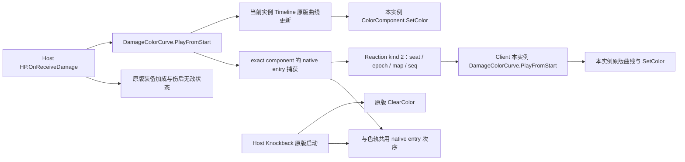

# ELMP v2：本机 Lily 受击色轨接缝（2026-11-05）

本页落实 ADR0009 第 8 条。范围只有 Host **实际启动**的 `DamageColorCurve.PlayFromStart`，以原版 Timeline 在 Client 对应本机 Lily 上播放；不根据 HP 差值推导，不广播 HP.OnReceiveDamage，不逐帧复制 Color。静态/反编译证据已具备，新增模块的真实双实例验收由主线程执行，未验收前不宣称色闪已恢复。

## 1. 原版因果与边界

- [E-CUE] `/Game/_Zenith/Core/Pawns/BP_Character_Player_Base.BP_Character_Player_Base_C` 的 HP.OnReceiveDamage 绑定事件 1：Kismet 2369 push-flow 2407，2374 调实例属性 `DamageColorCurve.PlayFromStart`；2407 后读取装备的 PostDamageInvincibilityBonusTime，2691 调 `AddStatesForDuration(PostDamageInvincibilityStates)`。整个 HP handler 有状态副作用，不能重播。
- [E-CUE] `DamageColorCurve__UpdateFunc` → ubergraph 2844 → 2742，仅把当前曲线 Color 送至 `ColorComponent.SetColor(Color, 0)`；`DamageColorCurve__FinishedFunc` → 2891 直接返回。`ColorComponent` 是该角色自己的组件。
- [E-CUE] 模板 `BP_Character_Player_Base_C:DamageColorCurve_Template`：VariableName=`DamageColorCurve`，TimelineLength 字段 0.25，LengthMode=`TL_LastKeyFrame`，仅一条 `Color` 色轨，曲线为 `/Game/_Zenith/Gameplay/Curves/Curve_PlayerDamageColor.Curve_PlayerDamageColor`，无事件/float/vector 轨；不循环、不自动播放。颜色属性名为 `DamageColorCurve_Color_899AC2694465CC6281559880FBA7924D`，方向属性名为 `DamageColorCurve__Direction_899AC2694465CC6281559880FBA7924D`。
- [E-CUE，新增实际查询] 色曲线 RGB 最后一键时间为 **0.25034273**，Alpha 在 0 时刻为 1。不能把模板的 0.25 字段当成实际播放截止，也不能替换成固定红色或任意时长。证据 `build/toolchain-smoke/research-lily-color/curve.json`。
- [E-CUE] CharacterBase.OnKnockbackStart 的 `ClearColor(0)` 是另一条原版因果链。Knockback 与 DamageColor 共用可靠 Reaction 次序，不以每次 Knockback 必然附加色闪替代 Host 真实调用。
- [E-CUE] SpineBase 的 HP 事件还会有条件调用 `PlayAdditiveDamage(0.2)`；这既不是 Timeline 更新，也不是本模块职责。此前 hit 图谱 §8 的条件仍须独立验收。

## 2. 原生入口与组件身份

| 已证入口 | RVA / 语义 |
|---|---|
| [E-IDA] `UTimelineComponent::execPlayFromStart` | `0x02AE7C40`；更新 FFrame.Code 后在 `+0x15` 以 E9 跳到 native；rel32 位于 `+0x16`，目标为 `exec+0x1A+rel32` |
| [E-IDA] `UTimelineComponent::PlayFromStart` | `0x028E60E0`；ABI `void(UTimelineComponent*)`，无输入参数、无返回值。先虚调用 Activate(false)，然后对 this+176 的 FTimeline 执行 `SetPlaybackPosition(0,false,true)`，清反向位、置 playing 位 |
| [E-IDA] `FTimeline::SetPlaybackPosition` | `0x028EA380`；native PlayFromStart 明确要求触发 update，初始色值在入口内立即应用 |

原始查询保存于 `build/toolchain-smoke/research-lily-color/{play-native,play-exec,play-exec-asm,play-xrefs,set-position,prefixes}.json`。manifest 的 `ColorDamagePlayFromStart` 与 `ColorDamagePlayFromStartExec` 同时校验当前 EXE SHA/前缀；安装时再从反射 `/Script/Engine.TimelineComponent:PlayFromStart` 验证 exec 与解析跳转目标。不钩整个蓝图 VM，也不以 UFunction 调用计数代替 native 调用事实。

[E-源码] UE4.26.2 `BlueprintGeneratedClass.cpp::CreateTimelineComponent` 1046 起：以 Actor 为 Outer 创建 TimelineComponent，以模板 VariableName 赋给 Actor 上对应 FObjectProperty；PropertySetObject 为同 Actor；逐轨设置曲线与属性名；将 update / finished delegate 绑定该 Actor 对应函数。`TimelineComponent.h` 的 FTimeline / FTimelineLinearColorTrack 私有 UPROPERTY 可反射，offset、数组步长、delegate / weak pointer 大小必须运行时解析，不写死 this+176 或色轨偏移。引擎 `Timeline.cpp` 的 PlayFromStart / SetPlaybackPosition 与 Shipping 反编译相符。

## 3. 实现契约与故障处理

1. 独立 `coop/reaction_color`，namespace `reaction::color`。Host 只在已启用 sink、游戏线程、shared seat filter 接受该 Actor 时观察；该 Actor 必须派生已证 PlayerBase，且它的 `DamageColorCurve` 属性精确等于本次 native `this`，Outer 也精确相等。其它角色 Timeline 原样执行，不产生事件。
2. 捕获前验证当前实例：Timeline / 色轨的反射结构与边界；仅一条 exact curve 色轨；无 event / float / vector 轨；PropertySetObject、方向/颜色属性名、update/finished delegate 均指向该 Actor 的已证函数，未被派生重写；自身 ColorComponent 已初始化；不循环、原版 PlayRate=1。缺失或变化不猜测、不调用 HP handler，Host 首错 latch 供 Reaction 主模块结束联机。
3. native entry 用共享 `reaction::next_capture_order()` 分配 `Capture.entry_order`，保存本次 Actor 的 ObjHandle 和时间戳。原版执行后核 IsPlaying、IsReversing、GetPlaybackPosition 的真实结果，再发 `kind=2`；无参数、无 State、无曲线 nameid。入口内的立即 update 允许执行，不能为了 post 顺序改写因果。Host 共用 entry order 排序及现有 own-seat / epoch / map 路由。
4. Client 对接收 Actor 的同一 exact 组件重新验证上下文，调用零参数原版 PlayFromStart，核已从 0 正向播放。不设置颜色、tick、无敌或 HP，不对全局 Timeline 加权限闸。重复的 Host 原版启动必须重启，不能自行去重为“已经 playing”。
5. schema 缓存仅保留类型/函数/曲线 ObjHandle；每次访问校验 weak serial，reset 清 schema 与故障。Actor / 组件指针不跨调用缓存。describe 暴露安装、Host/Client 开关、捕获/重播/失败计数与原因。

## 4. 真实验收计划与未覆盖项

先独立核新模块单文件编译，再由主线程统一构建及真实受击。必须同时记录 Host `color captured` 与 Client `color replayed`、相同 seat 的 Timeline.IsPlaying/Position 和 ColorComponent 输出；截取启动后多个时刻确认动态曲线及完成恢复，不能只凭计数判通过。普通 Knockback、HitStop、色轨混合时对照 shared seq 和 native entry order；重复受击应看到原版重启。确认本机 HP/伤后无敌仍仅接受 Host 结算，标题/换图后旧事件被 epoch/map 丢弃。

本模块未覆盖 Spine additive damage、全部受击 FX/音效与死亡分支，亦未以源码证明未知派生蓝图的自定义 Timeline 纯净。实际组件布局或 delegate 不符合已证原版时明确失败，留给新的资产/IDA 证据闭合。

2026-11-05 实现检查：`reaction_color.cpp` 使用当前工程 MSVC 参数独立编译成功（exit 0），日志 `build/toolchain-smoke/research-lily-color/compile.log`。CUE 再核 PlayerBase 的生成属性：色值 StructProperty 为 16 B、方向 ByteProperty 为 1 B、Timeline ObjectProperty 为 8 B，与运行时 resolver 契约一致。

`[E-实测]` 主线程后续完整构建、7/7 CTest及真实Slime接触伤害验证已完成。协议7基线Client曲线运行0帧，协议8原版曲线开始运行并经GetCurrentColor读到原版颜色变化、结束回白；停止新伤害后Host captured28与Client replayed28一致，captureFailed/rejected=0。混合反应总序列59条全部接收。窗口与时相仍有差异，见[lily-regression实测](lily-regression-2026-11-04.md)，不据此宣布所有受击画面完整。
