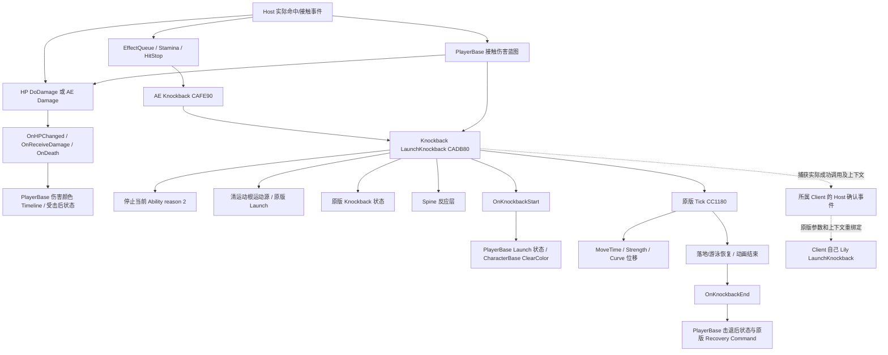
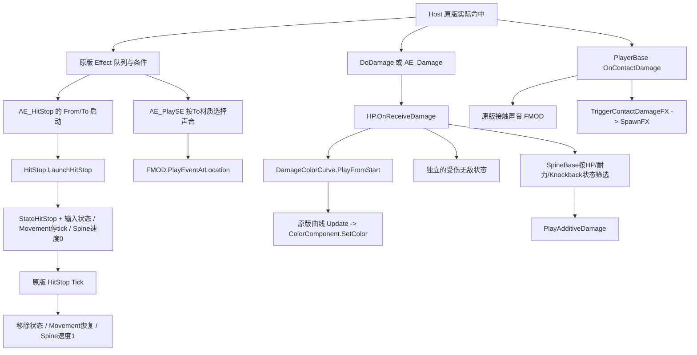

# 莉莉受击与本机击退：原版入口及联网断点

ELMP v2，2026-11-04；基线 `e8a1fe7`。本轮只读代码、IDA `database=elmp` 与此前 CUE 导出，未操作游戏；以下不能替代实机验收。新决定见 ADR 0009。证据保存在 `build/toolchain-smoke/research-lily-hit/`，既有蓝图证据位于 `research-lily/assets-{player,base,spine}-detail.json`、`assets-kismet.json`。

## 1. 代码上闭合的缺口

`[代码事实]` `coop/client.cpp::present_lilies` 的 own-seat 分支只做第一次放置、超过 150 UU 的 `K2_SetActorLocation(...Teleport=true)` 和 HP 属性写入，随后 `continue`。没有调用 `presentation::apply` / `visual_state::apply`，没有接收击退、速度、移动模式或受击时刻。不要把远端副本的 RootMotionFactor=0 归因到本机 P1；该策略不施加于它。

`guard.cpp` 在客人进程拒绝 DoDamage、技能 ApplyDamage、Effect Apply/Finalize、DeathStart；`open_replay/close_replay` 当前只有定义。Host `wants()` 又过滤所属 Client 自己 Lily/Spirit/Companion 的 Act/Fx/Snd。`LilyRow` 只有位置、数值、Pose/Visual 等输出，没有 Knockback 语义。当前本机输入/运动继续运行，却没有恢复 Host 已接受的外部受击原因。

`[因果推论，待实测轨迹确认]` 本机继续原本动作和速度，Host 则进入击退；偏差积累到 150 UU 后发生瞬移。这足以解释“不自然”的主要候选机制，但尚未测量每次反馈与纠正的时间差，不能把所有手感差异都归结为这一项。每帧覆盖 own Pose 会另造两个动画写者，也不能建立原版击退恢复状态。

## 2. 原版因果图

HP 减少与击退不是一对一：接触伤害蓝图分开调用二者，AE 击退还受耐力、过滤状态和队列时序影响。零伤害也可能广播受击事件；伤害也可能没有击退。不能依据 HP 差值合成 Knockback。

## 3. 已核实原生入口

所有地址为 Shipping RVA；IDA 库存在错误自动标签，以下认定依据为参数、原生调用、注册表和蓝图/重建声明交叉验证。

| RVA | 事实与边界 |
|---|---|
| `CA0380` | `[E-IDA]` `UHPComponent::DoDamage(self,From,int32,bool just,bool guard)`，写 `CurrHP +276`，随后 HPChanged、ReceiveDamage、可能 Death 广播。禁止拿它仅为了播放受击。 |
| `CB07E0` | `[E-IDA]` 技能伤害独立写 HP 并广播相同 delegate，尾部还有攻击者命中/击杀通知。绕开 DoDamage 不等于绕开结算。其第四参在此使用 +284/+285 的 HitInfos 标志；旧 manifest 叫 FHitEntry 的标签不能作为结构认定。 |
| `CAFE90` | `[E-IDA]` AE_Knockback 的 Apply 实现。无 StaminaComponent、或已破韧、或 `bBypassStaminaCheck +256` 时，以 `self+264` 的 KnockbackData 和命中方向调用 `CADB80`。不能在 Client 重跑耐力/命中过滤来决定是否击退。 |
| `CADB80` | `[E-IDA]` `int32 UKnockbackComponent::LaunchKnockback(const FKnockbackData&, FVector)`；Win64 实际 ABI `int32(self, const void* data, FVector* directionTemp)`。第三参是值传递的临时地址，会被归一化并置 X=0。返回 -1 表示拒绝；成功 ID 在 0..999 循环，不能直接当网络去重序号。 |
| `D72E90` | `[E-IDA]` `/Script/Zenith.KnockbackComponent:LaunchKnockback` 的 exec；末端 `D72FC9` 直接 call `CADB80`。反射适合 Client 调用；Host 只钩 UFunction 会漏原生直调，必须 native detour。 |
| `C9EA90` | `[E-IDA]` 根据原版 Movement 的 swimming / moving-on-ground 分支挑选 Swim/Ground/Air 向量，乘 `MovementFactor` 和 `LaunchKnockbackFactor`，非 absolute 时再按方向旋转。重放原始数据但缺少真实移动上下文可能选错分支。 |
| `CC1180` | `[E-IDA]` Knockback Tick。推进 ExecutionTime，根据 MoveTime/Strength/MovementCurve 做带 sweep 位移，结合 StunTime、落地/游泳和 Spine 层完成条件结束。末尾可按 bAirborneKnockbackTriggerLaunch 再调 `CADB80`，是一个新的实际启动。 |
| `CA67F0` | `[E-IDA]` 进入恢复：加恢复状态、设置 Spine 反应层与完成回调。 |
| `CAC0D0` / `CAC0E0` | `[E-IDA]` IsInKnockback 读取 `+417`；IsInKnockbackRecovery 返回 `+417 && +552`。原生 recovery 已包含在 running 中，不应把历史 Runtime 的 recovery 字节直接当永久活动标志。 |
| `CB9750` | `[E-IDA]` 移除本次 Knockback/Additional/Recovery 状态的内部清理，不是公开 StopKnockback 的同义地址。 |

`CADB80` 前缀（前 21 B）：`40 55 53 57 41 56 48 8D AC 24 68 FF FF FF 48 81 EC 98 01 00 00`。detour 必须同时通过 EXE SHA-256/前缀校验；反射 exec 地址与已核 direct-call 目标交叉验证。

## 4. 参数、必需上下文与可复用边界

`[E-IDA + E-SDK]` `FKnockbackData` 是 88 B、含 FTableRowBase vptr 的非 POD 结构，不能 memcpy 到线路或用未初始化 88 B 装 UFunction。偏移：`+8 bForceRestartDamageAnimation`、`+9 bResetVelocity`、`+12/+24/+36 LaunchVectorGrounded/Air/Swim`、`+48 bAbsoluteLaunchVector`、`+49 bKnockbackUntilGrounded`、`+52 StunTime`、`+56 MoveTime`、`+60 Strength`、`+64 MovementCurve*`、`+72 AdditionalStates TArray<UClass*>`。所有运行时访问仍应按反射验证字段/结构长度；曲线与状态类用资产/类路径重绑定。无法解析或数组超限要拒绝并记录，不能丢掉参数继续播。

`[E-IDA]` 组件 size `0x238`（注册 `607A90`）。RuntimeData size **136 B / 0x88**（`D71C50` GetStaticStruct 与 `607E30` CppStructOps 同证；反编译的 144 B 栈 scratch 不是结构尺寸）。OwnerCharacter/Ability/Spine/State/Death 缓存在 `+376/+384/+392/+400/+408`；RunningKnockback 从 `+424` 起。其 Type `+520`、Direction `+524`、有效 LaunchVector `+536`、ExecutionTime `+548`、Recovery/EndType `+552/+553`。运行数据不是任意可直接写入的纯状态；应用端调用原版入口构建它。

成功 Launch 执行：清此前击退状态；复制本次数据；开启自身 tick；停止活跃 Ability（reason=2）；Launch 型清 CharacterMovement 的 RootMotionSourceGroup 并调用原版 launch；增加状态；调用 Spine 的 `CC3AC0`（Launch）或 `CB3F80`（Normal）；广播完整 RuntimeData 的 OnKnockbackStart。它自身没有写 HP、XP、存档。但它不是“只改一张图片”：Ability Stop 和状态/委托都必须保留，且下游仍受原有结算闸门保护，不能宣称所有派生 BP 均已穷举。

前置还依赖：有效 OwnerCharacter 及原版 BeginPlay 初始化、Death 非死亡、Component reentrancy、原来是否仍在 Launch、真实 MovementMode/CustomMode、速度、Ground/Air/Swim 判定、组件 MovementFactor/LaunchKnockbackFactor。特别地，旧反应是 Launch 时，新启动可继续被归为 Launch，即使新有效向量为零；不能仅用非零向量推断 Type。

实现默认采用原始 data + Host 实际启动时位置/速度/MovementMode/CustomMode；检查双方原生因子一致。不能默认把一个向量填到所有地形来绕过上下文。Host 成功后的 Type/有效 LaunchVector 是重放结果校验值；不匹配报告失败。网络序号独立于原版 modulo-1000 ID，带 epoch/seat/map，按可靠次序去重。

`[E-源码]` Engine `CharacterMovementComponent.cpp:1057/1102/1145`：SetMovementMode 的原生 OnMovementModeChanged 在切 Walking 时会在当前位置 FindFloor/AdjustFloorHeight/SetBaseFromFloor，并可能清 Z 速度；NavWalking 没有导航数据会降级 Walking。因此重放先建立 Host 位置，再调原版 SetMovementMode、验证其实际 mode/custom，再恢复 Host 启动前速度，最后 Launch。不能把“函数调用成功”当成模式一定与 Host 相同。

## 5. 蓝图尾链与剩余受击域

`[E-CUE]` PlayerBase 的接触 Collision handler（ubergraph 1593）先 DoDamage，再于 1968 用敌人的 `ContactDamage_Knockback` 调 LaunchKnockback；随后本机手柄反馈、接触音效、`TriggerContactDamageFX`。复制 Launch 只恢复击退链，不等于复制整次接触的所有音/光/震动。

PlayerBase OnKnockbackStart（组件绑定事件 0，1062）按 Runtime.Type=Launch 添加 LaunchKnockbackStates。OnKnockbackEnd（绑定事件 2，594）移除状态，再按 Type、EndType、落地条件添加 `PostLaunchKnockbackStateDuration` 状态并入队 `CA_LaunchKnockbackRecovery`；该资产默认持续 0.5 s。CharacterBase 的 Start handler 调 ColorComponent.ClearColor(0)。这证明自然恢复依赖完整原版运行状态，而不是单张 `damage_launch` 动画。

PlayerBase HP.OnReceiveDamage 的绑定事件 1（2369）启动 `DamageColorCurve`，并按装备参数增加 PostDamageInvincibilityStates；Update 2844→2742 写 ColorComponent。它不由 Launch 替代，当前直接写 HP 不会自动触发它。旧 enemy 图谱关于 handler 非纯动画的警示仍成立。HitStop 是独立组件/效果队列：本次尚未逐路径重放；不能宣称仅 Launch 已覆盖打击停顿、全部色闪或死亡。

为了避免 Client 原版 Tick 的衍生再次 Launch 与 Host 事实重复，客人 armed 且目标为本机受控 Lily 时，Launch 只接受 Host 事件作用域；拒绝次数需审计。其余 Tick、状态移除、恢复命令和输入预测继续运行。该窄闸不扩大到未经核实的第三方对象。

## 6. 验收及未证项

- 必须在隔离实例对照同一次 Host→本机 Client：事件序号/参数、原生返回ID、Runtime Type/LaunchVector、位置/速度、IsInKnockback/Recovery、动画进入/恢复、硬纠正次数；构建或 hook 计数不能代替手感验收。
- 地面、空中、水中、连续受击、动作中断、接触伤害、跨图残留事件和已死亡目标必须分别检查。参数/资产失败要有精确理由。
- 延迟下旧输入仍可能领先 Host；仅恢复事件还不构成完整 rollback/replay。已有 150 UU 常态纠正不得在受击窗口反复与原生运动抢写；适当窗口策略与最新 Host anchor 对账需要实测。
- 本轮不依据当前 guard 数量宣布所有下游结算入口闭合。尤其 Ability Stop、Stamina 的 OnKnockbackEnd、不同角色 BP 和 native delegates 的副作用尚需继续审计。
- 本机受击颜色、HitStop、音效/震动和死亡属于后续已接受事实，不使用 HP 差值或固定动画名替代；保留未知范围。

## 7. 本轮实现与验证范围

`coop/reaction` 已实现原生成功调用捕获、Host 待发送数据（资产只保存路径）、反射/manifest 双重入口验证、Client 原参数和上下文重放、结果 Type/LaunchVector 对账及本机自主启动窄闸。Host 捕获失败暴露 host_fault，调用方结束会话；Client 参数/资产/上下文失败也不降级到合成动画。字段全部走反射，RuntimeData 以注册实证的 136 B 校验。

协议 Reaction=15，最多 16 个 AdditionalStates 路径引用，包含 seat/epoch/map/独立序号/启动时刻、完整数值数据、地形模式与速度上下文；不携带 HP、不携带进程指针。已单编 reaction/protocol/codec，并用新 codec/protocol 对象链接运行纯编解码测试：全参数往返、16 状态上限、所有截断前缀、非法计数/枚举/非有限值和尾字节拒绝通过。真实受击验收由主线程继续记录；上述通过不表示已证明所有受击表现完整。

## 8. 2026-11-05 补证：HitStop、色闪与命中声音不是 Knockback 的尾部同义事件

本节只读原版、当前代码与已有/新增 CUE 导出；未改源码、构建或操作实例。第 1 节的“没有 Knockback 事件”是 e8a1fe7 基线描述，现已由第 7 节 Reaction 实现及主线程实测推进；以下是仍独立存在的输入事实，不能由 HP 差或每次 Reaction 固定追加推断。

### 8.1 HitStop 可复用的原生入口 `[E-IDA]`

`/Script/Zenith.HitStopComponent:LaunchHitStop(float HitStopDuration)` 的 exec RVA **D69610**，其 direct call 位于 **D69680**，调用原生 **CADAA0**。实际 ABI 为 **`void(UHitStopComponent* self, float duration)`**，duration 在 XMM1；反编译把它漏成整数形参，不能照抄伪签名。前 14 B 为 `40 53 48 83 EC 40 0F 29 74 24 30 0F 28 C1`，使用前仍须反射地址、EXE/前缀双校验。

组件注册 `D657F0` 明确为 HitStopComponent，size=272。已核字段：HitStopFactor+176，AdditionalHitStopStates TArray+184，running+200，elapsed+204，duration+208，SpineAnim+216，StateComponent+224，MovementComponent+232，OnHitStopStart+240、OnHitStopEnd+256。

Launch 的实际行为：

- 准入条件是 `duration * HitStopFactor > 0`。汇编 `CADB3A` 存入 +208 的是**原始 duration**；不能自行把 factor 再乘进计时或改成 max 合并。
- 首次进入时添加原版 StateHitStop（注册 getter `D8C530`）及 AdditionalHitStopStates，关闭缓存 MovementComponent tick，调用 Spine `SetTimeScale(0)`（`7EDE70`）。
- 每次接受启动，包括已经处于 HitStop 时，均把 elapsed 清零、duration 写入、running=true、开启自身 tick，广播 OnHitStopStart。重复启动的语义是原版重新计时，不是任意去重。
- Tick **CC0B70** 累加 elapsed；达到 duration 后调用 **CA2630**。后者移除本次附加状态与 StateHitStop、恢复 Movement tick、Spine timeScale=1、关闭自身 tick，并广播 OnHitStopEnd。

直接原生调用的 xref 为 **CAFDF0**，对应 AE_HitStop 的效果实现：读取 TimedComponent duration+256，按 ExecuteOnInvoker+264 / ExecuteOnTarget+265，分别在 From / To 身上取 HitStopComponent，再调 Launch。`AE_HitStopComponent` 的 SDK 默认值为 ExecuteOnInvoker=false、ExecuteOnTarget=true、bOnlyApplyOnPawn=true，并忽略 guard/justguard/parry；实际效果仍由 Host 的队列与过滤决定，不能在 Client 重跑这个效果来判断是否停顿。

因此 Host 可捕获 **实际接受的 LaunchHitStop**，Client 本机角色经同一原版 UFunction 启动，并让原版 Tick / End 自行恢复。需要同一角色组件已经 BeginPlay 初始化、双方 HitStopFactor/AdditionalStates 一致，以及可靠次序、map/seat/activation 关联；不能把它并入“每个 Knockback 必有 HitStop”。Launch 返回 void，接受情况应核对原版 running/duration，而不是读无定义返回寄存器。

这条入口本身没有 HP/耐力/奖励/存档写入，但不是无状态的图片播放：PlayerBase 模板的 AdditionalHitStopStates 是 `STATE_LockMoveInput` 与 `STATE_LockInput_ALL`。应保留这段短时原生控制和结束恢复；不能为表面响应把所有角色永久冻结，也不能宣称派生 state/delegate 副作用已穷举。本次已读 Base / SpineBase / PlayerBase 的 ComponentDelegateBinding 没有额外 HitStop start/end 绑定，不代表全游戏没有。

### 8.2 受伤颜色的纯表现接缝 `[E-CUE]` / `[E-IDA]`

PlayerBase 的 ComponentDelegateBinding 明确把 HP.OnReceiveDamage 接到事件 1。Kismet 2369 push-flow 2407，2374 调 `DamageColorCurve.PlayFromStart`；2407 后读取装备的 PostDamageInvincibilityBonusTime，2691 调 AddStatesForDuration(PostDamageInvincibilityStates)。**整段 HP handler / 整个 OnReceiveDamage 广播不是纯颜色入口**，不可为了色闪在客人上重做该事件。

可复用的较窄入口是当前角色实例的原版 `DamageColorCurve` TimelineComponent 的 `PlayFromStart()`：模板 `BP_Character_Player_Base_C:DamageColorCurve_Template` 长度字段0.25、LengthMode=TL_LastKeyFrame，外部色轨使用 `/Game/_Zenith/Gameplay/Curves/Curve_PlayerDamageColor.Curve_PlayerDamageColor`。Update 函数→ubergraph 2844→2742 **只调用** `ColorComponent.SetColor(本次曲线颜色,0)`；Finished→2891 为 return，未见结算调用。不要手填固定红色/时长替代曲线，也不要硬调 ubergraph 入口编号。

Host 侧应观察实际 HP 绑定 handler / 原版 Timeline 启动事实（或同等确切原版调用），Client 仅启动同一实例 Timeline；不能从 HP 前后差推断。Host DoDamage 和 AE_Damage 的两条原生链均可能广播零伤害 OnReceiveDamage。原版 KnockbackStart 又会触发 Base 的 ClearColor(0)，因此色轨启动与 Reaction 的相对次序必须保留，不能把收到任意 Reaction 当成“立刻闪色”。

Color 原生实现也已核：

| 入口 | RVA / 行为 |
|---|---|
| `ColorComponent::SetColor(FLinearColor,float)` | exec `D4BE60` → vtable+1032 → **CBC380**；16B FLinearColor 以临时地址传入，LerpTime 在 XMM2 |
| 实际应用颜色 | vtable+1024 → **CBC420**；遍历 DynamicMaterials 写两个向量参数，写缓存 SpineRenderer.Color(+1716)，更新组件 CurrentColor(+232)；没有 HP/状态/奖励调用 |
| `ClearColor(float)` | exec `D4A780` → vtable+1048 → **C9E550**；取 DefaultColor(+216)再走原版 SetColor，保留 float lerp 参数 |

SetColor 内部 `C9FA10` 按需初始化动态材质缓存；不能误标成伤害或状态入口。当前 `visual_state` 可对远端副本应用颜色，但 Client 本机 own-seat 分支没有消费该 Visual；本机色闪应由已证的原版色轨响应，不必开放每帧 own Pose/Visual 写者。

另一个独立事实是 SpineBase 的 HP.OnReceiveDamage 绑定事件 0：HP>0，且不满足 `Stamina.IsBroken && Knockback.IsInKnockback && Type==Normal` 时调用 `SpineAnimation.PlayAdditiveDamage(0.2)`。恢复 LaunchKnockback 不保证这条 additive 也已恢复。若后续接入，应捕获 Host 实际选择的 PlayAdditiveDamage 入口，不在 Client 重新判一次耐力/当前 Knockback，也不通过广播整个 HP delegate 顺带完成。

### 8.3 声音与接触特效：两个不同的丢失位置

`[E-CUE]` PlayerBase OnContactDamage 的顺序为 DoDamage → LaunchKnockback → 手柄反馈 / ContactDamageSoundEvent / TriggerContactDamageFX。原始 Kismet **2058 push 2321、2063 push 2205**，手柄分支结束 pop 到声音，再 pop 到 FX；Pseudo 反编译器的普通 goto 表达容易误读，不能说“有 PlayerController 就不播接触声”。声音为空只跳到下一 flow，不会跳过 FX。

声音资产为 `/Game/FMOD/Events/SE/Player/player-contact-damage.player-contact-damage`，调用 `FMODBlueprintStatics.PlayEventAtLocation(this=Lily, event, Actor.GetTransform(), true)`。Player 模板 ContactDamageFX 为 `PS_Damage10`；`BP_FXComponent.TriggerContactDamageFX` 原始 Kismet 1440 分支只验证粒子、取 sort priority，再调用本组件 SpawnFX（bone None / identity offset / attach=false / follow=false / pool1 / reg=false）。这些入口不重新计算伤害。

`[代码事实]` Host 的 `fx::d_sound` 能把该 Lily context 归为 Lily；`d_spawn` 也能把接触 FX 归为受击 Lily。但 `host.cpp::wants()` 对 `RefKind::Lily && id==peer.slot` 直接 false，同样过滤自己的 Spirit/Companion。声音经 `send_to()`、FX 经 flush recipients 都使用这个过滤。因此 Host 实际产生的本机受击输出可能在发送阶段被当成“本机已预测的动作”排除。

Client 还有第二个接线条件：`actor_of(RefKind::Lily,id)` 只查 `g_copies`，未把 `id==g_seat` 映射到 `world::p1_pawn()`。**仅去掉 Host 过滤仍不能将这类事件应用到本机角色。** 后续须区分 Host 确认的外部受击输出与本机已生成的技能声音，给前者精确路由/去重，不能全量放开所有 own-seat Act/Fx/Snd。

`[E-CUE + 代码事实]` 技能命中音效还有一个更上游的确定缺口：`AE_PlaySE.OnApplyEffect` 先从 **To** 取 SoundData.Material，经 SoundSubsystem.GetHitSoundEffect(攻击 Material,目标 Material,Action) 选择 FMOD event，再以 **this=AE_PlaySE 组件** 为 world context、以 To.ActorLocation 为变换调用 PlayEventAtLocation。当前 `fx.cpp::sound_owner` 把 ActorComponent 归为 Outer；若是 AAbility 则直接返回 nullptr，注释理由是“重放 Ability 会自己播声音”。但 Client 的标准 Effect Apply/Finalize 由 guard 阻止，AE_PlaySE 不会随本地 Ability 再执行。这条实际 Host 命中 SE 因而在**捕获阶段**即被跳过，不只是 own-seat 过滤。

该缺口不能通过捕获所有 Ability 声音解决，否则 OnLaunch / OnTick 自行生成的声音会重复。可复用接缝是在 Host 已执行的 Effect Apply 作用域内标记 To 与实际选定 event/transform，转发该确定输出，再调用原版 FMOD 表现入口；不执行 Client AE_PlaySE，更不打开整个 Effect 队列。当前 Snd 只带 owner Ref / event / is2d，`play_sound` 用接收时 owner.GetTransform 重放；精确保留 Host 命中位置仍需协议或特定语义约束，不能默默把 Ability 位置当 To 位置。

BP_SoundComponent 本次读取的 BeginPlay 只绑定 CommandQueue.OnEndCommand 以管理声音取消，没有找到“它会替 HP.OnReceiveDamage 自动补全部受伤音”的证据。FMOD Attached 路径现为计数并直接调用原版，未形成完整传输；本节不声称覆盖所有音频入口。

### 8.4 实施边界与待验收

三类事件应分别捕获 Host 的实际原版调用：HitStop 接受启动；伤害色轨启动；原版接触/效果生成的声音与 FX。它们可以共享可靠次序与身份校验，但不能按同一 Reaction/HP差无条件衍生。Client 仍保留结算拦截，使用原版 LaunchHitStop / Timeline / FMOD / SpawnFX 的较窄入口恢复响应。

未实测项：这次 Slime 接触是否实际启动 HitStop（PlayerBase 接触图未调用它，不能因观感希望有停顿就补）；每个攻击的 AE_HitStop 准入次数/时长；连续停顿、Knockback与色轨的同帧顺序；实际 FMOD 捕获/路由/播放计数；输入锁结束与本机纠正是否冲突；所有派生 Blueprint、AdditionalStates 与动态绑定副作用。没有新的实机结论前，不把可复用入口写成已完成的联网行为。

新增证据仍在 `build/toolchain-smoke/research-lily-hit/`：`hitstop-{launch,launch-exec,launch-disasm,launch-xrefs,effect-apply,effect-disasm,tick,end,constructor,private-class,state-class,prefixes}`；`color-{set-exec,clear-exec,set-native,clear-native,apply-native,constructor,private-class}`；`AE_PlaySE-{pseudo,kismet}.json`、`ContactDamageFX-kismet.json`、`BP_{Sound,FX}Component-pseudo.json`。Timeline / delegate 事实来自 `research-lily/assets-player-detail.json`、`assets-spine-detail.json` 与 `assets-kismet.json`，按原始 Kismet flow stack解释，Pseudo 仅供阅读。

### 8.5 HitStop 接线实现（2026-11-05；实机验收待主线程）

`coop/reaction` 增加 kind=1 HitStop，与 kind=0 Knockback 使用同一 Host 可靠队列。捕获 `CADAA0` 原生调用，按 Host 已绑定的 exact 网络座位 filter 限定目标；满足原版正值准入才作为事件，记录原始 duration、HitStopFactor、AdditionalHitStopStates 类路径和原生调用时刻。异常参数、组件未初始化、状态类无法解释或 native 启动未保持 running，均记录故障并结束会话，不默默丢反馈。

Client 分支独立于 Knockback 锚点/速度/移动模式：验证本机 HitStop 缓存的 Spine/State/Movement 属于同一角色，验证 factor 与 AdditionalStates 数量、顺序、类路径，再调用原版 `LaunchHitStop(duration)`。不覆写状态数组、不自设骨骼速度、不模拟停顿结束；原版 Tick/End 负责恢复。仅 armed Client 本机 Lily 的非 Host 许可启动被拒绝并计数，其余对象与非联机会话按原版运行。大漂移纠正的 `reaction::active` 同时识别原版 HitStop running，避免停顿期间抢写本机运动。

HitStop 与 Knockback 的 Client 许可均限定 exact 组件和一次原生入口，在 detour 进入时消耗，返回时恢复外层许可状态；不允许相邻反应借用一个宽泛 replay bool。否则原版回调嵌套的另一次启动可能先本地执行，又被 Host 事件重复执行。Knockback 的原生 +560 重入位从 CADBB2 保持至 CAE22F，包含 CAE16D 的 Start 广播；同一组件内部递归本就返回 -1，本次没有改变其参数、位移或状态主体。

`Capture.entry_order` 是三个反应来源共用的原生 entry 单调序号，不进入 wire，也不随 stop/reset 重置。Host 在 post 回调收集完成后按此值排序，才分配线路 Reaction.seq，避免嵌套调用先返回而反转相邻 HitStop / Knockback / 色轨启动。原来 Knockback 参数与调用主体未改；新增种类没有位置锚点，不参与其 snapshot 防旧锚点覆盖逻辑。

HitStop 与 DamageColor 的四条 manifest 入口已对本机 Shipping PE 原始文件逐字节核对；两条 exec 相对跳转也独立计算确认目标，分别为 CADAA0 与 28E60E0。这里只说明二进制及编译检查范围；无实机 HitStop / 连续受击 / 色轨时序通过结论。

### 8.6 命中音光的来源桥（2026-11-05；实现与纯检查，待实机验收）

`guard::observe_effects` 复用已校验的 `D3BCB0/D3BD40` Apply/Finalize 钩，在原函数调用期间观察 exact `self/From/To`，Host 只装这两个观察入口，不 arm 权限闸。Client armed 时依旧先拒绝原 Effect，再返回，观察回调不能打开结算。`feedback_context` 同时只在联机会话注册 PlayerBase 接触函数的 exact UFunction 指针 pre/post；CUE 的真实签名是单个 `Actor* OverlapActor`、参数帧 8 字节，不是引擎通用 overlap 委托签名。函数/类用弱身份，退出会话注销，失效后冷解析；嵌套容量 64，失配、溢出、跨帧未退出均留下故障供安全 tick 结束会话。详细证据和缓存审计见 [反馈来源作用域](lily-feedback-source-context-2026-11-05.md)。

来源采用三态，不把外层 Contact 调用栈当作全部输出的来源证明。Effect 的 `self` 声音上下文映射到当次 `To`；`To` 自身及其 Outer 组件链同样有明确归属。Contact 只认当前 Lily 自身/Outer 组件链。Contact → Knockback → 原版 Ability 取消可能同步产生私有 OnStop 音光：这些源不匹配 Contact Lily 时仍使用原来 native Ability writer 路径，不加受击标签、不因外层 Contact 故障退出。Effect 内未能解释的来源/私有挂点则明示未闭合并故障退出；不能靠 Ability.Owner 把私有组件折算到 Pawn。未增加资源名白名单。

FX 使用 flags bit5=32 标明该来源，bit4=16 仍仅表示 initial baseline；原版 SpawnFX/SpawnEmitterAttached 的参数和 exact 挂点路径保留。有标签的 Host-only Effect 输出不再被“原版 Ability 私有 PSC 已有写者”提前吞掉。只有这种 FX 以及 `Snd.flags&1` 的消息可以绕过 Host 自己座位过滤，并在 Client `RefKind::Lily/id==本机座位` 解析到本机 P1。普通输入、走路和 Ability 自有音光仍走既有路径。Client 同来源的本地粒子/声音被抑制；网络回放仍走原版 SpawnFX / SpawnEmitterAttached / FMOD 入口，不重放 HP 委托或 Effect 结算。

Snd 增加原始 FTransform 的 10 个 float（quat4、translation3、scale3），flags bit1=2 表示 exact transform；feedback 必须同时携带 exact。捕获时锁定地图身份，只有世界位置的 Y 减去当次后台图 offset，PlayEvent2D 的 identity 不平移。发送前**先**核捕获 slot/map 仍存在及 owner/event 弱身份仍有效；旧图卸载、源对象/资产过期直接按生命周期退休旧事件，不能先调用 `ref_of_owner(nullptr)` 把正常退出误判为未闭合反馈。仍有效的源若已换图同样退休，不把旧播放点重新投到新图；只有同图存活对象无法建立可复制身份才故障。FX 则已有 owner/asset/PSC 失效 → stopped → 发 Stop/退休、随后才解析 Ref 的顺序。Client exact 分支调用 `FMODBlueprintStatics.PlayEventAtLocation` 并原样传该变换，不改成当前或插值后的 owner 坐标。`is2d` 保留既有 identity 约定；[E-SDK] FMOD 插件源码 `FMODBlueprintStatics.cpp:24` 的 PlayEvent2D 正是转调 AtLocation(identity)，与此重放相符。

FMOD 诊断将 `ProcessEvent` 成功和原生返回实例分开：`feedback FMOD replay instanceCreated/nativeEmpty` 记录 `FFMODEventInstance.Instance` 是否非空。原生可能因 world 不可听或 bank 未就绪返回空，这不作为会话故障，也不据此宣称实际扬声器发声。`feedback delivery` 另外显示 Host 标签 FX、sound、ownSeat 投递和地图退休数量。来源作用域失配、未知 Effect 源、反馈队列/PSC 容量、NameDef/编解码、Client exact 挂点/上下文超时失败，进入现有安全 tick fail-closed；没有从原生钩内部销毁会话。

检查范围：guard、feedback_context、fx、host、client 的独立 MSVC TU 编译通过；纯 codec 测试覆盖 FX bit4/5、Snd flags 0/2/3、变换截断/尾随/NaN/Inf/范围/四元数，均通过。日志在 `build/toolchain-smoke/research-lily-feedback/`。本段没有操作游戏、替换运行 DLL 或进行全仓构建；真实接触受击音光、Effect 命中音、技能取消不双播及地图切换需要主线程实机验收。Attached/looping sound、未知 Effect 私有挂点、其它来源/派生蓝图仍不是已覆盖结论。
