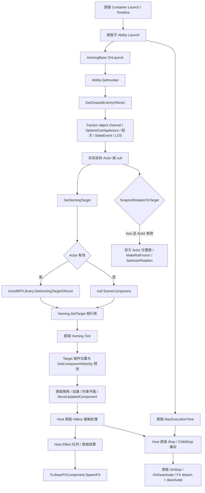

# Lily / Elaine 追踪弹上下文与命中边界

ELMP v2，2026-11-04 调查；2026-11-05 补齐原生查询、速度预测与恢复接缝证据。

## 结论与证据范围

当前 `Act` 重放原版 Ability / Container，却未传 Host 选中的追踪目标。`AbilityHitbox_HomingBase` 在每次 OnLaunch 中重新查询目标；Client 的远端敌人关闭 Actor collision，因此两端的查询候选集合不等价。这是已证的代码与原版依赖缺口，不等于已经观测到某一次 Elaine 施放选错目标。

主线程提供的 `build/lily-revision/v7-homing-baseline-{host,client}.json` 初次样本两端都记录 `NULL`；原采样先由 Target 取 Owner 再命名，尚需分别记录 `Target:IsValid()` 与 Target 自身完整名。这次样本不能用作“Host 有目标而 Client 无目标”的实测证据。本文未操作游戏、UEBridge 或实例。

已证的恢复接缝是：在**对应原版 Ability 激活作用域**内记录 `GetClosestEnemyOfActor` 的实际 Actor 返回值（含显式 null），Client 在同一次原版查询返回处使用 Host 结果，随后仍由原版 `SetHomingTarget`、可选初始旋转和 `UHomingComponent::TickComponent` 执行。仅替换 `Homing.SetTarget` 的组件入参不能完整覆盖可选的初始旋转分支。

本文的 `[E-IDA]` 地址均为当前 EL Shipping，image base `0x140000000`；下表写 RVA。IDA 历史自动符号存在错名，例如 `USynthComponent`、`UPhysicsSpringComponent::GetSpringDirection`，本文按调用与注册语义说明，不把这些错名作为结论。

## 原版执行图

## 蓝图与资产事实 `[E-CUE]`

资产目录 `/Game/_Zenith/Gameplay/Abilities/`：

| 资产 | 已读取事实 |
|---|---|
| `s5040_Witch/AbilityContainer_s5040_AttackA` | Timeline 单条子项为 `AbilityHitbox_s5040_AttackA_Projectile`；From=To=0；Offset translation.X=60；Spawn/Attach=None；fire-and-forget=true；原始参数 MaxExecutionTimeOverride=0、DamageRate=0.8 |
| `s5040_Witch/AbilityHitbox_s5040_AttackA_Projectile` | 继承 `AbilityHitbox_HomingBase_FX`；TargetSearchMaxRange=2000、CheckLineOfSight=true、CheckFront=true；MaxExecutionTime=0.8；bStopOnHitboxCollision=true；BlockingCollisionChannels 为 WorldStatic / WorldDynamic |
| 同一子弹 Homing 模板 | InitialSpeed=10、Acceleration=2500、MaxSpeed=4000、AngularSpeedForStraightToTarget=200、bRotationFollowVelocity=true、RangeForTargetReach=20 |
| `AbilityHitbox_HomingBase` | 基类 TargetSearchMaxRange=3000；Homing 使用 X 法线约束平面。OnLaunch 顺序是父 OnLaunch → GetHomingTarget → SetHomingTarget → 可选 SnapRotationToTarget |
| `AbilityHitbox_HomingBase_FX` | ProjectileParticleSystem 经 SpawnEmitterAttached 附到 Sphere，保存为 FX；OnDeactivate / EndPlay / Destroyed 经原版 detach KeepWorld、Deactivate、清 FX |
| s5040 子弹特效模板 | 主弹体 `PS_S5040_A`；AE_FXOnTrigger1 使用 `PS_Hit_Sp_Projectile_01`；AE_FXOnTrigger_Enemies 使用 `PS_Liquid02`，Attach / UseRotationToTarget=true，FactionFilter=Enemies；另一 AE_FXOnTrigger 模板 bActive=false |

`SnapInitRotationToTarget` 在 HomingBase、HomingBase_FX、s5040 子弹三个 CDO 导出中均未序列化；精确 `get_object_properties` 查询也报告 missing。不能把缺字段读成运行时实测值。随后主线程 v7d 实测该次两端运行时值均为 false，Range=2000、LOS/front=true（见下节补证）；这不把所有派生类的 Snap 分支排除。

`GetHomingTarget` Kismet：statement 0 调 Ability.GetInvoker；20 调 GetClosestEnemyOfActor，实参为 `Invoker, 0.0f, TargetSearchMaxRange, CheckLineOfSight, 3, CheckFront`；83 写出 Target Actor。距离和前方均相对 Invoker，不是相对已偏移的子弹。

`SetHomingTarget` Kismet：有效 Actor 分支调用 ActorBPFLibrary.GetHomingTargetOfActor，再调用 Homing.SetTarget；无效 Actor 分支直接调用 Homing.SetTarget(null)。**本地查询为空时仍调用 setter，没有跳过 setter 的空分支。**

`SnapRotationToTarget` 对同一个局部 Target Actor 再作 IsValid；有效时取双方 Actor 位置差，MakeRotFromX 后 K2_SetActorRotation。它不读取 Homing.GetTarget。若 Client 本地查询 null，而只在 setter 中换成 Host 非空组件，这个分支仍拿 null，初始旋转不会执行。

HomingBase 与派生类本次读取的函数图未见 OnTick 重新调用 GetHomingTarget。不能据此宣称游戏所有其他 Homing 派生类都没有重选逻辑。

## 原生入口、ABI 与查询依赖 `[E-IDA]`

| 原版入口 | RVA / 原生形态 | 已核实行为 |
|---|---|---|
| `UGameLogicBPFLibrary::GetClosestEnemyOfActor` | `CDECE0` → 实现 `D0B070`；`AActor*(AActor*,float,float,bool,uint8,bool)` | 实际选敌；UFunction exec `D5E0A0` 的 call 位于 `D5E257` |
| `UActorBPFLibrary::GetHomingTargetOfActor` | `CDF7C0` → `D0C340` | null 返回 null；ZenithCharacter 分支调用原版 GetHomingTarget 事件；其他 Actor 返回 RootComponent |
| `AZenithCharacter::GetHomingTarget` 事件 thunk | `D99C50` | FindFunctionChecked / ProcessEvent 获得 SceneComponent；不能用猜测的 RootComponent 替代 Blueprint/native override |
| `UHomingComponent::SetTarget` | `CBD030`；`void(UHomingComponent*,USceneComponent*)` | 只向 `self+0x104` 写 FWeakObjectPtr；exec `D6A660` 的 call 位于 `D6A6D0` |
| `UHomingComponent::GetTarget` | `CAAE50`；`USceneComponent*(UHomingComponent*)` | `self+0x104` 弱引用有效才返回；exec `D68240` |
| Homing reset interface | `CB9B30`，此处 this=`component+0xF0` | 重置当前线速度、角速度、elapsed 与起始方向；未清 Target 弱引用。非零 InitialForwardDeviation 另走随机偏转；本次 s5040 模板未覆盖该值 |
| Homing activate/reset caller | `CAB760` | 调 `component+0xF0` interface vtable+16，即上述 reset |
| `UHomingComponent::TickComponent` | `CC0BC0` | 读取同一弱目标并推进原版运动；不调用选敌函数 |
| `USceneComponent::execGetComponentVelocity` | `2AB54A0` | 调 component vtable+1112，和 Homing `CC0D82` 的调用完全一致；闭合目标速度语义 |

查询 ABI 在 Win64 下为 RCX=Actor、XMM1=MinDistance、XMM2=Range、R9=LOS，其余 channel/front 在栈。CDECE0 的当前完整 14B 前缀：`0F B6 44 24 30 88 44 24 30 E9 82 C3 02 00`。实现 D0B070 起始 13B：`48 8B C4 44 88 48 20 48 89 48 08 55 56`。应由反射 exec 定位原生入口并按二进制清单校验，不能只凭上述地址武装。

SetTarget 前缀为 `48 81 C1 04 01 00 00 E9 A4 9C 40 00`，尾跳 FWeakObjectPtr 赋值。它返回的寄存器值只是底层赋值实现产物；声明 ABI 为 void，不能当成功布尔值。

`D0C34E` 的类型检查调用 `D97C10`；该函数虽被 IDA 错标为 USynthComponent，注册字面量明确是 `/Script/Zenith`、`ZenithCharacter`，size=1728。故上述 ZenithCharacter 分支已由二进制注册核实（`zenith-class-identity.c`）。

D0B070 的筛选顺序与输入：

1. 取得 Invoker 的 Actor 位置与 forward；忽略列表含 Invoker。
2. 查 FactionComponent。`CAC230` 判断 `FactionComponent+176 == 1`，即 Players；相应选择 object channel 15，其他有 Faction 的调用者选择 14；没有 Faction 则 object-types 为空。EFaction 的声明为 None=0、Players=1、Enemies=2、PlayerCompanions=3。**不把 Spirit / Companion 的身份自动等同 Players，实用 probe 要读取实际 Invoker/Faction。**
3. `D0B268` 调 SphereOverlapActors，类过滤 APawn，以 Invoker 为圆心、传入 Range 为半径。
4. 候选有效性、可选 forward 点积非负、距离不小于 MinDistance；StateComponent 含 StateEvent 者排除。
5. 选择距离最近候选。要求 LOS 时，对候选执行 `UWorld::LineTraceTestByChannel`，无阻挡才返回；本蓝图使用 channel 3。

尚未逐个核实本关各对象的 Faction、碰撞 object type、实际 actor forward 与 StateEvent；因此两端均 null 可由这些真实条件造成，不能先归咎协议。

## Tick 对目标上下文的依赖 `[E-IDA]` / `[E-源码]`

Homing 原生类 size=0x160；已核运行时位置为 Target weak+260、当前方向+268、角速度+280、线速度+284、elapsed+288，后续反射属性从 InitialSpeed+292 开始。这些是调查读数，不是建议绕反射直接写入的清单。

Tick 先累加速度和 elapsed，再在 Target 有效且 UpdatedComponent 存在时计算目标方向。`CC0D82` 调目标 SceneComponent 的 GetComponentVelocity，目标预测点为：

`target component location + target component velocity * (distance / current linear speed)`

随后使用原版转向角速度 / AngularSpeedForStraightToTarget、约束平面与 bRotationFollowVelocity，最后 MoveUpdatedComponent。AutoStopHomingDelay 只限制转向时间；不等于重新选敌或自动 Stop。末尾距离阈值满足时广播 OnTargetReached；本函数未直接调用 AAbility.Stop。HomingBase / FX / s5040 已读导出中未见该 delegate 的绑定；**不能把“到达追踪点”直接描述成 Elaine 命中结算入口**。

引擎源码 `SceneComponent.cpp:2478` 的 GetComponentVelocity 返回 ComponentVelocity；`MovementComponent.cpp:378` 的 UpdateComponentVelocity 将 Movement.Velocity 写入 UpdatedComponent。PrimitiveComponent 如正在物理模拟，GetComponentVelocity 另返回刚体速度（IDA RVA `27A7570`）。

ELMP Client 当前 `presentation_policy` 关闭远端敌人的 Movement tick，`client.cpp::present_motion` 用延迟快照插值设置位置；本轮代码未把敌人的原版组件速度同步到追踪点。**已证依赖是“原版读取组件速度”；未实测的是具体追踪目标组件在 Client 中实际返回零、旧速度还是其他值。** 即使同步目标 Actor，仍需对照两端 target component location / velocity；不能承诺轨迹完全重合。父线程记录的约 100ms 表现位置延迟也是该上下文的相位差。

## Client 当前断点与结算边界

`native/coop/presentation_policy.cpp::close_actor` 关闭 Actor collision；引擎 `Actor.cpp:4027` 调所有 PrimitiveComponent.OnActorEnableCollisionChanged，`PrimitiveComponentPhysics.cpp:942` 更新 physics filter。`BodyInstance.cpp:890` 明确在 owner Actor collision=false 时返回 NoCollision。因此远端敌人不再是原版 SphereOverlapActors 的等价候选，不能靠原版本地查询期望选中相同对象。此结论不要求开放 Client 碰撞或结算。

`native/net/protocol.h::Act` 当前只带技能描述、变换、骨骼/附着与 AbilityParameters，缺选敌事实；`ability.cpp` 仍通过原版 LaunchFromDescription 走本地 OnLaunch。原版执行恢复了，但其输入上下文尚未完整。

原版 Host 的接触与停止边界：

- `CB4A60`（AbilityHitbox 接触处理）先按忽略重入、Invoker/同阵营、目标 state、碰撞 channel 等条件筛选。Pawn 分支经 `CA5580` 将 FHitInfos 等写入原版 336B HitEntry / Effect 队列，再走原版效果推进；命中其他 hitbox 的分支可先对对方 Stop(Cancel)。
- `bStopOnPawnCollision / bStopOnHitboxCollision / bStopOnNonPawnCollision` 对应条件成立时，`CB4DAF` 对自身调用 `AAbility::Stop(Cancel=2)`。不能只按目标距离自行判断 Stop。
- `CBEE00` 的 AAbility Tick 推进效果队列、处理延迟 Stop；MaxExecutionTimeOverride>0 时使用 override，否则用实例原版 MaxExecutionTime，超时 Stop(MaxExecutionTime=1)。
- `CBDB80` 的原版 Stop 可能待效果队列完成才执行最终停止。协议应传 Host 实际原生 Stop 事实和确切 activation / descendant path，保留原版清理顺序；不能用隐藏 PSC 代替。

命中特效 `AE_FXOnTrigger::OnApplyEffect(From,To,HitInfos)` 明确取 **To** 的 BaseFXComponent；计算相对朝向/偏移后调用其原版 SpawnFX。PS_Hit_Sp_Projectile_01、PS_Liquid02 资产只是组件配置，调用是否执行仍取决于 Host 原版过滤和结算队列。当前 `fx.cpp::d_spawn` 在 Host 记录这类目标组件调用，理论上能沿既有 Fx 通道送出；仍需真实命中时核对捕获、发送、接收、生成计数与目标 Ref，而不是仅从资产存在断言已显示。

Client EffectApply / Finalize、damage / death 结算拦截必须保留。Client 无需再次执行 AE_Damage，也无需为命中特效打开整个 Effect 队列。原版子技能 Stop → OnDeactivate 的 FX 清理与 Host 捕获到的目标 SpawnFX 是两个独立事实，都需验收。

## 可复用的恢复方案与限制

以下为基于已证入口的实施建议，**本次调查未修改源码、协议或实例**：

1. 在 `AAbility::Launch` 原生作用域已登记 activation/root/path 后，观察该 Homing 派生 Ability 的 `GetClosestEnemyOfActor`。Host 在原函数返回后记录原始输入、查询次序和实际 Actor；不要把 native hook 中的 UObject 指针直接当网络身份。
2. 同步根 Act 返回前已发生的查询可随该 Act 携带 `path + query ordinal + target Ref`。显式 null 是合法结果；缺记录 / 不可映射目标不是 null。序列须绑定 session epoch / map / root activation，避免池复用穿代。
3. Client 在同一次原版查询返回时替换为 Host Actor，校验当前 path、Invoker、query ordinal / 参数。随后原版 GetHomingTargetOfActor 自行得到正确组件，并且同一 Actor 继续传给 SnapRotationToTarget。对一般 Zenith 派生类，仍应审计 Host/Client 所选组件身份是否一致，不能猜都是 root。
4. 原版 Tick / 加速 / 转向 / FX 继续运行；只提供缺失输入事实。不得全局重写所有 GetClosestEnemyOfActor，也不开放 Client 的伤害、奖励、状态、存档结算。
5. 异步 Container Tick / OnStop 中才启动的子技能不在“根 Act 返回前收集”的窗口内。需要明确的后续目标事实通道，或把这种情形记为不支持并安全失败。不能默默回退本地选敌，更不能依赖网络包未来补到时追溯修正已经执行的 OnLaunch。
6. 目标 Ref 未就绪时在原版 Launch 前有限等待；不能先用 null 启动再后补目标，因为初始旋转、方向与生命周期已经不同。明示 null 则应按原版无目标路径立即执行。

## 实测读取项与未证项

下一轮应保存同一 root / child activation 的：Invoker full name、Faction、Actor location / forward；Range、LOS、front、SnapInitRotationToTarget；查询返回 Actor；Homing.GetTarget 的 IsValid / full name / owner；目标组件 world position / GetComponentVelocity；子技能 execution time / location / state；Host Stop reason / path；目标 SpawnFX 资产与发送/接收计数。

Host 空目标的只读定位可调用同一个 GetClosestEnemyOfActor：先原参数，再单独去掉 front 或 LOS，比较结果，避免为测试改碰撞/阵营；函数的候选查询本身不执行攻击。这不能替代 native hook 捕获“实际 OnLaunch 调用了什么”的最终证据。

尚未证实：各目标的 GetHomingTarget override 实际组件；高速移动目标的速度/相位误差；异步子技能全部查询时序；特定目标死亡后弱目标失效与 Stop 的先后；所有派生 Homing 类均无重选。以上不得写成已经实现或验证完成。

### 2026-11-05 v7d 的只读上下文补证 `[E-实测]`

主线程提供 `build/lily-revision/v7d-homing-query-{host,client}.json`，本调查已读取记录。该次两端均有 43 条活跃子弹采样，实际 `Homing.GetTarget():IsValid()` 均为 false；运行时 Range=2000、LOS/front=true、Snap=false。**仍未出现实际 Host 非空 / Client 空的弹体目标分叉样本。**

但 Invoker 上下文已证不同：两端同为 BP_s5040_Witch，Host Faction=Players(1)，Client 副本 Faction=None(0)。对同一原版查询作只读参数对照时：Host 原参数为 null，关闭 LOS 后在前方找到 Slime，关闭 front 后可找到另一 Slime；Client 原参数也为 null，关闭 front 后返回本机 Lily。后者吻合原生实现的“有 Faction 且不为 Players 则查询 player object channel”分支。

因此现在可明确记录两项事实：Invoker 的原版 Faction 上下文未还原；候选集合/筛选结果确实不同。恢复 Faction 只是修复一项原版输入，远端敌人 NoCollision 仍影响候选，不能据此宣布本地选敌等价。修复应从 Host 实际查询事实及完整上下文出发；这份样本不支持追加伪造轨迹或粒子。

## 原始证据索引

- `build/toolchain-smoke/research-homing/`：`GetHomingTarget.json`、`SetHomingTarget.json`、`SnapRotationToTarget.json` 为完整 Kismet 参数树；`*-selected-defaults.json` 为准确字段查询；`*-templates.json` 为资产与组件模板。
- 同目录：`closest-exec.c`、`closest-native.c`、`closest-implementation.c`、`enemy-channel.c`、`faction-class.c`、`homing-block-state.c`；`settarget-native.c`、`gettarget-native.c`、`target-implementation.c`、`zenith-homing-target.c`；`homing-native-tick.c`、`homing-reset.c`、`component-velocity-exec.c`、`primitive-velocity.c`；`native-prefixes.json`、`seams-xrefs.json`。
- 同目录 `effect-fx-pseudo.json` 辅助阅读命中特效；原始 Kismet 调用图在 `research-skill/AE_FXOnTrigger-graph.json`。Pseudo 只作阅读视图，不替代 Kismet 数据流。
- `build/toolchain-smoke/research-skill/`：HomingBase / HomingBase_FX / ProjectileBase 的 class、graph、kismet；s5040 子弹 / Container CDO；`ida-0x140CB4A60.json`、`ida-0x140CBEE00.json`、`ida-stop-xrefs.json`。
- 重建头 `D:/CodeT/EnderLilies/Source/Zenith/Public/{HomingComponent,GameLogicBPFLibrary,ActorBPFLibrary,AbilityHitbox,EFaction}.h` 只证明声明；ZenithCharacter.cpp 的 GetHomingTarget 空实现不能当 Shipping 行为。
- 引擎 `C:/Code2/UnrealEngine-4.26.2-release/Engine/Source/Runtime/Engine/Private/`：Actor.cpp、PrimitiveComponentPhysics.cpp、PhysicsEngine/BodyInstance.cpp、Components/SceneComponent.cpp、Components/MovementComponent.cpp。
