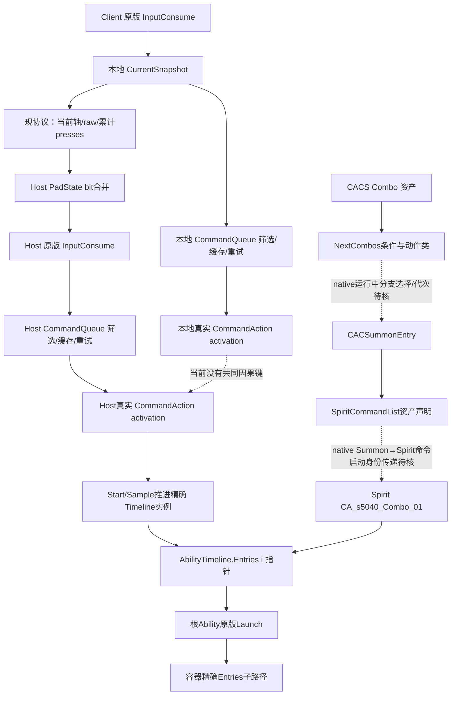

# ELMP v2：本机预测技能的共同因果身份（2026-11-05）

本次只读调查现有输入、命令队列、CommandAction 与 AbilityTimeline；没有改实现、构建或操作游戏。结论是：**当前协议没有足以把 Client 自发技能与 Host 接受的技能一一关联的共同身份。原版 CommandID、FrameID、同类对象、调用次数都不能补这个缺口。** 可以证明的局部来源是“某次已辨认 CommandAction activation 的确切 AbilityTimeline.Entries[i]”；但 Lily 输入命令经过 Combo / Summon 到 Spirit 命令的身份继承尚未闭合，不能把这些缺边画成已验证。

主线程报告 `v7d-own-client` 粒子 Host 2 帧、Client 26 帧，是本轮调查动机；本代理没有独立采样该实例，不将帧数单独视为根因证明。代码已确定 `host::wants` 排除本 peer 的 Lily / Spirit / Companion Act，子 Stop 又依赖已经投递根 Act 的家族账本；本机预测族目前没有绑定接收 Host 子停止事实的通道。

## 1. 当前输入协议能表达什么

[E-源码，当前仓库实现] `net::proto::Input` 只有 epoch、当前 x/y、raw held bits、每命令 u16 累计 presses、snap_ack。没有原版消费帧 ID、按键事件 ID、事件相互顺序、该沿所属方向快照、地图/装备代次、Command accept/reject、预测 root token。

`client::send_input` 在 ELMP frame phase 读 `ZenithInputComponent.InputSnapshot`（Current）并对其中 flags 每位递增计数；它没有在 native InputConsume 后标记“这一份 Current 已被统计”。正常一帧一次消费时可反映按下沿，但这不是每次原版消费的身份；若角色未消费而 frame phase 继续读取相同 flags，代码没有防重复计数凭据。本次未做暂停/停 tick 实测，不能把潜在时序当成已观察故障。

`host::on_unreliable` 对每键只判断新旧 presses **不相等**，不同则 `tap` 一次，不按计数差重建多个沿；首次 presses_known=false 只建立基线。`PadState::tap` 使用 `pending_ |= bits`；多个同键 tap 在一次 InputConsume 前也只留一个 bit。`PadState::consume` 输出 `pending | (raw & ~previous_raw)` 并清 pending。故计数由 10 跳到 12、或两包在同一次原版消费前到达，都不能证明 Host 执行了两份独立输入原因；不同键在同包有 bit 集合但没有先后关系。

这纠正旧仓库 `D:/CodeT/ELMP/docs/kb/net-facts.md` 中“计数差即补发 tap”的概述对 v2 的适用性：旧文是知识来源，不是当前 v2 实现的证明。u16 回绕且这里仅比较不等，也不适合作长期技能身份。

## 2. 新 IDA 证据：原版队列编号属于本进程

本轮新查询原文保存在 `build/toolchain-smoke/research-own-prediction/ida-<VA>.json`。以下 RVA 均相对当前 Shipping EXE `0x140000000`；IDA 错误自动符号（Rust/其它游戏类名）不作为语义依据，语义来自函数体和重建成员交叉定位。

| 原版接缝 | 已证行为 | 身份后果 |
|---|---|---|
| `CF3740`，ZenithCharacter Tick（沿用本仓库 player 图谱已存反编译） | InputConsume `CEF310` 后复制 40 B Current；`CBCA20` 交给 Queue；can-act 才 `CC2520` TryAdd；随后 `CC3970` Update | Actor 消费、队列尝试、成功启动是三个不同事件 |
| `CBCA20` | Queue Current(+336)→Last(+376)，再复制本次完整快照到 Current | 方向、flags、raw 都参与判断；只有 presses 计数不能还原每次判断上下文 |
| `CC2520`，TryAddCommands | Queue+320 先做 `(n+1)%10000` 作为这轮 FrameID；即使 CommandSet 空也先递增。逐个 136 B CommandSettings 调 `CC2840` | FrameID 是本地尝试轮次，既非网络帧，也非世界帧，不同 can-act/帧率/空集会分歧 |
| `CC2840`，TryAddCommandsFromSettings | DirectionInputProfile 过滤；Settings+33 AlwaysFire=false 时检查当前 flags 且上次 flags 未置；AlwaysFire=true 时检查 raw 或方向变化条件，并可因队列已有相同/派生 CommandAction 拒绝。成功候选写 UCommand+156 FrameID | 按下不等于入队；按住可触发无新 press 的尝试；同一输入帧有多个设置候选 |
| `D145B0` / `D15370` | 分别读取 FInputSnapshot+32 flags 与 +36 raw；InputType=100 和 NONE 还有特殊分支 | InputType 不是普通 bit 含义的完全同义词，不能泛化所有命令都是一次按下沿 |
| `CA8870` | 从 AvailableCommands 池复用或 NewObject；重置后 Queue+312 做 `(n+1)%10000` 写 UCommand+40 CommandID；拷 TTL、状态/能力/移动限制、InputType、GroupID | CommandID 不等于 Settings.RuntimeID，也不是两端相同的网络身份；UObject 本身也会复用 |
| `CA8300`，GetOrCreateCommandAction | 按 CommandAction class 在 Queue+184 map 中缓存对象，已存在就返回同实例 | 同一个 CommandAction UObject 能跨多次执行，ObjHandle 只防 GC 地址复用，不能识别执行代次 |
| `CABB70` | 执行 CanStart 回调、必要/禁止 State、玩家 Aptitude、MovementMode 等检查 | 相同输入/类/装备并不保证两端同一帧接受；Host 受击等事实能改变接受结果 |
| `CC2BA0` / `CC3970` | 查找当前可启动候选；不可启动可移除或保留；未开始命令递减 TTL，超时 reason=TTL 清理；可在后续 update 重试 | 原始输入原因必须绑定在 UCommand 入队实例上，不能启动时借“最新输入” |
| `CB4F00` | 首次运行广播 OnStartCommand；删除同 FrameID + CommandInputType 的其它候选（reason=Frame）；可被后续可启动命令 override；再调用 `D24D70` | 一次采样的多个候选是竞争关系；“第 N 次尝试/启动”在两端可不同 |
| `D24D70` | NONE 时对 CommandAction vtable+624 Start；随后 +632 Sample，写 CurrentResult；检查执行过程中请求结束/失败标记 | 应在真实 Start 原生边界登记 activation，不能拿预先广播/尝试当启动成功 |
| `D22F20` | 清 CommandID、CurrentResult、TTL、CommandAction、GroupID/FrameID、执行中标记 | 入队/执行 sidecar 必须带明确代次并在回池时失效 |

[E-SDK] `Command.h` 的 CommandID / CurrentResult / TTL / InputType / CommandAction / GroupID / FrameID 与这些读写相符；`ECommandRemoveTypes` 为 Normal/TTL/Override/Clear/NotStartable/Group/Frame，`ECommandResult` 为 NONE/IN_PROGRESS/SUCCESS/FAILURE。SDK cpp 的空函数不作为实现证据。

## 3. 从具体动作到 Ability 的已证边与缺边

[E-IDA] `CommandAction::Start` `D29F90` 每次重置并启动 State(+88)、Ability(+128)、Move(+224)、FX(+288)、Sound(+328) 时间线；`Sample` `D24FB0` 更新执行时间，HitStop 时 delta=0，再调用对应时间线。即使命令开始很早，Ability 可以稍后才生成，不能只把瞬时 Start 调用栈作为未来启动的来源。

[E-IDA，本轮重新查询] `FAbilityTimeline::Tick` `CBABE0`：Entries 步长 144 B；真实 entry 地址直接作为 FAbilityDescription 参数传给 `CAD0C0`，并将返回 Instance 写 entry+128。From(+96) 在旧时间到新时间区间内时启动；To(+100) 满足且非 FFA 时停止。**已辨认的 CommandAction activation + 其 Timeline 实例 + 精确 Entries 索引** 是可证明的局部来源；应验证参数指针确实属于那一个数组，而非只看同类 Ability。

[E-CUE，本轮新查询，`cue-context-0..3.json`] 伊莱恩 s5040 Lv1 链：

- `CD_s5040_Lv1.CommandSettings`：BufferTTL=0.25、bRemoveIfNotStartable=false、动作类 CACS_s5040_Combo；DirectionInputProfile 接受所有九方向。AlwaysFire 默认 false 另有 [E-SDK] 构造默认值，实际装备后的 Settings 仍须采样验证。
- `CACS_s5040_Combo`：SpiritClass=BP_s5040_Witch；NextCombos 按 Grounded+UpStrict / AirborneOrSwimming+UpStrict / Grounded / AirborneOrSwimming 选择奥义或普通首段；ResetComboOnInputs=134。
- 普通首段 `CACSummonEntry_s5040_Combo_01`：SpiritCommandList.AvailableCommands[0].CommandActionClasses[0]=CA_s5040_Combo_01，下一段可按 Grounded+UpStrict 分叉奥义，否则 Combo_02；本段 StateTimeline 包括 LockInput_Attacks 至0.4、LockInput_ALL 至0.5。
- Spirit 动作 `CA_s5040_Combo_01`：AbilityTimeline.Entries[0] 在0.27启动 AbilityContainer_s5040_AttackA；Feet、FFA=true、参数(0,1)。容器再生成 Projectile 的原版子路径与 ChildStop 证据见 skill 图谱 §5.1。

虚线是本次未核完的 native 身份传递，不能用资产引用替代执行事实。尤其不能给每个“最近同类 Spirit/Ability”补一个猜测 token；必须追到实际 Combo 子命令、SpiritCommandList 分支/条目及原版 Start 接缝。

## 4. 最小正确机制边界（方案，未实施）

现有根 Act/ChildStop 解决的是“Client 由这条 Act 明确创建了哪个 root”。Own prediction 没有这条创建关系；不能简单给 `wants` 放行 own Act，否则一边保留原版预测，一边又 Launch 一份；也不能只发送 ChildStop 然后按类找对象。

所需最小基础分为两个相互独立的绑定：

1. **共同输入原因 → 各端入队/接受。** 在同一个已预检 InputConsume 接缝里为真实新消费生成会话内不回绕 token，携带当次方向/flags/raw、seat+epoch+map 与装备代次；沿可靠/可确认的有界历史传给 Host，Host 注入与队列创建时保留这个来源。不能将最新状态包或 press 差当成完整有序历史；也不能在相同地址另装第二个 detour 而丢掉既有 virtual_pad 原始跳板。普通移动可以继续最新状态，但命令原因必须能追溯到原消费上下文。
2. **已接受命令 → 本机预测 root。** UCommand 候选创建时记录 source token 与稳定的 Settings 来源（装备组/槽位/资产+版本、设置条目、方向/InputType）；真实 Start 时分配本地 activation，并记录 Accept / Reject / TTL / Override 等终态。缓存后晚启动仍继承创建时原因。Host 的确认消息把其 root wire 身份绑定到“共同原因 + 已证命令派生路径 + Timeline entry + class/参数校验”，Client只绑定已有同源预测实例，不再次 Launch。随后可复用现有 root/child Stop 机制。

类名在这里是校验，不能充当选择身份；per-source occurrence 也只能在两端**已证同一来源条目**下使用，不能退回全局“第 N 次同类”。CommandAction、UCommand 与 Ability 都需要各自执行代次；根 UObject 复用后，旧 family 必须保留至 FFA 子结束。

还须先限定两个边界：

- 按住自动重复、方向改变触发、Combo自动续段、直接 AddNewImmediateCommand / Group、原版自行补入命令，不一定有新 press。必须给它们已证的父 activation + 原版分支/条目来源；尚未找到共同来源的路径不能假装可预测绑定。Host 不能反复消费同一个 latest input token 然后拿本地重复次数配 Client。
- Host与Client命令拒绝不同是合法的权威差异。协议必须能区分“未收到原因”“原版还在缓冲”“已拒绝/过期”“已接受另一分支”“成功且可绑定”。如果只有一端产生 root，不能继续盲用另一同类对象；需要明确拒绝预测/重建相应原版动作的方案。该协调机制尚未设计验证，不应当作本轮小补丁直接启用。

因此本轮可安全推进的是 **身份观察与日志**：真实消费 token → Queue候选 → Start/End → Combo/Summon来源 → Timeline entry → Ability activation 全链记录；先证明静止Elaine首段及拒绝/重试案例，再启用根绑定。不要为了提前隐藏尾迹差异把 own 所有技能冻结或把全部启动改成结果复制。

## 5. 协议缺项与后续可证伪验证

当前缺：有界可确认的命令输入历史与消费token、map/build代次、命令候选来源与接受状态、Combo/Summon/Spirit动作派生路径、own predicted root↔Host root 绑定/拒绝消息、绑定前Stop暂存及结束tombstone。现有 Act.seq、Ability native token、ChildStop.path 可以在**根绑定成功之后**继续使用，本身不能向上推导缺失的共同原因。

后续真实验证应覆盖：单次Elaine普通首段；同键两个短按在一Host消费间隔内；同帧两个槽位；按住续发；不同方向/腾空分支；输入被LockInput或HitStop缓冲后接受；Host受击而Client先预测成功；TTL过期；换装备/换组/换图；同UCommand/Action/Ability池对象复用。每条输出应能展示不可变源键与 native 地址/Entries 路径，而不是事后用轨迹或资源名认球。只有这些情况下仍能区分 matched / rejected / unsupported，才能声称 own 子停止已闭合。
