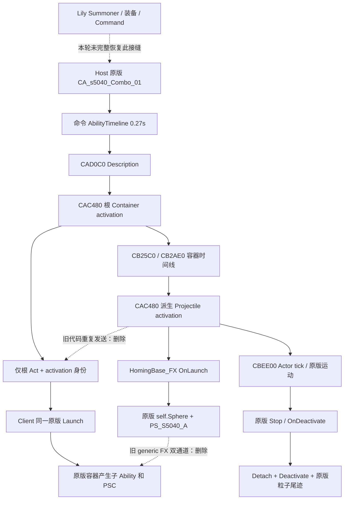

# ELMP v2：Lily 技能原版管线与远程重放（2026-11-04）

本轮起点为协议 6 / 提交 `e8a1fe7`。不能把状态计数成功当成技能画面正确，也不能把“缺少初始上下文”直接推成“应冻结整条原版管线”。本记录区分原版证据、当前断链、修复决定和未闭合路径。旧知识来源为 v1 `D:/CodeT/ELMP/docs/kb/net-facts.md`、v2 `player-sync-graph-v2.md`、`lily-presentation-graph.md`；以下关键技能链已重新查询 CUE / IDA，没有照搬 v1 实现。

## 1. 证据与复现材料

- `[E-CUE]` 原包对象、CDO、完整 Kismet 与调用图保存在 `build/toolchain-smoke/research-skill/`。`*-kismet.json` 必须同时检查 `scriptComplete=true` 和各表达式 `expressionTruncated=false`，仅靠调用名不足以证明参数。
- `[E-IDA]` 同目录 `ida-0x140*.json`，数据库 `elmp`，映像基址 `0x140000000`。本记录列 RVA；IDA 的若干自动类名不正确，按调用体、字段与反射声明交叉解释。
- `[E-SDK]` `D:/CodeT/EnderLilies/Source/Zenith/Public/{Ability,AbilityContainer,AbilityComponent,AbilityDescription,ReusableActor}.h` 证明签名及声明，不证明运行行为。
- `[E-实测，主线程采集]` `build/lily-revision/baseline-s5040-{host,client}.json`：Host P1 原版换装备组后两次 `SUMMON_1`，Host 的 `AbilityHitbox_s5040_AttackA_Projectile` 有效采样 93 帧、Client 191 帧。此帧数本身不能量化网络丢包；与下面父子重复启动证据一致。`baseline-elaine` 文件实际为 s5060，不能误引作伊莱恩。

## 2. 伊莱恩普攻：魔法球就是原版 Ability 自带的粒子

`[E-CUE]` `CA_s5040_Combo_01`：`attack_A` 动画；AbilityTimeline 在 0.27 秒，从 `Feet` 启动 `AbilityContainer_s5040_AttackA`，FireAndForget=true，AbilityParameters=(0,1)。容器 CDO 的时间线在 0 秒启动 `AbilityHitbox_s5040_AttackA_Projectile`，Offset.Translation.X=60，FireAndForget=true，DamageRate=0.8。

该 Projectile 继承 `AbilityHitbox_HomingBase_FX`；CDO 的 `ProjectileParticleSystem=/Game/_Zenith/Art/Effects/Battle/PS_S5040_A`，MaxExecutionTime=0.8。不是额外“网络粒子演员”。父蓝图完整 Kismet：

| 字节码位置 | 原版行为 |
|---|---|
| 154 | 调父 `AbilityHitbox_HomingBase.OnLaunch` |
| 245 | 可选 MuzzlePartcleSystem：SpawnEmitterAtLocation，WorldContext=self，位置=self.ActorLocation |
| 428 | ProjectileParticleSystem：SpawnEmitterAttached 到 **self.Sphere**，socket=None，offset=0，scale=1，LocationType=2，AutoDestroy=true，Pool=1，AutoActivate=true |
| 514、585 | 保存返回 PSC 至 self.FX；设置原版排序 |
| 609→20→85/124/138 | OnDeactivate：若 FX 有效，Detach(KeepWorld)、Deactivate、清空 FX；EndPlay/Destroyed 走同一清理 |

`[E-CUE]` 另两类交叉验证：s2022 Arrow 的 `TrailFX=PS_ArrowTrail`，`AbilityHitbox_ProjectileBase` 的 OnLaunch 字节码 173 挂 self.RootSceneComponent；s5060 Projectile 继承 `AbilityHitbox_ProjectileBase_FX`，同样挂 self.Sphere。修复应恢复共同的原版 Ability 生命周期，不能按这些 PS 名称建例外表。

## 3. 原版启动、容器派生、池与停止

| `[E-IDA]` RVA | 已核行为 |
|---|---|
| CAD0C0 | LaunchAbilityFromDescription 包装器：组合 Offset，转 CAC740；传递 AbilityParameters、骨骼、附着和 FFA |
| CAC740 | 解析原版挂点，组合世界变换；从池取得 Ability；写完整 ActorTransform 和 AbilityParameters；调用 CAC480；必要时原版 AttachToComponent |
| CA7B00 | 按类从 AvailableAbilities 复用或 SpawnActor；Actor.Owner=AbilityComponent 的 Owner；每次 Initialize |
| CAC480 | AAbility::Launch(self,Invoker)：设 Invoker(+640)，启动状态；**返回前**调用 OnLaunch 及效果 OnLaunch，再进入运行状态。身份必须在入口建立 |
| CB25C0 | AbilityContainer.OnLaunch：从 **Invoker Pawn** 取 AbilityComponent 与 FXComponent，立即以 dt=0 驱动内部时间线 |
| CB2AE0 | AbilityContainer.OnTick：继续内部 FAbilityTimeline；bAutoStop 满足结束条件时 Stop |
| CBABE0 | FAbilityTimeline::Tick：跨越 From 时直调 CAD0C0；To 到期停止非 FFA 实例 |
| CBEE00 | AAbility::Tick 是 **Actor tick**：调用父 AActor::Tick、OnTick、推进执行时间，处理命中队列，依据实例 override 或 CDO MaxExecutionTime 调 Stop |
| CBDB80 | AAbility::Stop 原生入口；同一 UObject 可在后续启动被池复用，ObjHandle 不能区分两次 activation |

容器的子 AbilityComponent 属于 Invoker，**不是容器自己的组件**。因此仅看 Description.owner 无法辨别父子；旧通道把父容器和子弹都发 Act，Client 的父容器原版 OnLaunch 再生一颗子弹，形成双写。异步容器 OnTick 也必须恢复同一身份上下文，不能只包一次 replay 调用。

## 4. 确定性断链与本轮决定

1. **双重删除粒子**：`fx_owner` 先把 Ability 私有组件归属折叠到角色；Host 的 attachment 序列化随后拒绝不属于角色的组件；Client replay 的原版 OnLaunch 又因该角色 guard marked 被 hide_now。PS_S5040_A 正好走这一条，完整证据不依赖推测。
2. **父子重复启动**：仅依据归属角色发送所有 Description，忽略原版 Container 已拥有派生；运行一次父管线同时又复制子结果。
3. **错误生命周期身份**：原版池复用同一 UObject，旧 Stop 若按晚读的指针映射会命中新 activation；OnLaunch 内可重入 Stop，post-call 才登记身份不够。
4. **任意 10 秒寿命**：SetLifeSpan(10) 不是原版技能停止依据，会破坏长技能和原版池。应由原版完成、Host Stop、会话退出与句柄失效收束。

决定（ADR0009 对应实施）：以原版 **根 Ability activation** 为唯一技能生成者。新增经过前缀校验的 native Launch / Tick 观察钩子；Launch 入口分配单调 uint64 身份，存 ObjHandle、身份、root 与 side。RAII 作用域贯穿原版 Launch / Tick / Stop，派生 activation 继承 writer，不再发独立 Act。不是对所有 Ability 类型或角色全部 FX 放行。

Client 只有成功网络根 Act 作用域或已登记 activation 的原版派生可成为此 writer；原版 Ability 自有的 exact 组件生成 PSC 保留，Host generic FX 捕获与投递均排除这批 exact PSC。目标角色受击 BaseFX、Spine notify、Companion.FX 等其他来源不在此放行范围。原版粒子 Pool/Detach/Deactivate 由原版蓝图继续管理；仅 generic 网络自建 PSC 保持 Pool=None。

Host Launch 与 Stop 使用同一单调 capture ordinal；Stop 在 native 入口绑定当时的 activation，不在 flush 时按 raw pointer 重新绑定。Host 事件按真实 entry 顺序发。Client 每条 ActStop 保存并核对本地 activation，池复用后的旧 Stop 不能停止新技能。停止期间仍保留原版 cleanup/尾迹作用域；仅在回收、对象世代失效或会话清理时撤销身份。缓存必须有容量上限、weak 校验和审计计数；超限不可降级为所有 Ability 放行。

退出边界：会话清理用原版 `END_PLAY=3` Stop（IDA CBDB80 的 reason=3 分支绕过剩余效果队列）终止现存 activation；保留 OnStop 的粒子清理，但拒绝该网络执行作用域中新派生的 Ability，不能先允许启动再删除身份。派生关系同时核对弱句柄 Invoker 相同；跨 Invoker 的 Description 仍是独立 Host 根事件，不能把任意调用栈都视为 Client 必会执行的原版子链。同 Invoker 但仅在 Host 结算分支生成的特殊 Ability 尚须逐条原版证据，作用域本身不证明两端因果等价。

权限边界不变：Client Effect Apply、Finalize、DoDamage 等结算拦截仍开启。本文没有证明可开放全部 Lily/Spirit 状态机，也不把其冻结当作最终架构。`CBEE00` 证明不应凭猜测打开 AbilityComponent tick 来修魔法球。

启动前保护交叉核：`[E-IDA]` ReusableActor native 注册表（VA 14348AB78）含 Activate / Deactivate / IsActive；exec D81E20 / D82110 分别调用 vtable +1584 / +1592，D82600→CE34E0 读取 +544 的 active 标志。Initialize CAB410 将首次 state(+552) 设 READY=1 并调用 Deactivate；Launch CAC480 仅 READY 时才设 state=2→Activate→OnLaunch。因此正常池 ready 应为 IsActive=false；异常已经 active 的对象不覆盖旧 activation。根 Act 也同步 FAbilityParams 的 MaxExecutionTimeOverride / DamageRate（两者仅验证 finite，负值不擅自钳制）。

## 5. 尚未闭合的原版上下文

- **Spirit 出现/消失**：`BP_SpiritCharacterBase` OnAppear / OnDisappear 包含 SpawnEmitterAtLocation（字节码 659/955）、Dissolve 时间线及状态变化；只复制 hidden/pose 不能复原入口。IDA CCFCB0 Appear→CEE460 ResetLocation（依 Summoner，复制完整变换）→CEFAE0 SetActive。SetActive 也恢复 tick、碰撞、Controller possess/AI；不能把它当纯显示按钮随意调用。下一步应核 CASummon→创建/复用→Summoner/Owner→StartCommandAction 接缝。
- 当前独立 Spirit 副本无完整 Summoner / PlayerController 上下文。输入本身是否充分并未证明；初始装备、晚加入、命令状态、受击与交互上下文仍需恢复上游。
- 修复前根 Act 未带 AbilityParams；本轮补齐这两个原版字段。伤害仍由 Host 结算；override 保留原版生命周期语义。子容器重新运行原包 CDO 保留子参数。
- 命中 Homing/碰撞及其纯视觉最终反应与权威命中结果如何汇合，需与受击管线核对。客户端结算闸不能为了画面而关闭。
- 根 Act 到达前已开始的技能、晚加入的活动 Ability 基线尚未完整建立；OnInitialize / BeginPlay 早于 native Launch 的粒子也不能自动算作已登记 writer。

### 5.1 子技能停止事实不能随重复启动一起删除

`[E-IDA]` `CB4A60`（AbilityHitbox.ProcessActorEnter，完整反编译已保存）在三类碰撞后依 +754 / +755 / +756 的 bStopOnPawnCollision / bStopOnHitboxCollision / bStopOnNonPawnCollision 直接调用 `CBDB80 Stop(CANCEL=2)`。Pawn 路径先调用 CA5580 处理命中，然后在 `CB4DAF` 独立 Stop；Stop 不以 Effect.Apply 已执行为前提。`CA26D0` / `CA2700` 的 EndPlay 使用 reason=3，与退出清理相符。

Client 对远端敌人关闭碰撞，因此不能指望它重复同一命中 Stop。`[E-实测，主线程]` v7 s5040 的 Host max execution 约 .683、Client 约 .788；两端采样窗口和帧率未完全对齐，该数值本身不能证明提前停止差异。停止事实缺失的结论来自上述原生碰撞链与发送路径对照。只删除子 Act 而继续忽略子 Stop 不算完整恢复。

拟补的是 **根 activation 下原版子 activation 的停止事实**，不重新发送子启动结果：wire 根身份 `(kind,id,root seq)` + 原版生成路径/序号 + class 校验 + reason；Client 只能查自己该根原版生成的子实例、核 activation，再调用原版 Stop。错误/歧义身份 fail closed，不能挑最近同类实例。容器 Stop 后 FFA 子仍可活动，因此根 wire→本地 rootToken 映射必须跨越根 Actor 的停止或池复用，直到子全结束/句柄失效/会话退出；旧根 Stop 不能销毁新一轮，也不能提前扔掉晚到子 Stop 的寻址依据。

本轮实施契约：`AbilityPath.depth≤8`；每级 `entries:u16` 与 `occurrences:u32`（从 1 递增，不回绕）。在 native Description 入口，指针必须精确等于正在执行的 Container 的 `AbilityTimeline.Entries[i].AbilityDescription` 地址，步长来自反射 `AbilityTimelineEntry` 尺寸；只在真正进入 ready→Launch 时增加该源条目的 occurrence。递归容器在父路径后追加一级。未知来源、超深度或容量超限记 unsupported，不能按距离/最近同类/第 N 次任意启动猜对应对象。

`Identity={token,root,path,cls,supported,active}` 在原生 Stop 入口快照；Host ChildStop 只带根 wire 身份、路径、class 名字典 ID、reason。`find_child(rootToken,path,class)` 只返回精确 Active 实例；`child_state` 区分 Missing / Active / Ended / Conflict。每个 family 留下 ended 路径的 tombstone，直到该 family 全部结束或会话清理；同一 UObject 被新 family 复用不能让旧路径重新指向它。`has_active_family(rootToken)` 不依赖根 Actor 仍持有旧 token。Stop 原版作用域返回后只结束所捕获 token；重入新 activation 不能被旧 Stop 标记结束。Client 已关闭根但仍有活跃 FFA 子时保留根账本；尚未生成子可重试，已结束子直接消费，身份冲突 fail closed。

Host 根 Act 只发给该地图已 ready 的实际收件端；family delivery 固定这些 peer / epoch / map。收件端离开后永久撤销其旧 delivery，返回同名地图不能复活旧 Stop；本地 map reset 结束旧 family。根 Actor 复用或根 Stop 只关闭根，账本仍留到 `has_active_family=false`。ChildStop 最大 60 字节，depth=1..8、reason=0..3；未知路径或有界队列故障 fail closed。实现缓存上限：当前 activation 4096、family 1024、家族成员（含结束 tombstone）8192、源路径 occurrence 计数8192；会话清理与 weak/activation 校验是失效来源，`elmp net` 的 ability 行公开 paths/unsupported/ended/family/lookupConflicts 计数。

完成判定纠正（2026-11-05）：`[E-IDA]` CBEE00 的 state=4 等待 +704 效果队列为空后才再次 Stop；调用 Stop 本身不等于已结束。`IsLaunched` 的 exec D3CB60→CAC120 只返回 state=2/3，**state4 也返回 false**。因此需要 `!ReusableActor.IsActive && !Ability.IsLaunched` 才标 ended；反射失败保留 active 并锁存联网故障。OnLaunch 内 Stop 可在 CAC480 尾部内联完成，故 Launch 返回与待完成 activation 的 Tick 返回也补查。退出 END_PLAY / 网络 Stop helper 依据 IsActive，覆盖 state4，不能被 IsLaunched=false 跳过。能力层容量、序号耗尽与完成判定失败提供首错 `fault()`，Host / Client 在下一游戏帧结束会话；只在已识别联网 capture/replay 生命周期中记录，不改变单机原版。

`[E-CUE]` `AbilityHitbox_HomingBase` 还证明 OnLaunch 的选敌上下文：GetHomingTarget→GetInvoker→GetClosestEnemyOfActor，SetHomingTarget→GetHomingTargetOfActor→HomingComponent.SetTarget；可选 SnapRotationToTarget 用双方位置差 MakeRotFromX→K2_SetActorRotation。本轮静止召唤轨迹样本相符，只证明该样本，不证明移动或多个候选敌人的原版目标选择已一致。初始世界变换/目标上下文应在后续移动与多敌验收中定位，不能凭猜测追加位移通道。

## 6. 实机验收策略

用原版装备/召唤命令触发 s5040 普攻，比较 Host / Client：根 Container 启动一次、Projectile 启动一次，PS_S5040_A 挂各自 Projectile.Sphere，原版 Actor transform / GetExecutionTime / FX.active 对账。不注入 PS，不手造 Projectile，不临时解冻所有组件。Host 命中与 Client 无结算分别核验。

再测 s2022 尾迹、s5060、连续快速同类池复用、容器延迟发射、Stop 内 cleanup、地图/会话退出。删除 generic Ability FX 复制后画面仍应完整，且不出现双球；停止后的尾迹由原版耗尽，不能仅看启动计数。最终结论必须包含截图或逐帧原版对象关系，未通过项保留为失败，不能写“机制成功即完成”。
