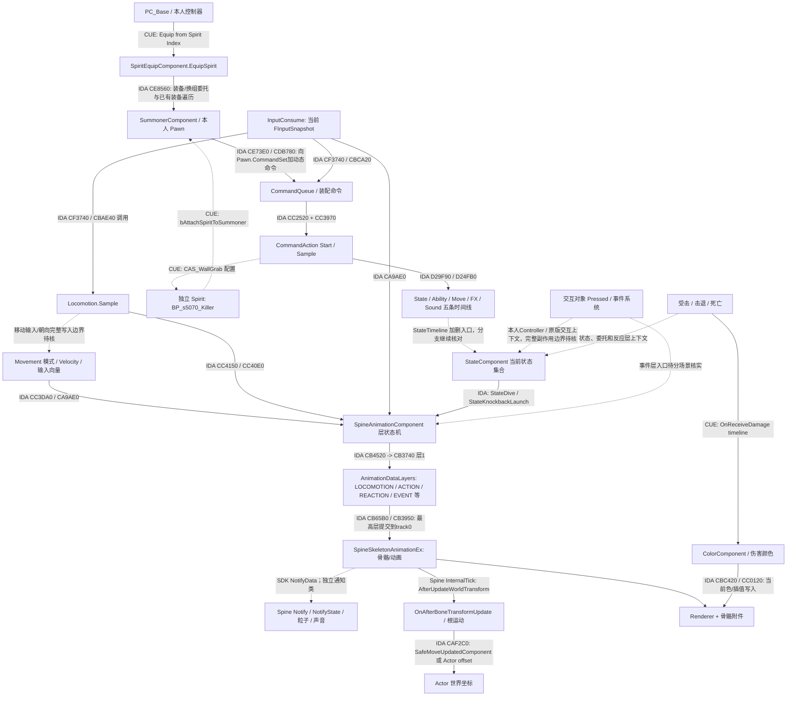
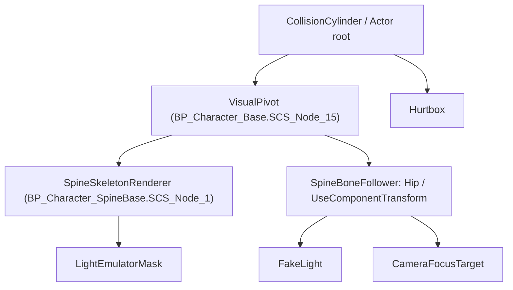
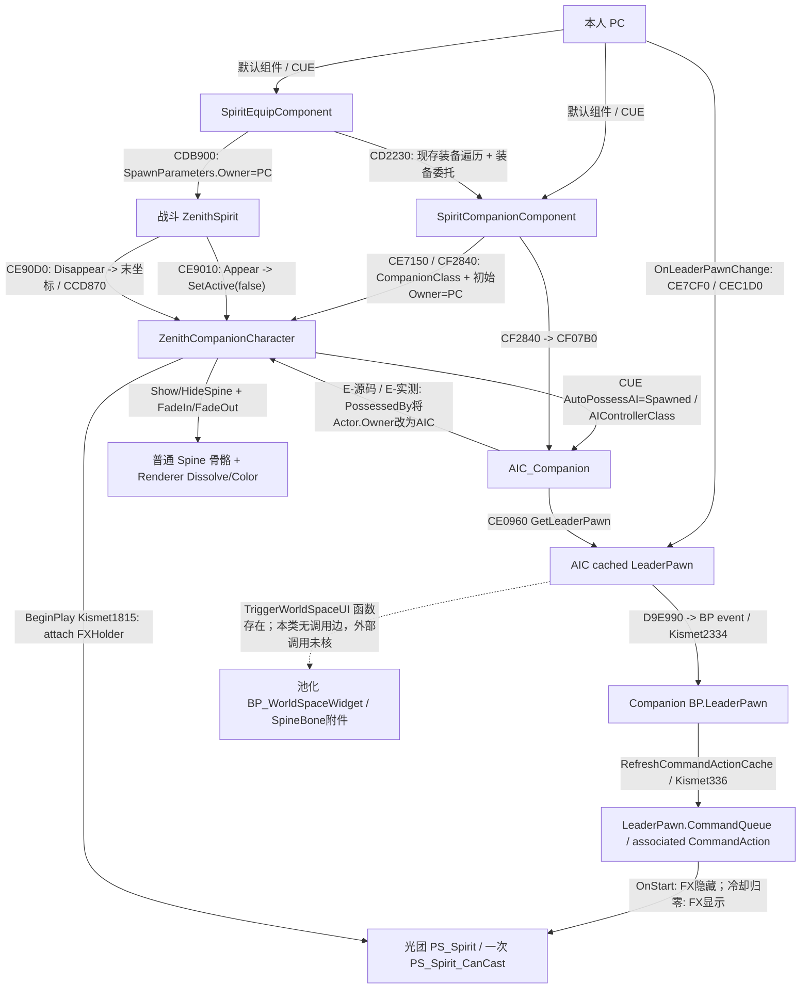

# 玩家同步原版链路图谱

ELMP v2，2026-11-04。调查范围为远程莉莉的构造、输入、命令、状态、召唤与表现；本轮只读 CUE4Parse/IDA/源码，没有向 Host/Client 输入，也没有把建议当作实测通过。

## 1. 证据与阅读约定

- `[E-IDA]`：本轮在 MCP `database=elmp` 上重新查询。镜像基址 `0x140000000`；下文写 RVA，VA = 基址 + RVA。工作库位于 `build/toolchain-smoke/ida/`，不是在正式游戏库上做修改。IDA 自动匹配的部分函数名明显错误，本文用注册表、调用参数与函数体认定职责，不采用误匹配名称。
- `[E-CUE]`：本轮读取游戏包的导出、SCS 模板和完整 Kismet。组件模板数据证明资产值，不自动证明已生成 Actor 的实际值。`scriptComplete=true` 的函数才用于排除该函数内不存在某次写入。
- `[E-SDK]`：`D:/CodeT/EnderLilies/Source/Zenith/Public` 以及插件头，证明成员、API 与枚举；重建 cpp 空实现不用于证明行为。SpinePlugin 中实际存在的 `InternalTick` 实现另列其具体路径。
- `[E-源码]`：当前 ELMP/引擎代码中的行为；当前代码的断点不是原版行为。
- `[推论/待实测]`：由证据提出的架构约束或候选修复，不表示已在隔离实例验收。

原始查询保存在 `build/toolchain-smoke/research-lily/`，这是被忽略的研究产物，不作为唯一知识来源；本文保留关键资产、函数与判断依据，以便重新查询。旧 `pipeline-facts.md` 和 `lily-presentation-graph.md` 的实测记录仍有历史价值，本文明确更正其过度推断，不擦除原始观察。

## 2. 原版主链与证据边界

图中实线表示本轮已通过 IDA/CUE/实际插件实现确认的相邻关系；虚线表示只确认了声明、资产引用或仍需追到原生实现的关系。虚线不能当作已经证明输入可自动恢复全部状态。

这里的结论是“原版表现依赖上游上下文”。它不等于“只发输入就足够”：装备、默认激活状态、当前命令与相位、非命令状态、交互目标、受击和晚加入前已存在的持续效果，都不包含在一帧输入中。

## 3. 输入、命令与 Actor tick

`[E-IDA]` `AZenithCharacter::Tick` RVA `CF3740` 本轮重新反编译，顺序为：

1. 原版 Actor tick 后检查 can-act 虚方法。
2. 对 `InputComponent`（角色 `+1344`）调用 `CEF310`；读取组件 `+224` 的 40 字节当前 `FInputSnapshot`。
3. 对 `CommandQueueComponent`（角色 `+1320`）调用 `CBCA20` 设置输入；can-act 时 `CC2520` 尝试依据 `CommandSet` 生成命令；然后 `CC3970` 推进现有命令。
4. 对 `LocomotionComponent`（角色 `+1392`）调用 `CBAE40`。

`[E-IDA]` `InputConsume` RVA `CEF310` 会依据 owner 有效/激活状态采集命令与轴，将 next snapshot 复制到 current，再清 next。输入快照并非一套无条件运行的动画指令。

`[E-源码]` 当前 `native/input/virtual_pad.cpp::consume` 在原版 `InputConsume` 返回后写当前 snapshot；它验证输入组件、Pawn、Controller 双向附身关系。因而附加一个虚拟 pad 后，如果 Actor tick 被关，pad 本身不会驱动 `CommandQueue` 或 `Locomotion`。该路径是已具备的输入入口，不是远程状态同步的充分协议。

`[E-IDA][E-SDK]` `CommandAction::Start` RVA `D29F90` 初始化五条时间线；`Sample` RVA `D24FB0` 推进它们。偏移与 `CommandAction.h` 对应：State `+88`、Ability `+128`、Move `+224`、FX `+288`、Sound `+328`。仅放行 `CommandQueueComponent` 的组件 tick 不替代 `AZenithCharacter::Tick` 中的 `UpdateCommands`。

## 4. Spine 状态机实际上读取什么

`[E-IDA]` `SpineAnimationComponent::TickComponent` RVA `CC1DD0` 由 `bUpdateAnimationsInTick`（`+800`）控制，执行 `CC3DA0`、`CC3AC0`，并在 `bCheckTurnTransitionsInTick`（`+802`）为真时执行 `CC4150`。

| 入口（RVA） | 本轮确认的输入 | 对同步的约束 |
|---|---|---|
| `CC3DA0` | Character `+912`；Movement 模式虚方法；Character.GetVelocity；`bForceUseGroundedLocomotion +801`、`bAllowVerticalLocomotionAnimation +804` | 根据地面/飞行/游泳/空中和速度选不同 locomotion；空中速度 Z 以 ±150 分 up/apex/fall。只写 Actor 坐标不等于恢复 Velocity/MovementMode。 |
| `CC40E0` / `CA9AE0` / `CA8ED0` | Locomotion `+936` 的根运动选项；InputComponent `+952` 当前轴；Movement `+928` 的 `GetLastInputVector`、`K2_GetInputVector`；Locomotion 可移动条件；Movement `+2864` 的 walk-mode 值 | 地面 idle/walk/run 不只依赖动画名或坐标变化。停 Movement tick 后，输入向量消费与 last-vector 更新是否仍正确必须核验。 |
| `CABF20` | StateComponent `+944` 查询 `StateDive`（类入口 `D89ED0`） | 游泳与潜水表现需要状态，不能从世界位置唯一决定。 |
| `CC3AC0` | `StateKnockbackLaunch`（类入口 `D8C2B0`）；Movement 三个 float `+964/+968/+972`、`CE1D00` 返回的 `+628/+632/+636`；Character Velocity | 击飞反应层会依据状态及多个速度/运动字段切换。两个字段组三维向量的正式成员名本轮尚未通过反射/布局确认，不把它们擅自命名。 |
| `CC4150` | Locomotion 上次朝向 `+237` 与当前朝向查询 `CABF60`；最高有效 AnimationDataLayer；Movement 模式；平滑的输入强度 `+1160` | 转身不是简单镜像 flip。恢复时必须保留历史朝向/过渡语义，不能每帧覆盖终态后期望它自行产生同样过渡。 |
| `CB4520` | locomotion 类型、是否使用根运动、`bRootMotionLocomotionIdleOnly +806`、既有层数据；`bSyncLocomotionTimings +812` | 调 `CB3740` 在 LOCOMOTION 层提交动画，并有既有动画/相位逻辑；不是直接向裸轨道 0 写名。 |

`[E-SDK]` 层枚举为 `NONE / LOCOMOTION / LOCOMOTION_TRANSITION / ACTION / KNOCKBACK_FALL / REACTION / DEATH / EVENT_LOCOMOTION / EVENT_KEEP / EVENT`。`PlayActionAnimation`、`PlayDamage`、`PlayDeath`、`PlayAnimation(..., Layer, ..., bUseRootMotion)` 是独立入口。不能由 track-0 的一个名字还原这些层与回调状态。

`[E-IDA]` **逻辑层不是 Spine 轨道号。** `CB3740 → CB3D10 → CBBB00` 构造定义并写 `AnimationDataLayers`；`CB65B0` 选择最高有效层；`CB3950` 将该层的 `AnimDefinitions` 用 SetAnimation/AddAnimation 提交到骨骼 **track0**，设置 StartTime，并绑定 OnTrackStarted/End/Complete。调用这条原生 PlayAnimation 路径会立即提交，不需要先开放 SpineAnimation 的自动 locomotion tick。因此“Host 呈现状态适配器 + 原生层入口”可与“让远端独立重新决定状态”分开实施；后者尚未被证明。隐藏的低优先级层、队列和回调仍不能只从最高层当前名恢复。

## 5. 组件坐标树与根运动是两件事

### 5.1 资产中的坐标树

`[E-CUE]` 本轮读取类链 `BP_p0000_Lily → BP_Character_Player_Base → BP_Character_SpineBase → BP_Character_Base → ZenithCharacter` 的 SCS 和 inherited templates：

- `BP_p0000_Lily` 的 `SpineSkeletonRenderer` 模板（export34）**显式序列化** `RelativeLocation=(0,0,-65)`；它指向 Player_Base 的 inherited template。Player_Base renderer export58 显式覆盖 `bUpdateColorData=true`；祖先 SpineBase renderer export33 有 `RelativeLocation.Z=-80`、scale `0.2`、yaw 约 `-180`。同一类和不同祖先的模板不能混用。
- Base `SCS_Node_15` export45 把 VisualPivot（模板 export37）挂到 CollisionCylinder。SpineBase `SCS_Node_1` export21 把 Renderer 挂到 VisualPivot。Lily `SCS_Node_5` export28 把 Hip follower（模板 export32）挂到 VisualPivot；Lily `SCS_Node_2` export26 把 Hurtbox 挂到 CollisionCylinder。
- `BP_Character_Base` 的 `ResetVisualPivotLocation` 及其 timeline 会写 `VisualPivot`；莉莉 crouch 蓝图改的是 `Hurtbox` 半高与 relative location。不能把所有 relative Z 都叫“脚底偏移”。
- 当前只传 Actor XYZ + renderer relative Z，无法覆盖 VisualPivot、Attachment 或骨骼附件的变化。位置验收必须同时读取 Actor world、VisualPivot relative/world、renderer relative/world 和附件 parent/bone，才可区分坐标空间错用、重复位移和模板初始化。

完整调用图检查覆盖 Lily 18、PlayerBase 108、SpineBase 37、Base 50、PC 202 条边，均无 diagnostics/分页截断；这五类蓝图中未见 renderer relative location/transform setter。此否定证据只限已检查的蓝图，不涵盖原生。Base `ResetVisualPivotLocation`（function export5）进入 ubergraph export0 的 entry521：BlendTime>0 时保存当前位置并运行归零 timeline；顶层 statementIndex858（内部调用偏移880）写 VisualPivot，非混合分支为738（内部760）。Lily crouch 的顶层 statementIndex308/435（内部330/457）写 Hurtbox。

### 5.2 `OnAfterBoneTransformUpdate` 实际移动世界位置

`[E-IDA]` 注册名 `OnAfterBoneTransformUpdate` → exec RVA `D878B0` → 实现 RVA `CAF2C0`。本轮完整函数中没有把 renderer relative Z 设为 `-65` 的代码。它做的是：

1. 清空 last root-motion move；若内部根运动启用标志 `SpineAnimation +1072` 为零则结束。
2. 从骨骼动画组件 `+480` 读取根运动，按 renderer ComponentToWorld 的旋转/缩放变换，再乘 `SpineAnimation.RootMotionFactor`（`+808/0x328`）。
3. 有 Movement 时调用其移动虚方法或 `UMovementComponent::SafeMoveUpdatedComponent`（调用点 VA `0x140CAF638`、`0x140CAF705`）；无 Movement 时仍有 Actor offset 分支（VA `0x140CAF7D6/810/848`）。
4. 写 last root-motion move 与相关采样值；部分分支还写 Movement 的向量字段。

`[E-IDA]` BeginPlay RVA `C9CC70` 缓存 Anim/Renderer/Character/Movement/Locomotion/State/Input 组件，并把该函数绑定到骨骼动画更新委托。EndPlay RVA `CA4A70` 移除委托。

`[E-SDK，实际插件实现]` `D:/CodeT/EnderLilies/Plugins/SpinePlugin/Source/SpinePlugin/Private/SpineSkeletonAnimationComponent.cpp::InternalTick` 在动画 `state.update/apply`、骨骼 `updateWorldTransform` 后广播 `AfterUpdateWorldTransform`。当前 freeze 仍让 SpineSkeletonAnimationEx tick；**仅停 SpineAnimation 自身 tick 不解除这个绑定，仅停 Movement tick也不阻止回调直接调用移动函数。**

`[推论/待实测]` 可用的独立闸门候选是按远程角色将反射属性 `RootMotionFactor=0`：从该函数体可知这一路的位移向量将归零，又不必关闭动画组件。它会改变 `GetLastRootMotionMove` 等下游读数，须检查命令依赖并做真实实例验证。`bApplyRootMotionLocomotion=false` 只控制 locomotion 动画的根运动选择，不能证明 Action/Event 根运动也被关闭。MoveTimeline、Locomotion.Sample、交互或蓝图位移另有入口，不能由这一个闸门声称“所有本地位移都被禁止”。

## 6. 装备、召唤与墙抓狼

`[E-CUE]` `DATA_CommandSet_p0000_Lily` 的固定命令集是移动/工具命令，并不包含装备攻击动作。`PC_Base::Equip from Spirit Index` 的完整 Kismet 调本 PC 的 `SpiritEquipComponent.EquipSpirit(SummonSet, Inventory.GetItemAtIndex 返回的行名, CommandInputType)`。因此本人控制器、装备组、装配位、等级/参数上下文是需要还原的输入，不是换一张莉莉皮肤即可取得。

`[E-CUE]` PC 默认子对象 SpiritEquip export51、SpiritCompanion export50；Pawn 的 Summoner 位于 PlayerBase `SCS_Node_6` export51 → `Summoner_GEN_VARIABLE` export62，不能把 Summoner 误放到控制器上。PC `Equip from Spirit Index` function export32 的调用位于顶层 statementIndex226（内部偏移248），完整8 statements。`EquipDefaultSpirits` 的存在不证明 spawn 时自动调用它。

`[E-IDA][E-SDK]` 原生装配边已补查：

1. Summoner BeginPlay RVA `CD3120` 缓存 Pawn，并绑定其 OnPossessed/OnUnpossessed；已有有效控制器时会进入 OnPossessed。
2. OnPossessed RVA `CE8560` 从 Pawn 的 Controller 获取 SpiritEquipComponent，缓存 weak handle `+184`；绑定装备/卸装/换组委托。随后遍历装备组件现有 `SummonSets`，对每个槽调用 `CE73E0`。这解释了附身后如何恢复已经存在的装备上下文，不要求重新点一次装备 UI。
3. OnEquipSpirit RVA `CE73E0` 检查是否已登记、是否当前召唤组；当前组调用 `CDB780`。
4. `CDB780` 从 `FSpiritData.CommandSettingsData`（`+312`）复制设置，填 SpiritID 和 CommandInputType（`+320`），向 Pawn.CommandSet（角色 `+1552`）经 `CFFD30` 添加动态命令，并缓存返回索引。`CFFD30` 的本轮函数体确实执行按优先级插入命令设置和分配索引。

`SpiritEquipComponent` 还持有 `SpiritForSpiritClasses` 并提供 `ReequipSpirits`；本轮后续补查已确认 EquipSpirit 生成战斗 Spirit 时的 Actor.Owner 是组件所属的 PC（§11.2）。运行中 summoner 赋值、复用与附着生命周期仍未全核实。不能把已确认的“装入动态命令”升级成“已证明任意晚加入能恢复进行中的 Spirit”。

墙抓案例 `[E-CUE]`：

- `BP_WallGrabComponent` 的 `WallGrabCommandActionClass = CAS_WallGrab_C`。
- `CAS_WallGrab` 继承 `CASummon_Base`；`SpiritClass = BP_s5070_Killer_C`、`SpiritCommandList = CA_s5070_WallGrab_C`、`bAttachSpiritToSummoner=true`，`SettingsSummon.LocationOffset=(50,0,-4)`。
- 该 CAS 的初始化从 Pawn 取得 Controller，再取得 `SpiritEquipComponent`。莉莉本身的 `wall_grab_start/loop` 与 IgnoreGravity/LockMove/WallGrab 状态不等于已经构造并附着狼 Actor。
- `DT_Items_Spirits.s5070` 的 CompanionClass 是 `BP_Companion_s5070`，不同于动作所用的 `BP_s5070_Killer`。不要把跟随同伴、技能精灵和莉莉自身动画合并成一个实体。

装备等级也会改变命令类：`DT_Spirit_s5070` 1–3级 → `CD_s5070_Lv1`、4–5级 → Lv2、6级 → Lv3，再分别引用 `CACS_s5070_Combo`、`..._LV2`、`..._LV3`。基本 combo 还依 Grounded/Airborne/Up/Down/Horizontal 选择分支；等级不是单纯伤害倍率。

`[推论/待实测]` 晚加入时恢复“已处于墙抓”至少要回答：谁在墙抓、当前状态/命令与相位是什么、对应 Spirit 是否已存在、它的 summoner/owner 与 attachment 是谁、是否已触发一次性开始事件。只补一条 `wall_grab_loop` 不能回答这些问题；简单重发起始输入也未必能满足墙面/状态/装备前置条件。

## 7. Notify、颜色与交互尚不能归并为单一事件流

`[E-CUE]` Player_Base 的 `SetSpineData`（function export16）先载 Notify/Atlas/Skeleton，再于顶层 statementIndex419 调 `ReplaceSpineData`，478 调 `RequestRefreshPlayingAnimation`。完整 Kismet 中没有 renderer relative location 写入。Lily 覆盖函数 export5 调父函数后设置 FakeLight 材质。当前 `core/skin.cpp::apply` 自行 Replace、setup pose、ForceTick、idle，不等于原版的刷新播放层路径。

不能直接调用一切原版皮肤入口便假定它使用远端身份：PlayerBase `FindSpineDataForLevel`（export15）statementIndex82 明确调 `GetZenithPlayerController(this,0)`，167 取其 `ParameterPlayerComponent.GetSkinLevel(false)`。远端皮肤必须使用该远端基线选择的数据，不能隐式读本机 player index0。SpineBase 除三种 Spine 主组件还有 SpineBone、LightEmulator/Mask；PlayerBase 有 BP_IKBones、RightArm BoneDriver，Lily 有 Hip follower/FakeLight。恢复链不能只列 renderer。

`[E-SDK]` SpineExtension 有独立的 `NotifyData`、`SpineAnimNotify_PlayParticleEffect`、`SpineAnimNotifyState_TimedParticleEffect`、PlaySound 与 NotifyState 生命周期声明。旧 `pipeline-facts.md` 已记录 SpawnFX 没覆盖召唤连段粒子的实测；本轮尚未逐个重核这些原生 notify 分发入口，所以图上保留虚线。不能宣称抓 `SpawnFX` 就覆盖所有表现，也不能宣称只放开 Spine tick 后所有通知都必然正确且只执行一次。

`[E-CUE]` 颜色的蓝图来源已确认：`BP_Character_Base` 的 Knockback.OnKnockbackStart 绑定调用 `ColorComponent.ClearColor(0)`；Player_Base 的 HP.OnReceiveDamage 驱动 `Curve_PlayerDamageColor` timeline，Update/Finished 调 `SetColor(curveColor,0)`。ColorComponent 模板自身没有显式 color 属性。

`[E-IDA]` ColorComponent 的原生行为已补查：

- 构造 RVA `C919A0` 初始化 default `+216`、current `+232` 为白 `(1,1,1,1)`；插值起终点 `+248/+264` 为黑 `(0,0,0,1)`，duration/elapsed `+280/+284` 为0。PrimaryComponentTick 标志 `+58 & 0xF9 | 2` 是可 tick、初始禁 tick；对应位语义由引擎 `EngineBaseTypes.h::FTickFunction` 确认。
- BeginPlay RVA `C99B00` 缓存 Spine renderer（`+208`），存在时把 renderer.Color（`+1716`）同时复制到 default/current。因此原版运行初值还取决于 renderer，当作恒定白色也不准确。
- `SetColor` RVA `CBC380`：LerpTime>0 保存当前色/目标色、重置插值时间并启 tick；否则立即调用写色函数并禁 tick。`ClearColor` RVA `C9E550` 把 default 交给 SetColor；GetCurrentColor RVA `CA8C00` 返回 `+232`。这里 GetCurrentColor 被 IDA 错命名成 UMediaTexture 方法，认定依据是 UColorComponent 注册表与 vtable。
- 写色 RVA `CBC420` 更新材质参数、renderer.Color 与 current；tick RVA `CC0120` 直接根据 duration/elapsed 在起终点间插值并调用写色，完成后自行禁 tick。

`[推论/待实测]` 当前 Simulated 分支强开“所有非 Movement 组件”会把本来未请求插值的 ColorComponent 也打开；新对象的黑色插值端点会被 tick 写到 renderer。这是具体可复现候选机制，不是普通的“模板丢了”。尚不能据此追溯认定旧莉莉黑色案例只有这一原因（其当时模式/调用时序需另证）。周期 ClearColor 会覆盖原版伤害闪色，也不能替代正确的 tick 所有权。

`[E-源码]` 当前 `party/interact.cpp::press` 依赖交互对象的 `GetInteractingController()==本人PC`，再分普通按键与上下方向类型，权限通过才调已预检的 Pressed 入口。当前 `LilyRow` 没有交互对象/阶段、State 集合或事件层状态。交互相关原版状态、动画与 Host 权威副作用的边界仍需逐类核实；直接在客人重放完整交互入口不属于已批准方案。

## 8. 当前远程莉莉的实际断链

以下保留本轮 **ADR0008 实施前** 检查到的源码断链，便于解释旧现象；不是对实施后代码的验收结论。2026-11-04 同轮已开始以 `presentation_policy`、`presentation`、`visual_state` 替换这些分支；新增 Companion 调查及其独立缺口见 §11。

| 文件/入口 | 当前行为 | 丢失或冲突 |
|---|---|---|
| `net/snapshot.h::LilyRow`、`coop/host.cpp::lily_row` | 位置、面向、vitals、skin/map、renderer zoff、track-0 名/时间/loop | 没有 InputSnapshot、Movement/Locomotion/State、完整层、装备上下文、VisualPivot/attachment。Host `t` 发送存在不代表 Client 已用它。 |
| `coop/client.cpp::present_lilies` | `core::spawn::spawn` 创建 PC/Pawn，只给位置和 skin，随后 Presentation freeze | 此路径没有恢复远端档案/装备，关闭 Actor tick 后输入→命令→Locomotion 无法推进。 |
| `coop/client.cpp::freeze` | Movement tick 关闭；Presentation 只放行部分组件；Actor tick 只有 simulated 才放行 | 不能等同“仅禁止权威结算”，它同时切断表现上游。根运动委托又可能继续运行。 |
| `freeze` 的 `g_anim_local` 条件 | `(g_anim_local && cls==SpineAnimationComponent)` 没有限制 Mode | 敌人实验开关会影响后续生成的 Presentation 莉莉，造成原版状态机与 snapshot SetAnimation 两个写者。 |
| `present_lilies` 动画分支 | 仅动画名变化才 SetAnimation(track0) | 未使用 `row.t`；同名重启、loop 改变、相位/层/transition 与回调上下文丢失。 |
| `present_lilies` 位置/皮肤/颜色 | Actor teleport、单独 renderer_z、spawn 时 skin、周期 normalize/ClearColor | 未恢复坐标树其他部分；后续 skin 变化不应用；周期颜色/模板改写可能覆盖原版正在运行的表现。 |
| `coop/host.cpp::send_events` Cmd | 仅 Enemy/Dyn 通过 | Lily/Spirit 的命令沿未由这条通道送达。不能用敌人试验成功推断远程玩家已跑原版链。 |
| `coop/client.cpp` FX 处理 | `local_mode && 非persistent` 时跳过 replay | 这是全局选择；远程 Lily 上游仍冻结时，丢弃 fallback 并不会自动产生本地效果。 |

`[推论]` 现象最直接的解释是“创建出外观类似的 Pawn 后，只复制了原版系统的一部分输出，而冻结了生成其他输出所需的状态”。具体哪次错误坐标来自未恢复的 VisualPivot、重复 root motion、模板未初始化或 attachment 错误，仍须真实数据对账，不能仅凭静态代码选定唯一原因。

## 9. 架构调整候选与验收

**本轮证据不支持直接全面解冻远程 Lily Actor tick。** 现有 guard 并未证明涵盖全部效果结算、死亡、交互副作用；Spirit 生成/拥有者与基线恢复仍有未闭合边。当前可独立验收的最小改动边界是 Host 权威的远端呈现适配器：撤去互相泄漏的全局 sim/anim/fx 实验，单一表现写者、正确模板/皮肤初始化、相位/同名重启/loop、分开的坐标空间及已证根运动闸门。若改用原生 `PlayAnimation(..., Layer, ...)`，必须从 Host 采集真实层和所需参数，不能从 track0 名称猜成 ACTION，也不能声称只同步最高层就恢复了所有隐藏层/事件语义。

这个边界能修已证的呈现冲突与错误相位，却不自动完成召唤、交互、晚加入或全部 Notify。迁移期仍需把它们作为显式未覆盖项，保留已正确工作的 Host 权威结果通道；按角色/输出逐项移交唯一写者，不能在 Lily 上游仍断开时全局禁掉 FX fallback。

先保存职责边界，再做实现减法：

1. **构造/基线层**：恢复本人 PC↔Pawn、装备/能力/参数、激活状态、地图代次；明确已有 Spirit 和持续效果的归属。晚加入基线必须能代表现在，不能依赖接收方看过过去全部输入。
2. **运行状态层**：分别处理输入沿、Host 已接受的动作/阶段、非命令状态、交互与受击状态。尚未验证“输入与状态最终相同”，不能预先删掉必要权威基线/纠偏。
3. **原版表现层**：保持 State/Locomotion/Spine 层、Notify、颜色、附件的原版生成关系；为同一输出选择唯一写者。迁移完成后删除名字变化才写 track0、周期 normalize、特殊 zoff 补丁等与原版写者竞争的逻辑；删除前先证明等价场景均被覆盖。
4. **位移与结算边界**：明确禁止自主 Movement、RootMotion、MoveTimeline/交互位移的每个入口；Host 位置权威不允许被一条未登记原版回调二次偏移。效果结算/存档/交互世界副作用与纯表现不能用停整个 Actor tick 混为一谈；无法区分的分支 fail closed。
5. **按角色选择策略**：本机受控 P1、远程 Lily、敌人、Spirit 不共享未经限定的实验布尔开关；切换模式时不能遗留另一套动画/效果写者。

真实隔离实例验收建议（本文件尚未执行）：

| 场景 | 必须同时对账的证据 |
|---|---|
| 干净 spawn / 晚加入 / 重连 / 过图 / Pawn 重生 | PC/Pawn/组件句柄与代次、装备组和动作、默认 State、Actor 与组件坐标树、初始化失败时无半成品 |
| 待机→走跑→转身→跳跃/落地→游泳/潜水 | 输入序号、当前命令、State、MovementMode、Velocity、pending/last input vector、Locomotion facing/previous facing、Spine 层/名/相位 |
| 墙抓与离墙、召唤攻击、换组/换装 | Lily + Spirit 两个实体的 owner/summoner/attachment、命令/阶段、独立动画层、粒子/声音出现与结束各一次 |
| 受击/击飞/死亡/复活 | StateKnockbackLaunch/Dead、反应层、颜色 timeline、HP 结算仅 Host、客户端无额外伤害/掉落/存档 |
| 坐椅/祈祷/梯子/事件 | 交互对象与本人 Controller、事件阶段/层、客人纯表现与 Host 世界副作用分别计数 |
| Movement tick off + Spine tick on 的候选 | 分别比较 RootMotionFactor 正常/0；每帧 Actor 与 renderer/VisualPivot；相关 native detour 计数，不能用 UFunction hook 没响证明原生没执行 |

窗口最小化时不恢复窗口，不截图空 PNG；用后台状态/组件与原生计数证据。截图只能补充位置/外观验证，不能代替状态/所有权/副作用计数。

## 10. 明确更正旧知识与保留未知

- 更正 `lily-presentation-graph.md` §7：`-65` 已在莉莉 renderer 资产模板中存在；`OnAfterBoneTransformUpdate` 不是负责写这个 relative Z 的函数，而是根运动应用。旧“CDO 为 0，所以一定每帧由该回调算出 -65”的因果链不成立。
- 更正“只关 Movement tick 即没有自主位移”：根运动委托可以直接移动；其他命令/蓝图移动入口也需分别核实。
- 更正“墙抓只有莉莉 track0”：CAS_WallGrab 明确引用独立的 Killer Spirit 和 attachment/offset。
- 收窄 `pipeline-facts.md` 开头“所有表现都从统一输入入口推导”的表述：Tick 是重要入口，但装备/possess、交互、受击、事件与初始化拥有额外入口。该文末尾本来也把输入复制充分性列为待证，不能在架构里升级成已证。
- Color 原生 init/插值、Summoner 装备动作注入、Spirit/Companion 的 SpawnParameters.Owner 与 Companion 的 LeaderPawn 链已补为本轮 IDA 证据。**SpawnParameters.Owner 不等于附身后的 Actor.Owner**，本轮首版在此处判断错误，已由 §11.7 的实机/引擎证据更正。旧黑色案例的具体调用时序、战斗 Spirit 运行中 summoner/附着/复用、Notify 全分发、State 的基线恢复入口、MoveTimeline/交互位移与结算拆分仍有缺口。

## 11. 跟随同伴不是战斗 Spirit：身份、归属与持续表现

本节为 ELMP v2，2026-11-04 的追加调查。只读 CUE4Parse、IDA、重建头与当前源码；**尚未对 Companion 同步做真实实例验收**。下面的方案是供后续需求/架构修订的实施建议，不表示代码已覆盖。

### 11.1 三种对象必须分别建模

`[E-CUE][E-SDK]` `/Game/_Zenith/Core/Pawns/BP_CompanionFX_Base.BP_CompanionFX_Base_C` export31 的父类为 `/Script/Zenith.ZenithCompanionCharacter`；后者继承 `ACharacter`，不继承 `ZenithSpirit`。`BP_Companion_s5070` 继承此 Base；其普通 `SpineSkeletonAnimationComponent`（export11）与战斗 `BP_s5070_Killer` 的 `SpineSkeletonAnimationExComponent` 不同，二者共享 SpinePlugin 动画基类。

| 对象 | 原版职责与数据来源 | 同步识别方式 |
|---|---|---|
| Lily Pawn | 玩家命令、状态与自身骨骼；本人 PC 持有装备 | seat / Pawn 代次 |
| `ZenithSpirit` | 装备技能实际召唤出来的战斗 Actor；如 `BP_s5070_Killer` | 独立 Actor 身份；Actor.Owner 与 GetSummoner 分别采样 |
| `ZenithCompanionCharacter` | 未出招时跟随的光团/同伴骨骼，技能冷却提示及事件同伴；如 `BP_Companion_s5070` | 独立 Actor 身份；运行时 Actor.Owner 与 Pawn.Controller 都是同伴 AIC；AIC.GetLeaderPawn().Controller 才是玩家 PC |

`DT_Items_Spirits.s5070.CompanionClass` 与 `CAS_WallGrab.SpiritClass` 分别指定后两者。装备系统让两者协作，不会让它们成为同一个 Actor。仅枚举 `ZenithSpirit` 会漏掉跟随对象，即使战斗 Spirit 与 Lily 的多轨动画同步正确，也不能声称完整远程玩家呈现已经完成。

### 11.2 原生构造、owner 与 LeaderPawn 已闭合的部分

| 入口 / RVA | 本轮原生证据 |
|---|---|
| `SpiritEquipComponent::EquipSpirit`，exec `D8F410` → 实现 `CDB900` | 注册表 VA `14349B360` 将 `EquipSpirit` 连到该 exec。实现中 `CDBDC4` 初始化 SpawnParameters，`CDBDD0–CDBDF4` 将组件 owner（`+160`）写入参数 `Owner`，`CDBE4F` SpawnActor；生成对象写入 `FSpiritData.ZenithSpirit` 并经装备委托发布。玩家 PC 的 SpiritEquip 默认子对象见 §6。这里证明 **装备生成的战斗 Spirit.Actor.Owner=PC**，不证明其运行中 summoner 总等于 owner。 |
| `SpiritCompanionComponent::BeginPlay`，`CD2230` | 从自身 owner 取得 SpiritEquip，weak 缓存在 `+208`；绑定装备/卸装/换组委托；遍历已经存在的 SummonSets，对每个现存槽调 `CE7150`。因此组件初始化能恢复已有装备对应同伴，不仅处理之后的装备沿。 |
| `SpiritCompanionComponent::OnEquipSpirit`，`CE7150` | 绑定战斗 Spirit 的 Appear/Disappear 委托；以 `FItemSpiritData.CompanionClass` 调 `CF2840`；给 Companion 写 associated input（`+1366`）、CommandSettings weak（`+1368`）及 ItemSpiritData（`+1376`），再调 `OnSetAssociatedSpiritData`。每组 map 以对应战斗 Spirit 为 key，值为 CompanionData。 |
| Companion spawn helper，`CF2840` | owner 经 AController 类型检查；读取 owner 当前 Pawn（`+592`）作为初始 transform 来源。`CF290A` 初始化 SpawnParameters，`CF2916` 写 `Owner=组件 owner`，`CF29B2` SpawnActor；取得新 Companion 的 Controller（`+600`），`CF2A23` 调其 SetLeaderController(owner)。这里只证明 **生成参数 Owner=Leader PC**；AutoPossess 使运行中 Owner 变成 AIC，详见 §11.7。 |
| `AIC_Companion::SetLeaderController`，exec `D9BC60` → `CF07B0` | LeaderController 存于 AIC weak `+864`；设置黑板并绑定 PC 的 OnLeaderPawnChange 委托（PC `+1480`）；末尾调用 `CE7CF0`。 |
| `OnLeaderPawnChange`，`CE7CF0` → `CEC1D0` | `CEC230` 将 Leader PC 当前 Pawn 写入 AIC weak `+872`，同伴自身 Pawn weak 在 `+896`。有首次跟随/定位处理并可直接 SetActorLocation。`CE7D48` 将该 LeaderPawn 传入 `D9E990` 蓝图事件封装；该封装使用的 FName 由 `60FBC0` 明确初始化为 `OnLeaderPawnChanged`。 |
| `AIC_Companion::GetLeaderPawn`，exec `D9A7F0` → `CE0960` | 只在 weak `+872` 有效时返回 LeaderPawn。注册表 VA `1434A90B0`；这是运行时归属主链入口，再取 LeaderPawn.Controller 找玩家 PC，不必把该 raw offset 写入 ELMP。 |
| `ZenithSpirit::GetSummoner`，exec `DA1E10` → `CE2980` | 返回战斗 Spirit weak `+1416` 的 Pawn，失效返回空。注册表 VA `1434B0400`。这是另一条明确的 Pawn 引用；其赋值和召唤重绑时序本节没有追完。 |

`[E-源码]` `C:/Code2/UnrealEngine-4.26.2-release/Engine/Source/Runtime/Engine/Classes/Engine/World.h::FActorSpawnParameters` 的字段顺序为 Name、Template、Owner，Owner 位于该 Win64 参数结构 `+16`；以上 SpawnActor owner 判断依据参数布局，不是依据 IDA 错误自动函数名。`[E-SDK]` `SpiritData.h`、`CompanionData.h` 分别声明战斗 Spirit 与 CompanionController/Companion weak 成员，支持输出结构身份认定。

### 11.3 同伴生命周期与表现输出

`[E-IDA]` 战斗 Spirit 出现时，`OnSpiritAppear` RVA `CE9010` 在当前组 Companion map 找到对应 AIC，关其 Actor tick，并对同伴调 SetActive(false)。战斗 Spirit 消失时，`CE90D0` 取 Spirit 最后世界坐标，移动对应同伴，再调 `CCD870`；后者清跟随状态、启 AIC tick，并 SetActive(true)。`SetActive` RVA `CEFA60` 同时写活跃状态、控制 Actor tick、隐藏并关骨骼/renderer tick，分派 OnActivate/OnDeactivate。**仅用 Actor.bHidden 不能表达这个状态机**，也不应在 Client 调 SetActive 后假定没有重新开启自主逻辑。

`[E-IDA]` `OnUnequipSpirit` RVA `CEA0D0` 解绑战斗 Spirit 委托，移除该组的 CompanionData，再调 `CD7930`；后者广播销毁事件并分别 Destroy 同伴 AIC 与 Companion Pawn。额外同伴入口 `RequestExtraCompanion` exec `D90790` → `CEE000` 先在当前组和 ExtraCompanions 查相同 soft class；未找到才走同一 `CF2840` 构造并保存到 ExtraCompanions。故 registry 按 **实际 Actor** 枚举能够同时涵盖装备同伴和额外同伴，不能只按装备三槽生成远端副本，也不能认为每次 RequestExtraCompanion 都产生新身份。

`[E-CUE]` `BP_CompanionFX_Base` 完整 Kismet（Ubergraph111 statements，`scriptComplete=true`）：

- BeginPlay 入口 Kismet2227，经父入口到1815，用 `SpawnEmitterAttached` 创建 `/Game/_Zenith/Art/Effects/GamePlay/PS_Spirit.PS_Spirit`，附着到 `FXHolder`，保存为 `FX`（1911）；这个持续光团不是战斗 Spirit 的 `SpawnFX` 事件。骨骼组件另有 idle Layer1，以及可选 meat_action 附加 track。
- `OnLeaderPawnChanged` 在2334 保存 `BP.LeaderPawn`；`RefreshCommandActionCache` 先解绑旧动作，再从 LeaderPawn 取得 CommandQueue，以 associated CommandSettings 的 CommandActionType 调 `GetOrCreateCommandAction`（336）并绑定启动委托。只有重建普通骨骼而没有 associated 装备上下文，不会自动恢复这条冷却链。
- OnAssociatedCommandStart 检查 RecastTime>0 后隐藏 FX（664）并启 CheckCommandCooldown；ReceiveTick 检查 GetCooldownTime（738）归零后重开 FX（847）、生成一次 `PS_Spirit_CanCast`（862）并设 Color 参数，然后 TeleportToAssociatedLocation。
- `TeleportToAssociatedLocation` 从自身 AIC.GetLeaderPawn 取玩家位置，加 `LeaderOffsetForAssociatedInput`，在491直接 `K2_SetActorLocation`。这再次证明只关 CharacterMovement 不能阻止同伴自行位移。
- OnShowSpine 停光团、播 idle、开始 FadeIn；OnHideSpine 激活光团、停止 FadeIn、开始 FadeOut。timeline Update 在425/495调 `SetDissolveValue`；该函数同时写 renderer 材质 scalar `DissolveValue` 和 renderer.Color（RGB 为 clamp(1-dissolve)，A=1）。Renderer.Hidden、tick、材质 dissolve、光团 Active/Visible 是不同状态。
- EndPlay 对 `FX` 做 Deactivate/DestroyComponent 并置空。生成、隐藏、淡出、销毁不能都简化成“这一帧没有动画行”。
- `TriggerWorldSpaceUI` 函数确实取得池化 `BP_WorldSpaceWidget`、生成 `WBP_WorldSpace_SummonCastAvailable`，并 FollowTarget 到 LeaderPawn.SpineBone 的附件（骨名枚举0x3C）与输入槽偏移。但本轮 `get_kismet_call_graph` 的126条本类边中没有调用它的边；尚未调查外部/原生调用，不能声称普通冷却循环必然触发这段 UI。

### 11.4 可实施的身份、采样与呈现方案（建议，待架构批准）

建议新增 `registry::Kind::Companion`，原生 class path `/Script/Zenith.ZenithCompanionCharacter`；沿用 registry 的对象句柄/世界失效规则，并增加独立快照 section `cp`、`RefKind::Companion`。复用 `Pose` 与 `Visual` 的数据实现是合理的，复用战斗 Spirit 的 key 命名空间与“仅可见行”语义则会把两种生命周期混在一起。

1. **身份**：Host 为每个实际 `ObjHandle(index,serial)` 分配 cp 内单调、不回绕的 u16 id；row 显式传 seat，完整身份为 `(world/session epoch, RefKind::Companion, id)`。同伴活跃/隐藏、技能施放和当前组切换不重分 id；Actor 销毁后该 epoch 内不复用 id。所有者变化时移除旧身份并分配新身份。容量和 id 耗尽必须有明确拒绝/审计，不能让 u8 自增回绕。可先取 cp64 为工程上限候选，但这不是已证游戏对象上限；超容量必须报告 baseline 不完整并 fail closed，不能静默漏对象后仍报告同步通过。
2. **归属（实机修正）**：只读取得 Companion.Controller，要求其 AIC_Companion 类成立，再调 `GetLeaderPawn`，以该 Pawn.Controller 对应 P1 或 `party` PC 找 seat。Actor.Owner 通常也是该 AIC；仅当其直接对应有效玩家 PC 时才作为过渡互证，不能在它不匹配 seat 时提前丢对象。两条有效玩家链矛盾时不猜 seat、计数并延迟呈现；LeaderPawn 空值时不猜 P1，保留既有 ID 待重试。缓存的归属是 LeaderPawn.Controller 的 weak handle；已确认玩家 PC 变化才重分 ID，AIC 变化/重附身本身不等于玩家归属变化。
3. **基线**：枚举所有已归属同伴，包含暂时 inactive/隐藏者与 ExtraCompanions；传 class、seat、世界完整 transform、active/state、renderer/FX 的 Hidden/Visible、骨骼 Pose/Color、FXHolder 相对 transform、当前 dissolve 与光团 Active/Visible/Color。`GetAssociatedSpiritData` 可提供输入槽及 ItemSpiritData 供审计/初始化，但不要把未知布局的大结构直接裸拷贝进协议。Host 当前材质 scalar 的只读采样入口还需验证；不能仅凭 Renderer.Color 逆算任意类 dissolve。
4. **统一呈现者**：Client 建同伴副本后先以固定 policy 关闭 Actor、Movement、AIC 及所有 AIC 组件逻辑；骨骼可继续更新但 `RootMotionFactor=0`。按 Host 当前骨骼、renderer/material 和 FX 状态直接恢复；不通过 `SetLeaderController`、`SetActive`、`OnLeaderPawnChanged` 重放原版行为，因为已证这些入口会启动 AI、定位、装备动作绑定等额外逻辑。若 BeginPlay 已创建 PS_Spirit，采纳该确定 FX 组件作为唯一持续光团，禁止同时由 fallback 重建第二份。其余一次性 `CanCast` 需独立事件序号/去重，不能让每帧 active=true 都重触发；晚加入基线只恢复持续状态，不补播已发生的一次事件。
5. **接到现有基础模块**：本轮新 `presentation.cpp` 通过 `/Script/SpinePlugin.SpineSkeletonAnimationComponent` 基类查找，已经能共用普通与 Ex 的多轨采样。当前 `presentation_policy.cpp` whitelist 与 release skeleton 记录仅含 `SpineSkeletonAnimationExComponent`，接入 Companion 前必须把普通基类骨骼加入同等策略，确保 release 仍先关 tick 再恢复根运动。当前 `visual_state` 已按 renderer 组件类型查找，不依赖其在 Lily 上叫 `SpineSkeletonRenderer`、在 Companion 上叫 `SkeletonComponent` 的差别；VisualPivot 则按可选属性处理，无此组件时 valid bit 保持未置位，不能用零 transform 补齐。现有 Visual 还没有 hidden/dissolve/FXHolder/FX 状态，需要明确增加这些输出。
6. **对象消失与网络恢复**：活跃/隐藏变化更新状态，不删除 row；真正 Destroy、离开本世界或 owner seat 离开才由明确 removal 清理副本和附属 FX。换图/重连按 epoch 全部失效；丢包沿用已确认 delta base，不以单包 section 缺席当删除。若远程 Lily 的 PC 基线以后会让原版 SpiritCompanionComponent 自建同伴，必须明确采用还是抑制该本地生成路径，避免与 cp spawn 产生双份；不能直接删除本机 P1 的合法同伴。

`[E-源码]` 调查时 `host.cpp::write_spirits` 仅枚举 `Kind::Spirit`，按 bHidden 丢行，key 为 `seat<<8|uint8 perSeatIndex`，sp容量32。把 Companion 直接塞进这个循环而保持相同分配器，既漏普通骨骼/FX状态，也增加索引回绕及两个类型冲突风险。独立 cp 的方案不要求改战斗 Spirit 当前 key，但原有长期装备重建导致的 u8 wrap 仍应独立修复。

### 11.5 下一轮真实验收与尚未核实项

完整远程玩家同步应包括跟随同伴；“已记录为未覆盖”不能作为该功能最终验收结论。实施前仍需在隔离实例完成一次只读库存：逐个列 Actor class/handle、Owner PC、AIC、GetLeaderPawn、associated input、IsActive、状态、骨骼类型、renderer/FX 当前字段，确认实际反射入口和全部零值/空值含义。

| 场景 | 必须对账 |
|---|---|
| Host 已有装备/额外同伴后 Client 晚加入 | 按 seat/class/独立 id 对账对象数量；既有光团与正在显示的骨骼各只一份；inactive 对象不会错误显示 |
| 同一技能召唤→收回→冷却完成 | Spirit 与 Companion 是两个 id；光团/骨骼转换、Host 最后位置与 CanCast 一次事件分别对应；Client 无自主 AI/位移 |
| 换组、卸装、重装、RequestExtraCompanion 重复请求 | 隐藏/销毁/复用分别计数；对象句柄及 serial 正确，不因同 class 合并两个不同同伴，也不因重复请求产生副本 |
| Pawn 死亡/重生、过图、断线重连 | Owner PC 与 LeaderPawn 代次变化正确；旧 AIC/附属 FX 及时清理；基线无需补发过去输入 |
| 最小化窗口、持续运行与拥塞 | 后台对象/组件/网络审计可验；无容量静默截断、id 回绕或持续效果累积；每帧采样耗时在预算内 |

仍需核实：额外同伴各调用者与事件用途、换组/地图切换全生命周期、材质 scalar 的可靠只读入口、全部派生 Companion 模板差异、事件 UI 的外部调用、一次性 CanCast 如何纳入已有 FX 来源与去重。以上未知不影响已经确认的原生 owner/LeaderPawn 链，但限制“直接放开所有原版同伴 tick”或“仅加一个 class bucket 就完成”的说法。

本节原始证据：`research-lily/ida-140CDB900.json`、`ida-140CD2230.json`、`ida-140CE7150.json`、`ida-140CF2840.json`、`ida-140CF07B0.json`、`ida-140CEC1D0.json`、`ida-140CE7CF0.json`、`ida-14060FBC0.json`、`ida-140CE0960.json`、`ida-140CE9010.json`、`ida-140CE90D0.json`、`ida-140CCD870.json`、`ida-140CEFA60.json`、`ida-140CEA0D0.json`、`ida-140CD7930.json`、`ida-140CEE000.json`、`ida-140CE2980.json`，以及 `assets-companion-base-summary.json`、`assets-companion-base-functions.json`、`assets-companion-final-kismet.json`。文件位于本文 §1 所列 build 研究目录；正文函数/资产可用于独立复查。

### 11.6 ADR0008 第7条首版实现边界

`[E-源码]` 同日新增 `coop/entities/companion.{h,cpp}`，以 `Kind::Companion` / `RefKind::Companion=5` / `cp` 独立通道接入。正式初始容量按本轮架构决定为 **48**（取代 §11.4 的64候选），u16 ID 在会话内递增、不因换图复用，显式 u8 seat；归属已按 §11.7 修正为 AIC→LeaderPawn→玩家 PC。有序全量/delta 基线保留隐藏行，真正移除清理副本及自有 AIC，已确认玩家归属改变分新ID；容量或ID耗尽清空本帧 cp 并计数，禁止回绕覆盖其他对象。

flags 采样字段如下。Actor/Scene/ActorComponent 的反射字段声明另由 UE4.26 `Actor.h`、`SceneComponent.h`、`ActorComponent.h` 验证；这是字段含义证据，不是当前游戏实例已验收。

| bit | Host 原始字段/入口 | 首版 Client 行为 |
|---|---|---|
| 0 | Actor.bHidden | SetActorHiddenInGame；应用失败时强制隐藏 |
| 1 | ZenithCompanionCharacter.IsActive() | 诊断计数；不据此调用 SetActive 或推断 renderer 显隐 |
| 2 / 3 | SkeletonComponent.bHiddenInGame / bVisible | 对副本 renderer 分别 SetHiddenInGame / SetVisibility，均不向子组件传播 |
| 4 | BP.FX 指向有效 ParticleSystemComponent | Host 不存在时静默客户端该组件；Host 存在而客户端缺失则失败计数并隐藏副本 |
| 5 / 6 / 7 | FX.bIsActive / bVisible / bHiddenInGame | 仅对副本 BP.FX 这一确切组件调用 Activate(bReset=false)/Deactivate、SetVisibility、SetHiddenInGame；状态不变不重启粒子 |

普通 `SpineSkeletonAnimationComponent` 已加入 policy 的白名单及 release 先关 tick 列表。Pose 与 Visual 共用基础模块；facing 首版仍只有 `GetScaleX` 的符号，接收侧保留模板幅度，**没有覆盖骨骼 ScaleX 幅度变化或 ScaleY 翻转**。AIC 句柄变化会重新应用固定策略，schema/pose/visual 失败不允许该副本继续作为可重放事件的 ready owner。

**光团唯一写者**：同轮审查发现 `fx.cpp::d_em_attach` 对 SpawnEmitterAttached 只标 `8|1`（emitter/attached），没有持续 bit4/early缓存；§11.3 的 `PS_Spirit` 又只生成一次，之后通过 Activate/Deactivate/Visibility 切换。仅依赖 spawn 事件会丢 Host 开始联机前已有、晚加入及再次激活的光团。因此 ADR0008 第7条已追加批准：保留副本 BeginPlay 生成的 `BP.FX`，由 cp 上述当前状态驱动；Host FX 捕获/投递和 Client 通用抑制通过 `entities::companion_owns_fx(owner,psc)` 排除该**确切组件**，不按资源名排除其他实例。`PS_Spirit_CanCast` 的新 PSC 不等于 BP.FX，仍走原有事件通道。

原版 SpawnEmitterAttached hook 返回时，蓝图可能尚未把返回值赋给 BP.FX；因此捕获时一次 exact 检查不够，Host 实际投递前必须再检查。`fxActiveWrites`、`fxVisibilityWrites`、`fxMissing`、`hostFxVisibleSamples`、`fxStateChanges` 供实机核对。当前仍未传光团粒子内部相位及动态 Color 参数，也没有把 Sprite/FXHolder 全部 transform 纳入 cp；`fxPhaseColorPending=1` 明示该边界。此处完成的是光团当前开关状态与唯一写者的实现，不是全粒子确定性同步。

另一个交叉边界是 Host FX delivery 的 owner 身份：Companion owner 改变、失败清行或地图复本重建时，既有 PSC 可能继续存活；delivery 若仅记录 peer/map 而不核对 Ref(kind,id)，不会自动向新副本补发。行移除、重新发布与 FX 停止/重绑定必须协作验证。该项已提交主线程处理，本文不预先写成通过。

验证状态：本轮六个相关 C++ 翻译单元独立编译通过；纯 codec 测试验证 cp48 满容量替换，最大全量128649字节、全段全部换key的delta130363字节，均小于128KiB。最大delta仅余709字节，后续增加字段必须重新检查。**尚未在真实实例验证 Companion 基线、骨骼/光团切换、清理与帧时间**，不能把编译或codec结果当作游戏验收。

### 11.7 首次实机归属失败及更正（ELMP v2，2026-11-04）

`[E-实测]` 主线程在 Host/Client 的后台 probe 保存 `build/toolchain-smoke/sync-v4/companions3.json`：Host14个 Companion，其中12个有 AIC/LeaderPawn、另2个对象 owner/ai/leader 均空；Client6个本地同伴。有效同伴的 **Actor.Owner == 自身 AIC == Pawn.Controller**，LeaderPawn 分别指向实际玩家 Lily。首版因先拿 Actor.Owner 对玩家 PC 匹配，得到 `hostIds=0 / unowned=5970`，根本没有发布 cp 行。这是本轮实际阻断，不能用之前单文件编译通过覆盖它。

`[E-源码]` UE4.26 `Engine/Private/Pawn.cpp:511` 的 `APawn::PossessedBy(AController* NewController)` 首句就是 `SetOwner(NewController)`，随后赋 `Controller=NewController`。因此 CF2840 中传给 SpawnActor 的 Owner=PC 与完成自动附身后的 Owner=AIC 并不矛盾；此前图谱把构造参数推成运行时不变量，是调查与实现错误。

修正采样顺序为 `Companion.GetController()` → 类型验证 AIC_Companion → `GetLeaderPawn()` → 反射 Pawn.Controller → 已登记 seat。Actor.Owner 只有在直接指向已登记玩家 PC 时才进行矛盾检查；不再作为提前拒绝条件。Leader 过渡空值只暂停该行发布并保留既有对象身份；实际无归属对象不凭位置或 class 猜玩家。**修正后仍需主线程重新实机确认 hostIds、双方 cp 数量及 FX 状态；本段只记录失败证据和修正原理，不预先记通过。**

### 11.8 协议5截图失败：遗漏Actor世界旋转（2026-11-04）

`[E-实测]` `sync-final-host.png` 可见两侧同伴，Client最终图只见中央叠放模型，尽管 HostIds12/Clientcopies6、applyFail0。`build/toolchain-smoke/sync-v4/companion-rotation.txt` 进一步显示 Host全部及Client原生同伴旋转均为(0,90,0)，Client六个远端副本均为(0,0,0)，双方scale均为1。主线程只对六个远端副本临时设置(0,90,0)后，模型立即全部可见，保存 `companion-rotation-proof-client.png`。这是本次缺失模型的因果证据，而不是材质/皮肤猜测：原版二维模型平面被错误世界旋转转成侧对镜头。

`[E-源码]` cp此前只有xyz和骨骼facing，spawn_copy使用单位Actor旋转；renderer相对transform不能补偿Actor世界旋转。ADR0008批准协议6为CompanionRow新增pitch/yaw/roll三float，Host读K2_GetActorRotation，Client调K2_SetActorRotation，并拒绝非有限值；实现不硬编码90。新副本/身份失效清旋转缓存，角度变化后再写，纯codec要验证全量、旋转delta、NaN/Inf及48行最坏包尺寸。协议6永久修正的重启后截图仍待主线程验收。

实现后的 Companion 单文件编译与 test_net_codec 均通过（`build/toolchain-smoke/companion/rotation-*.log`），全量129225字节、全部换key最大delta130939字节，距128KiB只余133字节；测试明确断言这两个尺寸及旋转全量/delta和三轴NaN/Inf拒绝。后续增加任何快照字段必须重新预算，不能沿用此前709字节余量。

## 12. SpawnEmitterAttached 的组件与坐标不能丢弃

`[E-源码]` 本轮修复前 `fx.cpp::d_em_attach` 把 AttachToComponent 的 FName 存入 `custom_bone`，但丢掉 AttachPointName、AutoDestroy/AutoActivate；`replay_emitter` 又明确无视该组件名，固定取 Actor root、socket=None、AutoDestroy/Activate=true。这会把 FXHolder、renderer 或骨骼挂点的局部偏移当成根组件偏移。`protocol.cpp::decode(Fx)` 还把所有 xf[0..3] 当四元数检查，而 emitter 的前3项实际是 Euler，因此非零旋转会被误拒绝。

`[E-源码]` UE4.26 `Engine/Private/GameplayStatics.cpp:1087` 的原版步骤：创建 PSC → SetupAttachment(AttachToComponent, AttachPointName) → 计算相对变换 → RegisterComponentWithWorld → 依据 AutoActivate 激活。其中 KeepWorldPosition 用指定 socket 的世界变换求逆转换 Location/Rotation/Scale；SnapToTarget 的 Scale 除以父 socket 世界缩放；其他情况保留传入相对值。调用后 PSC 的 RelativeLocation/RelativeRotation/RelativeScale3D 是这些规则已经计算完的结果，不能再在另一个根节点重复解释。

本轮决定（ADR0008 补充）：捕获原版返回 PSC 的实际相对变换及原附件/socket，Client 对准确目标以 KeepRelativeOffset 重建，避免 Host 背景地图世界 Y 偏移进入相对坐标。附件身份独立于 socket：显式 root、Actor 内组件相对对象路径、确切 Companion.FX、SpineBoneComponent 的 BoneFollowers/RotatedBoneFollowers 枚举映射。未知的 ability 私有附件、未映射动态组件、重复/缺失路径必须报告失败，不退回角色根组件。

`[E-SDK]` `SpineBoneComponent.h` 声明 `BoneFollowers`、`RotatedBoneFollowers` 两个 `TMap<ESpineBone,USceneComponent*>`；`BaseBoneComponent.h` 声明 `GetAttachComponent(ESpineBone,bool)`。`[E-IDA]` exec 位于 RVA `7D4D80`（vtable+1032），ByName exec为`7D4E60`（vtable+1048）。SpineBone ctor `7D39A0` 写 vtable `14330ECA0`，对应实现分别是 `7CEEE0` / `7CED20`。枚举版查 `+176 BoneFollowers` / `+256 RotatedBoneFollowers`；None0 返回 Owner.RootComponent，Feet10 返回 `+352 SceneFeetComponent`，其他枚举取骨名后经 `7D4500 ProcessEvent(GetAttachComponentByName)` 创建并缓存到相应 map。

`[E-IDA]` ByName `7CED20` 创建的是 SpineBoneFollowerComponent（class getter `81CF30`，IDA 误命名为 CameraShake）。它以 OwnerActor 为 outer、注册、附着到 Owner.Root，设置 BoneName、UseComponentTransform(+528)=true、UseRotation(+530)=follow、UseScale(+531)=false。Follower ctor `7DBEE0` 的 vtable `1433111F0` 中 +840 是 TickComponent `7EE370`；创建时以 Delta=0 调用一次。Tick 取 Owner 为 Target(+504)、缓存 Skeleton weak(+532)，读 GetBoneWorldTransform；UseComponentTransform=true 分支仅写组件 world transform，不移动 Actor，无结算调用。本轮只允许**确切原生 SpineBoneComponent 类**，调用前验证活体、真实 GetOwner 与 root，拒绝 CDO/模板；BlueprintNativeEvent 派生重写并未自动获得安全证明。使用枚举 getter 的内建 map 缓存，不能每个 FX 直接调 ByName 反复新建组件。

协议5的 Fx 字段已显式区分 attachment kind、component NameDef id、socket NameDef id、emitter AutoDestroy/AutoActivate；普通 BaseFX 的 `custom_bone` 含义保持。NameDef 单字符串上限200字节，超过即拒绝；socket缺失不当成None。两种远端重放均使用 PoolMethod=None，网络FX生命周期不再和本机P1共享池中同一PSC。所有返回后 active 的 emitter 都保留在场基线，直至 Deactivate/inactive/失效，且可进入128条 early缓存（有溢出计数）和 Host1024条生命周期表；AutoDestroy不证明是否loop。AutoActivate=false 后首次激活、同一PSC停用后重新激活、粒子内部时间相位仍未知，不能泛化成全生命周期闭合；Companion.FX 的开关另走cp。

本轮独立编译 fx.cpp 和真实纯 codec 测试通过：非零Euler、4种源坐标规则、附件字段/未知枚举、每个截断点、NaN/Inf、字符串长度、骨骼枚举和普通FX四元数约束均覆盖；最大全量/替换delta保持128649/130363字节。**尚非实机粒子坐标验收**；主线程下一轮需核对 VisualPivot、socket、骨骼挂点、KeepWorldPosition/背景地图偏移、HostPool1→ClientPool0、晚加入和停止尾迹。

`[E-源码]` ParticleSystemComponent.h:533 的 `bAutoDestroy` 没有 UPROPERTY，不能反射写；:1195 的 `GetNumActiveParticles` 是 UFUNCTION。ParticleComponents.cpp:6138 DeactivateSystem 仅抑制新粒子并确保 tick，:6103 Complete 才清 active、关 tick、依据池/AutoDestroy 回收。网络独占的 Pool=None PSC 因而在 Stop 时 Deactivate，进入最多1024个 ObjHandle 的 retiring 集；全局 `fx_retire` frame phase（不依赖Client会话仍在场）每100ms只对 `!active && count==0` 的完成对象调 `K2_DestroyComponent(Object=GetOwner())`，其权限语义见 ActorComponent.cpp:1369。不按超时截断尾迹；已卸载World/组件由弱句柄清理。原版抑制和 Companion.FX 不进入此所有权表，仍只 Deactivate。owned/retiring/retired/expired/retireFailed/capacityRejected 均可审计；达到1024只拒绝新网络PSC，不驱逐仍活动的效果。
